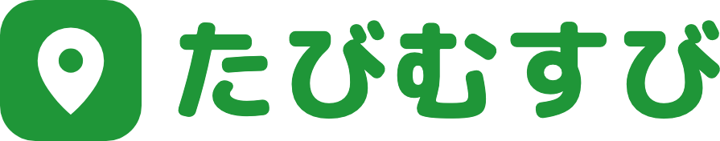
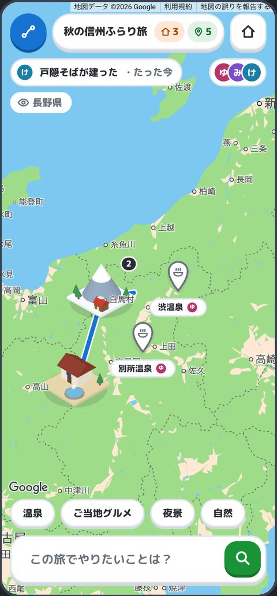
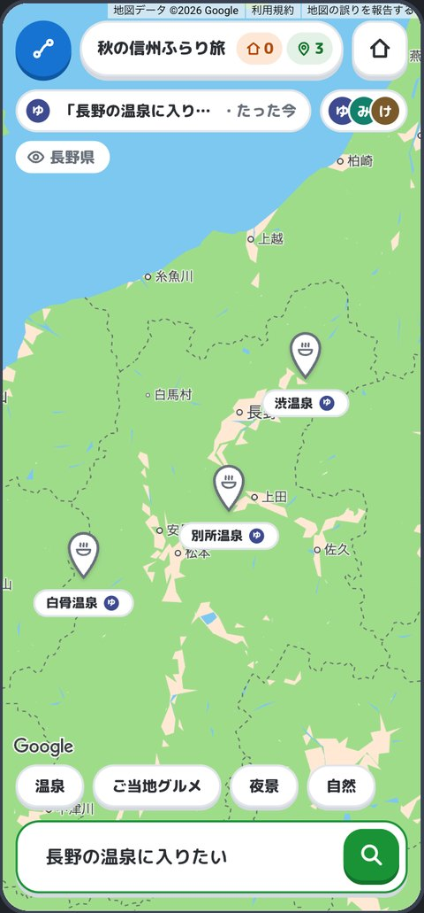
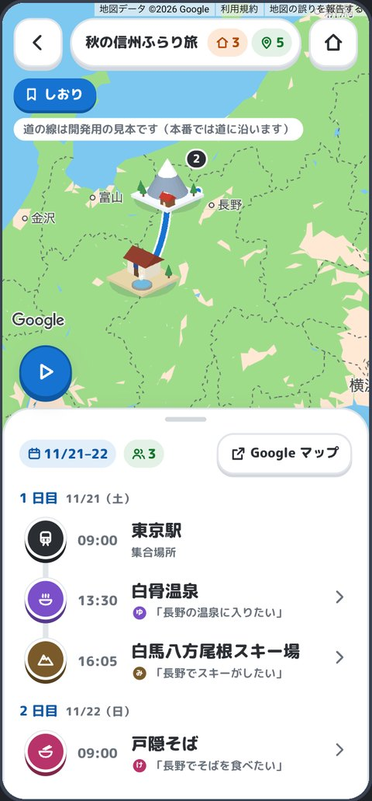
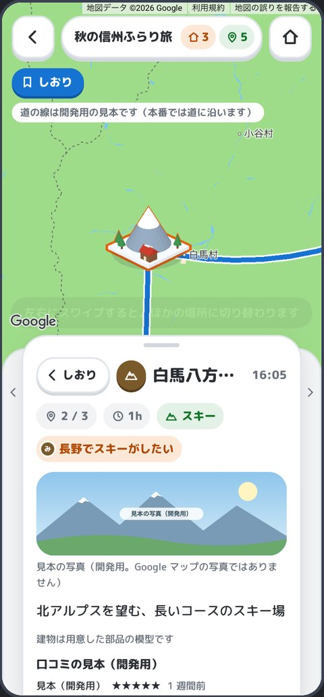
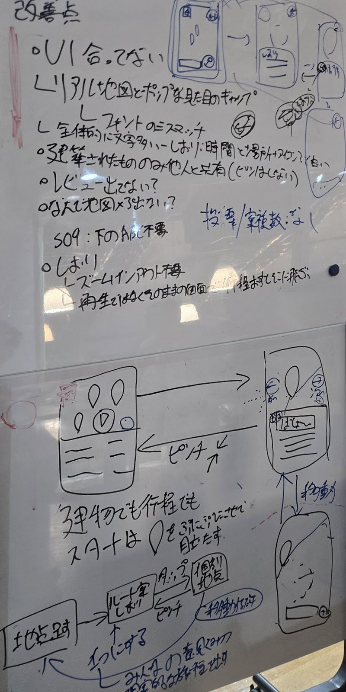
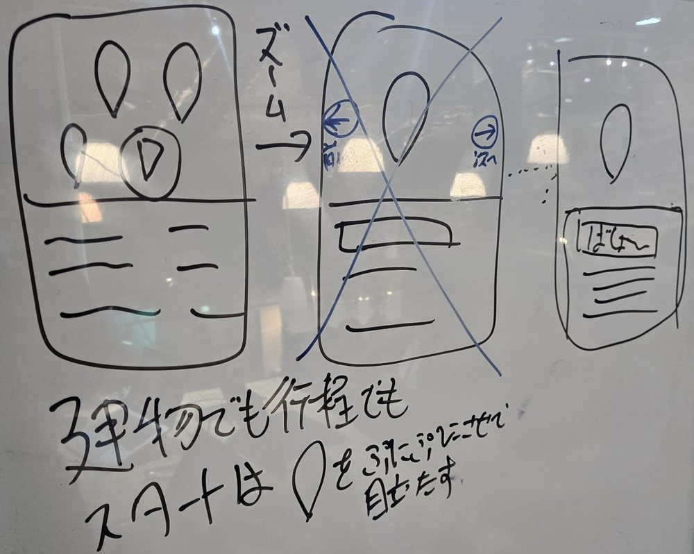
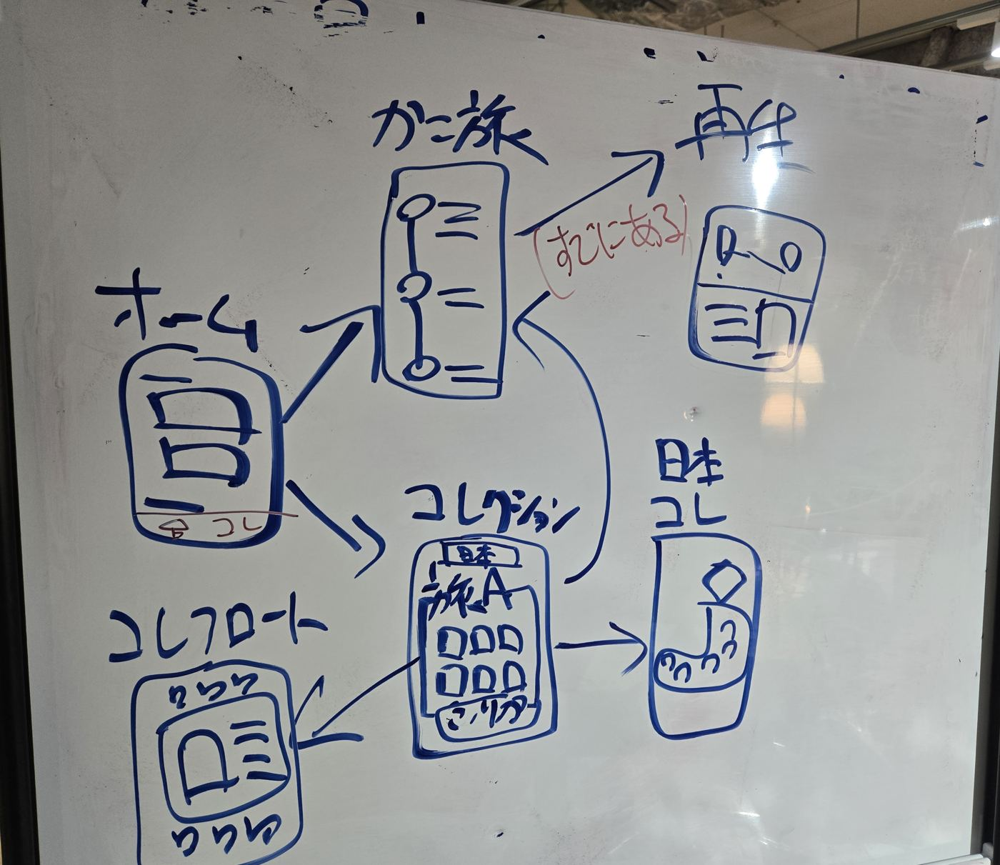
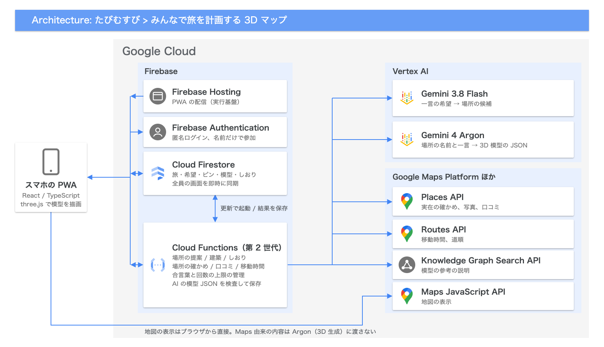

# 

**全員が主人公の旅を！**

友達と「旅行でやりたいこと」を入れるうちに日本地図の上に 3D の街が建っていき、いつの間にか旅のしおりに！スマホ向けのワクワク旅行計画アプリです。

**今すぐ試す：https://konbu-devfest-hackathon-2026.web.app**



<sub>このREADMEの写真は開発中に撮影したのものです。実際の画面は、デプロイ版をご覧ください。</sub>

## 目次

- [幹事ひとりに任せない旅行へ](#幹事ひとりに任せない旅行へ)
- [アピールポイント](#アピールポイント)
- [旅ができるまで](#旅ができるまで)
- [UXのこだわり](#uxのこだわり)
- [Gemini がやっていること](#gemini-がやっていること)
- [試すときの注意](#試すときの注意)
- [しくみ](#しくみ)
- [技術選定](#技術選定)
- [開発方法](#開発方法)
- [ローカルでの起動方法](#ローカルでの起動方法)
- [その他の情報](#その他の情報)
- [ライセンス](#ライセンス)

## 幹事ひとりに任せない旅行へ

グループ旅行の計画は、気づくと幹事のみの仕事になっています。ただ幹事が立てた予定を文字で送っても、受け取った側はあまりイメージがわかず、「任せるよ」で終わってしまう。旅行計画という旅行の楽しい側面が、幹事の負担になってしまいます。

たびむすびは **「全員が主人公の旅行」** を実現すべく、旅行好きではない人も旅行計画を楽しめるようにするアプリです！

全員が好きなときに「やりたいこと」を書き、それが地図の上で形になっていく。随所に「旅の計画をするうちにイメージが湧く」工夫をしてあります。

とはいえ、決める人がいないと、行き先が割れたときに旅行が決まりません。そこで、旅を作った人（発案者）が決めるのは、日程、大まかな場所、旅程の確定の 3 つだけにしました。それ以外はみんなが自由に「やりたいこと」を足し、自分の案がしおりに入っていく。それが、このアプリの考える「主人公」です！

## アピールポイント

- **あなたの「行きたい」が、見える候補になる。**
  - 例えば「長野の温泉に入りたい」と書くと、Gemini が場所の候補を考えて、地図にピンを立ててくれます。
- **行きたい場所が 3Dのミニチュアになる。**
  - ピンの中から行きたい場所を選び、「建築」することができます。
  - すると行きたい場所が3Dモデルになるため、旅行のイメージをみんなで共有できます。
  - 全国の名所 1,219 か所はミニチュアを用意してあるので、すぐに建ちます！
- **みんなで旅を作っていく！**
  - 誰かの建物が建つと、全員の地図に現れて、画面にお知らせも出ます。
  - 候補のピンは建てるまで自分の地図にだけ出るので、思いつきをそのまま書けます
- **建てた場所が、そのまま「しおり」になる。**
  - 行きたい場所を回る順番や時刻、「誰のやりたいことか」がしおりにまとまります。
  - 全員の希望が入っているのが一目で分かります。
  - さらに、泊まる夜ごとの宿と、朝・昼・晩ごはんの枠も入り、「宿を探す」「お店を探す」を押せばその日の道のりに合う候補が地図に立ちます。
  - 天気予報や、1 人あたりの交通費・食費の目安も出ます！
- **どんな交通機関でも！**
  - おもな移動を電車・バスか車から選べ、区間ごとに徒歩や飛行機にも切り替えられます。
  - 遠い区間や島へは最初から飛行機で組み、ANA と JAL の時刻表から乗れる便を探します
- **出発前のシミュレーション**
  - 再生ボタンを押すと、乗り物が道順をたどって各地を回ります！
  - 電車の区間は電車が走り、飛行機は空を飛び、歩く区間は人が歩きます。
  - 場所に着くと「パシャ」とシャッターの音が鳴り、写真が出ます。旅への期待感も増大！
- **決まったら、しおりを持ち歩ける。**
  - 発案者が「この旅で決まり！」を押すと、しおりができます。
  - PDF に書き出したり、Google カレンダーにまとめて入れたり。好きな方法でしおりを保存することができます！
- **旅の記憶がコレクションに！**
  - 終わった旅で建てたミニチュアがコレクションに並び、日本地図の上で「これまで行った場所」を見返せます。
  - 旅に行けば行くほど、自分だけのかわいい日本地図が育ちます！
- **招待は URL を送るだけ。**
  - 受け取った人は名前を入れれば参加できます。
  - 共有リンクやQR コードや旅の合言葉でも入れ、Google アカウントとつなげば別の端末でも同じ旅を開けます！
- **多言語対応！**
  - 端末ごとに日本語または英語から言語を選ぶことができます！

## 旅ができるまで

まずは発案者が旅をつくります。
日程、出発地、おもな移動を 1 問ずつ答えるたびに、地図が具体性を帯びてきます。
日本地図から地方や県を選び（迷ったらサイコロ！）、「ここへ出発！」を押すと、地図がその場所へぐいっと寄って、そのまま旅のマップが表示されます。
そうしたらあとはみんなで行きたい場所を探して、共有しましょう！

| 1. やりたいことを書く | 2. 建てると、しおりになる | 3. 場所をじっくり見る |
| :---: | :---: | :---: |
|  |  |  |
| やりたいことを書くと、候補のピンが地図に立ちます | みんなの持ち寄ったアイデアがしおりにまとまります | ミニチュアにズームして、場所の情報を読めます |

しおりは基本的にはアプリが作りますが、もちろん気になるところは直せます。行をドラッグして順番を入れ替えたり、時刻を直したり。
宿とごはんが決まって発案者が確定すれば、旅の準備はばっちり！
そして旅が終わると、その旅のミニチュアがあなたのコレクションに加わります！

## UXのこだわり

AI を使うと、画面を形にするのはすごく簡単です。
ただ、触って楽しいかどうかは実際に人が触らないと分かりません。
そこで動く画面をチームで見ながら調整したり、様々な友人に使ってフィードバックをもらったりしながら問題点を洗い出し、調整を重ねていきました。

| 改善点の洗い出し | 画面の流れのスケッチ |
| :---: | :---: |
|  |  |

- **ルート案の投票をやめた。**
  - 「全員が主人公の旅行」は、全員の行きたいところが選ばれて実現します！
  - 最初の方針だった、案をいくつも出して投票する形をやめ、建てた場所がそのまましおりに並ぶ形にしました
- **大まかな場所を、最初に選ぶようにした。**
  - みんなの行きたいところをそのまま集めると、大阪・長野・青森のように全国に散らばり、全員にとって微妙な旅になってしまいます。
  - そこで発案者が旅を作るときに、地方や県だけを先に選ぶ形にしました。指で地図を塗る案もありましたが、自由すぎて大事な判断が雑になるので、選ぶ形にしています
- **AI を幹事にしない。**
  - ルートや時刻の計算は AIと計算式に任せつつ、何を建てるか、旅を確定するかは人が決めます。
  - 旅を計画する楽しさは、AI に明け渡しません！
- **みんなに見えるのは、建てたものだけにした。**
  - 建築されていない候補のピンは、自分の地図に、建築までの間だけ出ます。
  - 認知負荷を減らすためです！
- **文字を減らした。**
  - しおりは時刻、場所、アイコン、誰のやりたいことかに絞りました！
  - まだ決まっていない宿やごはんの枠は1行にたたんでいます。
  - 空の枠のボタンが並ぶと、肝心の行が読みにくくなるからです
- **地図に「前へ・次へ」のボタンを置く案を破棄。**
  - 場所の情報は、下のシートを左右にスワイプして切り替えるようにしました！直感的！
- **飛行機の便は、押す前から探しておく。**
  - 「飛行機」を押してから便が出る形は、使ってみると待たされる感じがありました。
  - そこで飛行機の区間は、しおりを組んだ時点で便を探しておくようにしました！
  - 他にも裏で処理を先に終わらせておくことで、ユーザーの待つストレスを減らす工夫が随所に仕込まれています。
- **案内は、必要になったときに出す。**
  - 初めて開いた人には、本物の地図で撮った動く画像のチュートリアルを、1 枚に 1 つずつ見せます。
  - 宿が決まっていないことのお知らせも、しおりを一度開いたあとに出すようにし、最初から案内で埋め尽くさないようにしました
- **見た目は本当にいくつも検討。**
  - 旅行が楽しみになるようなデザインにしています！
  - そのほか、情報量の調整やボタン配置、アイコンの大きさなど細かく調整を重ねています。
  - 終盤には、我々や我々の友人で画面を実際に触ってUI/UXレビューを行い、どんどん改善を重ねていきました。

### ホワイトボードから画面へ

画面の案は、人が手で描くところから始めています。
下は、旅行のあとに見返す「コレクション」の画面の流れを、ホワイトボードに描いたものです（2026-11-21）。
この写真や会議の内容をAIに渡し、[デザイン案](https://claude.ai/artifact/CtaMT75scBbLDrf8NTNr9h)にして、コメントで直してから実装しました。



## Gemini がやっていること

| モデル | 役割 |
| --- | --- |
| Gemini 3.8 Flash | 「やりたいこと」の言葉から、場所や宿、お店の候補を提案する。しおりを回る順番を考え、時間に収まらないときは残したい順を付ける。旅の名前をおまかせで考える |
| Gemini 4 Argon | その場所に合わせた ミニチュアを、形の JSON として作る |

AI が作ったミニチュアはコードとして実行しません。形と大きさを検査した JSON を、共通の処理で描いています。Maps 由来の内容は 3D 生成の入力にしていません。

ミニチュアの生成には 2〜3 分かかります。そこで全国の名所約1200か所は、開発中に手元の Gemini で先に作り、実在を確かめて建物辞書に入れておきました。
そのため定番の場所はすぐに建ち、辞書にない場所だけを Gemini がその場で作ります。

一方で、時刻や便、イベントの開催日は Gemini に作らせていません。
ハルシネーションが起こるといけないので、ここは計算式で埋めるようにしています。

## 試すときの注意

費用の上限を守るため、本番のアプリは合言葉で守っています。URL を開くと最初に合言葉の画面が出ます。合言葉は提出したプロダクト説明ドキュメントにだけ書き、このリポジトリには書いていません。合言葉を通すと、本物の Gemini、Google マップの写真と口コミ、道に沿った線が使えます。

- 本物の Gemini を呼べないとき（1 日の上限を使い切ったときなど）は、自分たちで書いた見本の場所の一覧と部品のミニチュアで動き、画面にもそう表示します
- 電車・バスの移動時間は、時刻表を使わない見積もりです。しおりにも「目安」と書いています
- 花火大会などのイベントは、見本の一覧から探しています。実在の催しではありません

## しくみ



| 役割 | 使うもの |
| --- | --- |
| フロントエンド | React、TypeScript、Vite、three.js（Firebase Hosting で配信、PWA。日本語と英語） |
| バックエンド | Cloud Functions（第 2 世代）、Cloud Firestore、Firebase Authentication（匿名。Google アカウントとの連携は任意） |
| AI | Gemini 3.8 Flash、Gemini 4 Argon |
| 地図 | Maps JavaScript API、Places API、Routes API、Knowledge Graph Search API |
| 移動と天気 | 国土数値情報（鉄道データ）、公共交通オープンデータセンター（ODPT）の ANA・JAL の時刻表、気象庁の天気予報 |
| 連携 | Google Calendar API |

## 技術選定

主な決定と、選んだ理由、検討したもののやめた案です。すべての決定と決めた人は [技術選定の記録](docs/architecture/decisions.md) にあります。

### アプリの形と基盤

| 選んだもの | 選んだ理由 | やめた案と理由 |
| --- | --- | --- |
| スマホ優先の PWA | URL を送るだけで参加でき、審査員もすぐ試せる。three.js をそのまま使える | ネイティブアプリ：インストールと配布が重く、3D は WebView 頼みになりやすい |
| Firebase（Firestore、匿名の Authentication、Hosting） | Firestore の onSnapshot で全員の画面をリアルタイムにそろえられる。匿名の認証で、名前を入れるだけで参加できる。Emulator で手元で開発できる | — |
| 匿名の参加に、旅の合言葉と Google アカウントとの連携（任意）を足す | ホーム画面に入れた PWA からは招待リンクを開けず、匿名だけではブラウザが変わると別の人になる。連携を任意にすれば、ログインなしで入れる手軽さも残せる | 連携を必須にする：ログインなしで入れる手軽さがなくなる。招待リンクだけ：PWA から参加できない |
| Cloud Functions（第 2 世代） | Firebase と一体で扱え、構成が単純 | Cloud Run を直接使う：自由度は高いが、管理が増える |
| 3D 生成を含め、プロダクトの AI は Gemini だけ | Google の技術を主役にする（ハッカソンの規定） | 他社の 3D 生成 AI（Tripo など）：規定に合わない |

### 地図と 3D

| 選んだもの | 選んだ理由 | やめた案と理由 |
| --- | --- | --- |
| Google の地図にミニチュアを重ねる（WebGLOverlayView） | 実在の場所と移動時間を Google のデータで出せる | 自作のローポリ地図：世界観はそろうが、Maps 規約 3.2.3(e) で Places や Routes と一緒に使えない |
| ミニチュアは Gemini 4 Argon が形の JSON を返し、共通の処理で three.js に描く | サーバーにもブラウザにもコードの実行環境が要らず、誰も画面を開いていなくてもミニチュアが完成する。形と大きさを検査してから描くので安全 | AI が書いた three.js のコードをブラウザの隔離枠で実行：画面を閉じていると完成しない。Cloud Run で実行：構築で詰まるおそれ |
| ミニチュアは場所の名前・地域・種類で辞書にし、同じ場所は作ったものを使い回す | 生成の回数を節約でき、定番の場所はすぐ建つ | Maps の place_id や位置で見分ける：Maps 由来の情報をミニチュアの側へ渡すことになる |
| 素の three.js | 依存が少なく、Google の地図の WebGLOverlayView に直接つなげる | React Three Fiber：WebGLOverlayView との相性の確認が要る |
| 場所の候補は、Gemini が Maps を使わずに提案する。ミニチュアの入力は名前、説明、利用者の言葉だけ | Maps 由来の内容を 3D 生成の入力にしない（Maps 規約 3.2.3(c)） | Maps のピン名や写真、口コミから作る：規約に反するおそれが強い |
| ミニチュアの説明を Knowledge Graph Search API で補う | 1 日 10 万回まで無料で、文のライセンス（CC BY-SA）がはっきりしている | Google 検索の grounding：規約で結果の保存と作り変えができない |
| Routes と Places（写真、口コミ）は保存せず、開くたびに取る | 規約が保存を禁じている。合言葉を通した端末だけに絞り、1 日の回数に上限をかけて費用を抑える | 写しを Firestore に置く：規約に反するおそれ |

### 移動としおり

| 選んだもの | 選んだ理由 | やめた案と理由 |
| --- | --- | --- |
| 電車・バスの移動時間は、国土数値情報（鉄道データ）の駅と線路のつながりから自分たちで見積もる | 全国 35 区間の答え合わせで、実際との差は平均 7 分ほど（34 区間で 30 分以内）。外部の API を使わないので、回数の上限も保存の制限も費用もない | Routes API の電車・バス：日本では結果が空だった。事業者ごとの時刻表：全国がそろわない。Gemini に検索させる：時刻を作ってしまうおそれ |
| 飛行機の区間は、ODPT の API から ANA と JAL の時刻表を読み、近くの空港の組み合わせから最も早く着く直行便を選ぶ | 無料で、便名と時刻をしおりに出せる。公開しているアプリで使えるライセンス | 有料の時刻表 API：費用がかかる。Gemini に検索させる：便や時刻を作ってしまうおそれ |
| 決まったしおりの予定を、Google Calendar API で押した人のカレンダーにまとめて入れる | 場所ごとの予定が一度に入る。Calendar API は無料 | 「カレンダーに追加」のリンク：予定 1 件ごとに保存が要る。.ics のファイル：スマホでは取り込みの手順が多い |

## 開発方法

- 4人がそれぞれAIと組み、同じリポジトリで並行して開発しました。
- 人がAIの作業すべてを見張ることはできません。そこで、AI に守らせたいことを文書に書くだけで終わらせず、機械で止める仕組み（ハーネス）と、リポジトリの設計を開発の最初に作りました。全体は [ハーネスの全体像](docs/process/README.md) にあります。

### 複数の AI ツールで並行して作る

実際の開発には Claude Code、Codex、Antigravity を使いました。Gemini CLI からも同じ仕組みを使えます。ルールの判断の本体は 1 つ（`scripts/harness/lib/`）にまとめ、ツールごとの違いは入出力の形をそろえるアダプターで吸収しています。ルールは 1 か所を直せば、どの AI にも効くようにしました。（[AI ツールごとの設定](docs/process/tools.md)）。

セッションの始めには、フックが各 AI に「自分の立ち位置」を渡します。いまのブランチ、ほかの人と AI が進めている作業と触るファイル、自分の作業との重なり、人の判断待ちです。こうすることにより、AIは人に聞かなくても、ほかの作業とぶつかりづらい範囲で作業ができるようになります。

### Issue からレビューまでの流れ

1. **Issue に起票する。** 開発タスクはすべて GitHub Issue にし、誰の AI が何を進めているかをカンバンで追えるようにしました
2. **作業宣言を出す。** 着手の前に、目的、触るファイルの範囲、確かめられる完了条件を `docs/work/` に書き、先に main へ入れます。ほかの AI はこれを見て作業を分けます
3. **PR を出す。** 区切りごとに commit と push をして、途中経過を全員に見せます
4. **手元で確かめる。** 作業を終える前に、lint、build、テスト、Emulator での通しの確認を手元で走らせ、通った記録を残します
5. **別のコンテキストでレビューする。** 実装したAIとは別のコンテキストのレビュー役が、決めた評価軸（完了条件、企画書との一致、設計方針など）で PR を評価します。実装した側の思い込みを持ち込まないためです
6. **merge と本番への反映。** AI が merge できるのは、手元の確認の記録があり、レビューで承認され、会話で人と合意した作業の PR だけです。本番に出すのは、人が main を `deploy` ブランチへ反映したときだけで、そのときに Deploy がもう一度まとめて確かめます

はじめは CI が通ることを merge の条件にしていました。ところが開発の終盤に CI の順番待ちが 160 件を超え、本番への反映まで止まってしまいました。そこで 2026-11-22 に、merge の条件を手元の確認の記録に切り替え、CI 相当の確認は本番への反映のときにまとめて走らせる形にしました。

費用、有料 API、何を作るか、秘密情報、権限のような判断は、AIが決めずに `todo/humans/` に書き、人が決めます。待つあいだ、AI はほかの作業を進めます。会話で人と決めたことは、AI がその場で記録して、全員の AI に届けます。

### ガードを 3 層でかける

1 つの層が漏れても、次の層で止まるように重ねています。止めるときは必ず「代わりにどうするか」を返し、夜中に人がいなくても AI が迷わず進めるようにしました。

| 層 | 効く相手 | 主に止めるもの |
| --- | --- | --- |
| 1. AI ツールのフック | Claude Code、Codex、Antigravity、Gemini CLI | main と deploy への push、force push、`--no-verify`、デプロイ、有料 API の呼び出し、.env の読み書き、main での編集 |
| 2. git hooks | すべての AI と人 | main への commit、秘密情報、作業宣言のない push、ブランチ名、設計の層の違反 |
| 3. 手元の確認と merge のガード | すべての PR | 層の違反、作業宣言、秘密情報、他社 AI の SDK、文書のリンク切れ。確認の記録やレビューの承認がない PR の merge |

3 層のあとに、別のコンテキストのレビューと人の判断が続き、本番への反映のときには Deploy がもう一度確かめます。止めすぎると AI は迂回を探し始めるので、「止めるべきものを止め、通すべきものを通すか」を正常系と異常系の入力セットでテストしています。

### 仕組みの選定

| 選んだもの | 選んだ理由 | やめた案と理由 |
| --- | --- | --- |
| フロントエンドは Feature-Sliced Design、バックエンドは機能ごとの縦のスライス | 4 人がそれぞれ AI と並行して作っても、置き場所が決まっていてぶつかりにくい。依存の向きを機械で確かめられる | 層を決めない：置き場所が AI ごとにばらつく。横の層（controllers、services など）：機能を足すたびに全部の層を触る |
| AI のガードを、ツールのフック、git hooks、手元の確認と merge のガードの 3 層でかける | 文書に書いた「しないで」は守られる保証がない。どの AI にも人にも効く | AI ツールの権限設定だけ：ほかの AI と人に効かない。CI を merge の条件にする：順番待ちで開発と本番への反映が止まった |
| 層のルールは、依存なしの小さな自作のチェックで確かめる | Windows、macOS、CI で同じに動き、直し方を日本語で案内できる。フロントとバックエンドを 1 つで見られる | dependency-cruiser など：締切前に依存と設定が増える |

### AIの利用方法

- **実装：** 企画書と画面のイメージを読ませ、実装と、複数のブラウザでの動作確認を任せました。AI が仮に決めたことは PR の説明と `todo/humans/` に書かせ、人が確かめて決めました
- **ミニチュアの用意：** 名所 1,219 か所のミニチュアと、地方・県の名物のアイコンは、開発中に手元の Gemini で作り、確かめてから入れました
- **画面の文言：** AIが書いた日本語は、推敲のスキル（yomiyasu）を通してから入れる決まりにしました。また、それでもおかしいと人間が感じた部分は実画面・Readmeなど全体的に、人間が修正を入れて読みやすさにこだわっています。
- **人が決めたこと：** 何を作るか、技術の選定、費用、本番への反映

場面ごとの記録は [AI の利用記録](docs/records/ai-usage.md) にあります。

## ローカルでの起動方法

`mise` で Node と Java の版をそろえます。Firebase Emulator で動き、既定では Gemini を呼ばず固定の応答を返します。

```sh
brew install mise
mise trust && mise install
mise exec -- npm run setup
mise exec -- npx firebase login
mise exec -- npm run dev
```

http://localhost:5173 を開きます。テストは `mise exec -- npm run verify` です。

## その他の情報

- [企画書](docs/product/proposal.md)
- [技術選定の記録](docs/architecture/decisions.md)（比べた案と選んだ理由）
- [設計方針](docs/architecture/design-principles.md)
- [ハーネスの全体像](docs/process/README.md)
- [AI の利用記録](docs/records/ai-usage.md)
- [出典とライセンス](docs/records/credits.md)

## ライセンス

Copyright (c) 2026 Team Konbu-tachi. All rights reserved.

許可なく使用、複製、改変、再配布することはできません。ライブラリや素材など第三者の部分は、それぞれのライセンスに従います（[出典とライセンス](docs/records/credits.md)）。全文は [LICENSE](LICENSE) にあります。
