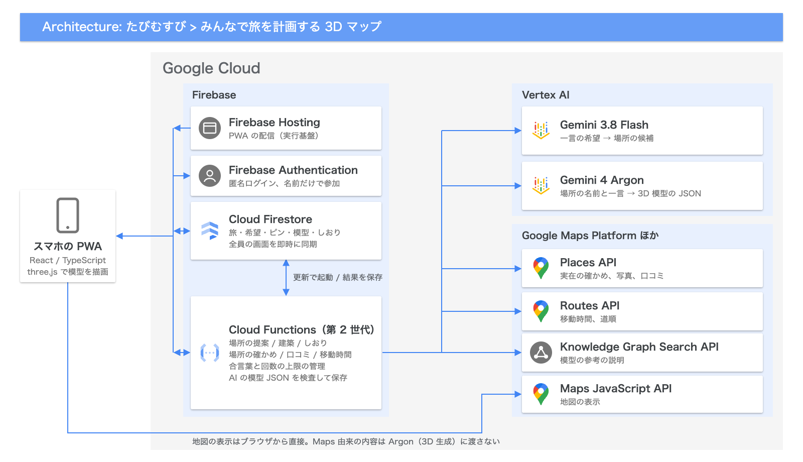

# プロダクト説明ドキュメント（下書き）

公式サンプルの見出しの順に書いた下書きです。提出のときは、運営の「提出物・提出ルール」にある**指定テンプレートのコピー**へ写し、名前を「プロダクト説明ドキュメント_[チーム名]」にして Drive のフォルダに入れます。**【人】** の印がある所は、チームが書くか確かめます。根拠はこのリポジトリの文書（企画書、decisions.md、ピッチ原稿の出典、競合調査、setup.md）にあることです。写し終えたら、このファイルは提出用のリポジトリから除きます。

---

DevFest GDGoC Japan 2026 Hackathon

## チーム情報

- 会場：東京
- チーム名：**【人】**（企画書では未定）
- メンバー：Active_Turtle、Takana、ヨウキン、Mahiro **【人：提出時の表記を確かめる】**
- アプリケーション名：たびむすび
- カテゴリ：観光
- GitHub リポジトリ URL：https://github.com/Devfest-Hackathon-2026/df-2026-t140

## 【必須項目】

## 1. プロジェクト概要

たびむすびは、友人どうしの旅行の計画を、幹事ひとりの仕事から全員の遊びに変えるスマホ向け Web アプリ（PWA）です。

メンバーが「温泉に入りたい」「夜景を見たい」と一言ずつ書くと、Gemini が地図の上に候補の場所を立てます。気になった場所で「建築する！」を押すと、その場所の 3D 模型が地図の上に建ち、全員の画面に同時に現れます。建った場所は旅の順にしおりに並び、車の模型が道順をたどる映像で旅の流れを見られます。

- 参加：招待 URL を開いて名前を入れるだけ。インストールとアカウント登録は要らない
- 目的：旅のイメージを幹事だけが持っている状態をなくし、全員が主人公の旅行を作る
- AI の位置づけ：AI は提案するだけで、何を建てるかを決めるのは人

## 2. 解決する課題

### 2.1. 対象ユーザー

友人どうしで旅行に行く若者のグループ。とくに、計画が集中しがちな幹事と、任せきりになりがちなほかのメンバー。

### 2.2. 課題と根拠

グループ旅行の計画は幹事に集まります。幹事には調べものと決定が集中し、共有しても反応が薄くなります。ほかのメンバーは、文字の予定を見ても旅のイメージがわかず、結局は任せきりになります。

- 観光目的の国内旅行のうち、友人と行く旅行の割合は 2019 年の 18.1% から 2024 年の 15.8% に下がった（観光庁「令和 7 年版観光白書」概要版 p.11 図表Ⅰ-43。2024 年は速報値）
- 宿泊旅行をしなかった理由の上位に「家族や友人等と休日が重ならない」がある（同 p.12 図表Ⅰ-50）。白書のテーマ章の取組事例は、同行者との休暇調整にハードルがあると述べている
- 旅行の企画者の 6 割以上が、1 回の企画に 10 時間以上かけていた（Klook 調査、2026 年、日本の回答者 263 人、18〜45 歳のオンラインパネル）

白書は、友人との旅行が減った原因を計画の手間だとは述べていません。私たちは、合わせる手間と幹事への集中が、その一因だと考えています。**【人：自分たちのアンケートや試用の結果があれば足す。課題の根拠は審査項目の 1 つ】**

### 2.3. 既存手法との違い

AI による旅程作成、地図上のスポット管理、共同編集、投票は、すでに複数のサービスにあります（AVA Travel、Funliday、TravelCanvas、GroupTripper、Truce など。2026-11-06 に公開ページで調査）。たびむすびは、計画を便利にすることより、計画そのものを楽しくし、普段は計画に参加しない人を巻き込むことを狙っています。

| 観点 | 文字の共有（チャット、スプレッドシート） | 既存の旅行計画サービス | たびむすび |
| --- | --- | --- | --- |
| 旅のイメージ | 文字から各自が想像する | 地図とスポットの一覧 | 希望が 3D の模型になって地図に建つ |
| 参加のしかた | 幹事が調べて共有する | 候補の提案、投票、共同編集 | やりたいことを一言書くだけ。行き先に詳しくなくてよい |
| 参加の手間 | なし | サービスによる | URL を開いて名前を入れるだけ |
| ルート | 幹事が考える | AI の生成、手での編集 | 建った場所が旅の順に自動で並ぶ。みんなは行きたい所を足すだけ |

「3D マップの上にスポットを建築し、みんなで旅行を組み立てていく」体験を中心にしたサービスは、調べた範囲では見つかりませんでした。

## 3. Google 技術の活用

### 3.1. 使用した Google 技術

- [x] Firebase Hosting
- [ ] App Engine / Compute Engine / GKE / Cloud Run / Firebase App Hosting

### 3.2. Google 技術の活用例

| 使用技術 | 使用箇所 | 選定理由・メリット | デメリット |
| --- | --- | --- | --- |
| Gemini 3.8 Flash（Vertex AI） | 一言の希望から場所の候補を提案する | 「新潟の温泉！」「夜景と一生の思い出」のような曖昧な言葉を、場所の候補にできる | 費用がかかる（1 回 約 $0.006〜0.011）。提案した場所が実在するとは限らないので、Places で確かめる |
| Gemini 4 Argon（Vertex AI） | 場所の名前と一言から、3D 模型の JSON を作る | AI が書いたコードを実行せず、JSON を共通の処理で描くので安全。誰も画面を開いていなくても完成する | 2〜3 分かかり、費用もかかる（1 回 約 $0.04〜0.05）。使える形が 6 種の基本形状に限られる |
| Knowledge Graph Search API | 模型を作る前に場所を調べ、Wikipedia の説明（CC BY-SA）を Argon の参考にする。出典は画面に出す | 1 日 10 万回まで無料で、ライセンスが明確。Maps 由来の内容を生成に使わずに模型を実物へ近づけられる | 説明が見つからない場所では効果がない |
| Maps JavaScript API（WebGLOverlayView） | Google の地図の上に three.js の模型を重ねる | 実在の地図の上で計画でき、ベクター地図のカメラと模型を同期できる | 地図の読み込みに回数の上限を設けている。地図の内容は規約上、3D 生成の入力にできない |
| Places API | 建てる場所を確かめて位置を直す。場所の写真と口コミを出す | 「AI が提案した場所が実在するか」を裏付けられる | 写真と口コミは規約上保存できないので、開くたびに取得する |
| Routes API | しおりの移動時間と、道に沿った線を出す | 直線距離の目安より実際に近い時間と道順を出せる | 規約上保存できない。電車とバスは試した区間で結果が空だったので、車の時間だけを使う |
| Cloud Firestore | 旅、希望、ピン、模型、しおりの保存。全員の画面の同期 | onSnapshot で全員の画面をリアルタイムにそろえられる。Security Rules で「他人の旅は読めない」を守れる | 複雑な検索や集計には弱い |
| Firebase Authentication（匿名） | 名前だけで参加する | 招待 URL から入るときにアカウント登録が要らず、参加のハードルを下げられる | 端末を変えると旅の一覧が引き継がれない（招待リンクから入り直す） |
| Cloud Functions（第 2 世代） | Gemini の呼び出し、建築の処理、回数の上限の管理 | Firebase と一体で扱え、Firestore の更新を起点に裏で処理できる。キーを端末に置かない | Cloud Run を直接使うより自由度は低い |
| Firebase Hosting | PWA の配信 | URL を開くだけで全員が同じものを使える | 動的な処理は別のサービスが要る |

### 3.3. Google 技術を選定した理由

このアプリの中心は、利用者の言葉を Gemini が計画と街に変えることです。Gemini Flash が言葉を場所へ、Gemini Argon が場所を 3D の模型へ変えます。Google Maps Platform は、Gemini の提案を実在の場所と移動時間で裏付ける役割です。

AI の提案と Maps の情報は、規約を守るために意識して分けています。Gemini は Maps を使わずに場所の名前を提案し、「建築する！」を押した場所だけを Places で確かめて、ピンの位置を直します。Maps 由来の内容は 3D 生成の入力にしません（Maps Platform 規約 3.2.3(c)）。模型の精度を上げるために Google 検索の grounding も比べましたが、結果の保存と作り変えができないので、ライセンスが明確な Knowledge Graph の説明を選びました。

3D は Gemini に統一しました。他社の 3D 生成は速さでは有利ですが、Google 技術を中核にする方針に合いません。生成は遅いので、会話を止めないよう待ち画面を出さず、「工事中」として裏で完成させます。

## 4. アーキテクチャ図

## 5. プロジェクトをデプロイした URL

https://konbu-devfest-hackathon-2026.web.app

合言葉：**【人：Drive のドキュメントにだけ書く。このリポジトリには書かない】**

URL を開くと最初に合言葉の画面が出ます。上の合言葉を入れると使えます（端末ごとに 1 回）。

## 【任意項目】

## 6. 動作確認の方法

### 6.1. テストアカウント情報

ログインはありません。名前を入れるだけで使えます。

費用の上限を守るため、アプリ全体を合言葉で守っています。URL を開くと最初に合言葉の画面が出るので、「5. デプロイした URL」に書いた合言葉を入れてください。合言葉は端末ごとに 1 回だけです。合言葉を通すと、本物の Gemini、Google マップの写真と口コミ、道に沿った線も使えます。**【人：合言葉は、Drive のプロダクト説明ドキュメントの「5. デプロイした URL」にだけ書く（運営の回答、`todo/humans/2026-11-10-app-passphrase-gate.md`）。このリポジトリには書かない。回数の上限は締切の前に決める。提出後は上限の引き上げも禁止】**

### 6.2. 動作確認手順

スマホの幅で開いてください。複数の端末かブラウザで開くと、同期を確かめられます。

1. URL を開き、合言葉を入れる
2. 旅のタイトル、日程、出発地を入れて「旅を計画する」を押す
3. 招待の画面のリンクを、別の端末で開き、合言葉と名前を入れる
4. 「長野の温泉に入りたい」のように、やりたいことを書く
5. 地図に立った候補のピンを押し、場所カードで「建築する！」を押す
6. 「工事中」のあと模型が建ち、別の端末の地図にも同じ模型が現れることを確かめる
7. 別の端末からも、やりたいことを書いて建てる
8. 地図の左上のルートボタンでしおりを開き、建った場所が旅の順に並ぶことを確かめる
9. しおりの行を押して、その建物へのズームと場所の情報を確かめる
10. しおりの左上の再生ボタンを押して、車が道順をたどる映像を見る

### 6.3. サンプルデータ

**【人：本物の Gemini で作った旅の招待 URL を用意するなら、ここに書く】**

## 7. アプリの詳細や機能に関する自由記述

### 7.1. 主な機能

| # | 機能 | 内容 |
| --- | --- | --- |
| 1 | URL だけで参加 | 招待リンクや QR コードから、名前を入れるだけで同じ旅に入れる |
| 2 | 希望から候補のピン | 一言の希望から候補が地図に立つ。場所も書けばそこを、書かなければ今見ている範囲を探す |
| 3 | 3D の建築 | 「建築する！」で裏で模型を作り、待たずに次の希望を探せる。完成は全員の画面に出る |
| 4 | しおり | 建った場所が旅の順に並ぶ。誰のやりたいことか、時刻、道順が分かる |
| 5 | 場所の情報 | しおりから建物へズームし、説明、写真、口コミ、Wikipedia の説明を見られる |
| 6 | 旅の再生 | 車の模型が道順をたどり、着いた場所で写真を見せる。動画ファイルは作らず、地図の上で再生する |

### 7.2. 安全性と保守性

- Security Rules で、旅のメンバーだけが読み書きできるようにしている。ルールは確認テストで確かめている
- Gemini の呼び出しは Functions に限り、回数の上限をコードで止める（Flash 累計 300 回、Argon 1 日 20 回・累計 300 回）。上限やクレジット切れのときは、見本の一覧と部品の模型に戻って動き続ける
- AI が返した模型は JSON として形と大きさを検査してから保存し、コードとして実行しない
- フロントエンドは Feature-Sliced Design、バックエンドは機能ごとの縦のスライスとポート・アダプターで分け、層の依存を機械で確かめている
- 秘密情報をコミットしないよう、フックと CI で検査している

### 7.3. 今後の展望

- 旅行中：街を見ながら、次の行き先を確認する
- 旅行後：写真や思い出を街に残し、次の旅行につなげる
- 普段使っているチャットアプリから使えるようにする

## 【採点外項目】

## 8. AI をどの場面でどう使用したか、なぜその場面で使用したか

**【人：下は `docs/records/ai-usage.md` と `docs/architecture/decisions.md` からの要約。11/8 以降の分は記録が止まっているので足す】**

- サービスの機能：利用者の言葉を場所の候補と 3D の模型に変える部分に Gemini を使っています。曖昧な希望を扱えることが、キーワード検索や手作りの一覧にはない価値だからです
- 開発：4 人がそれぞれコーディング AI を使い、並行して実装しました。実装、テスト、ブラウザでの動作確認を任せています。仕様が文書で決まっていて、結果を機械的に確かめられる所を中心に任せました
- 人が決めたこと：何を作るか、技術の選定、費用、API の利用範囲は人が決め、比べた案と選んだ理由を `docs/architecture/decisions.md` に残しています。AI には PR ごとに別のコンテキストでレビューさせ、ルールの違反はフックと CI で止めています
- AI の提案を採らなかった例：会話の記録から AI に作らせたピッチの下書きは意図を汲み取れていなかったので、メッセージは人が書くことにしました（2026-11-08）

## 9. 自分たちが開発を通して何を得て、どれくらい成長できたのか

**【人：各自の言葉で書く。AI の下書きを入れない。必須記入で、未記入は必須項目の不足になる】**
