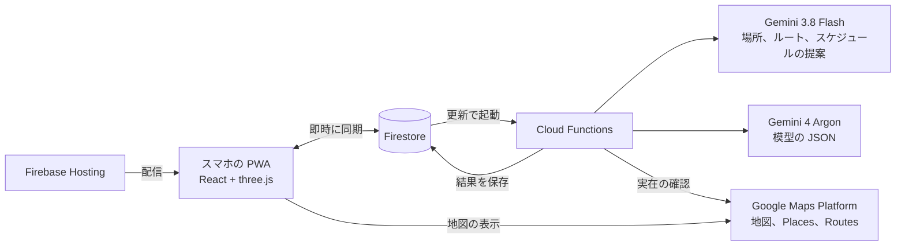

# 旅の計画が街になるアプリ 企画書（DF Hack26）

2026-11-04 作成 · かめ

話し合うほど、旅の計画が 3D の街として育っていく Web アプリを作ります。幹事だけでなく、全員で旅行を計画できるようにするのが狙いです。

## 1. タイトルとキャッチコピー

| 項目 | 内容 |
| --- | --- |
| アプリ名 | たびむすび |
| キャッチコピー | 旅の計画をみんなで、もっと楽しく。 |
| カテゴリ | 観光 |
| チーム名 | 未定 |
| メンバーと役割 | Active\_Turtle、Takana、ヨウキン、Mahiro（役割は未定） |

## 2. 課題

グループ旅行の計画は、幹事任せになりがち。幹事が一方的に進んでしまうケースが多い。

- 誰の課題か：若者の友人同士で旅行するグループ
- 幹事の困りごと：調べものと決定が集中し、共有しても反応が薄い
- 他の人の困りごと：文字の予定を見てもあまりイメージがわかず、ワクワクしない。結局幹事に任せっきりになってしまう。
- なぜ起きるか：旅のイメージを持てる人が一部だけだから。計画している人はすでに情報を得ているし、幹事1人でやってしまう。
- なぜ解きたいか：旅行は計画も楽しいのに、その楽しさが一部の人に留まっているから。計画するほど旅は「自分ごと」になるし、みんなの行きたいところを集めた理想の旅行プランができあがるのに。

## 3. 解決策

**旅の計画をみんなで、もっと楽しく。**

一部の計画者の頭にしかなかった旅の「ワクワクのイメージ」が、3Dの地図に落とし込まれることによって、みんなが旅行の計画に参加し、全員が主人公の旅行を作れます。

このアプリによって、旅が「幹事が決めて共有するイヤイヤ旅行」が「全員で組み立てて、いく前からワクワクする旅行」に変わります。

これにより「全員が主人公の旅行」を実現します！

スマホ優先のPWAにします（＝スマホを前提にします）

```
スマホ優先のPWAにした理由：旅行においては手軽さが命。パソコンを旅行に持っていく人は少ない。手元で日常的に、用事の隙間で手軽に旅行計画に参加できることを考えると、スマホで動くことが大前提。ネイティブはインストールと配布が重いので、URL だけで参加できる PWA にする。
```

### ユーザー体験

画面の流れは[画面イメージ・遷移図](https://claude.ai/artifact/43SzUgCqyFxMaFenBRPp5v)にあります（コピーと各画面の画像は [ui/screen-flow/](../ui/screen-flow/README.md)）。見た目は[いくつかの案](../ui/screen-flow/design-options/README.md)を比べ、A（ぷっくりポップ）と C（マップが主役）を合わせた A＋C で進めます（2026-11-07）。画面は A＋C で描いてあり、画像は [screenshots/](../ui/screen-flow/screenshots/) にあります。この節を画面にしたものなので、食い違ったらこの節に合わせて画面を直します。

1. 誰かが旅行のタイトル・日程（開始日と終了日。終了日なしなら日帰り）・出発地を入れて「旅を計画する」を押すと、日本の3Dマップが出現する。友達を招待できる。行き先は幹事が決めず、みんなで決める。エリア（県など）を選ぶ画面はない。地図の右上のホームボタンから、いつでもメニュー（計画中の旅の一覧、旅の切り替え）に戻れる。
2. 計画フェーズ（各自が好きなときに進める。ほかの人を待たない）
   1. それぞれが「温泉に入りたい」「スキー場で滑りたい」「わさび農園に行きたい」「夜景と一生の思い出を作りたい！」などと書く。「新潟の温泉！」のように場所も書けばそこを調べ、「温泉」だけなら、いまマップで見ているあたりから探す（ズームアウトして日本全体を見ていれば全国から）
   2. 関連する場所に候補のピンが複数立ち、タップすると場所の説明が見られる（[イメージ](https://pokemongo-get.com/wp-content/uploads/2016/09/%E8%BF%91%E3%81%84%E3%83%9D%E3%82%B1%E3%82%B9%E3%83%88%E3%83%83%E3%83%97.png)：ポケストップ）
   3. 気になったピンで「建築する！」を押すと、裏で建築が始まり、すぐ次のやりたいことを探せる（待ち画面は出さない）。建築ができ次第、マップのその場所に建物の3D模型が自動で建つ
   4. 建った場所は、しおりに旅の順で並ぶ。ルート案を何パターンも出すことと、どのルートにするかの投票はしない（2026-11-07 にチームで合意してやめた）
3. しおり（計画中もいつでも開ける）
   1. 地図の左上のルートボタンを押すと、しおりになる。建った場所が旅の順に並び（時刻・地点・誰のやりたいことか）、地図にも道順が出る。しおりでは同じ場所が戻るボタンになり、押すと「この旅でやりたいことは？」を入れる画面に戻る
   2. しおりで場所を押すと（地図の建物でも、しおりの行でも）、その建物の3Dにズームし、下のシートがその場所の情報（場所の種類の小さな印と説明。本番で合言葉を通した人には、Google マップの写真 1 枚（撮った人の名前つき。写真を出す設定を人が入れたあと）と口コミも出す。どちらも保存しない。口コミは、やりたいことを書いて立った候補のピンの場所カードでも、同じ条件で出す（建てる前に選べるように。かめの承諾、2026-11-08、#203）。模型を Knowledge Graph の説明で作った場所には、その Wikipedia の説明（冒頭）も出典つきで出す。2026-11-08 かめの決定）になる。シートの左上の「しおり」ボタンで、しおりに戻る。しおりの先頭の集合場所の行を押すと、集合場所の情報になり、そこから旅の順に場所を見ていける（集合場所は建物ではないので、建物と見分けられる印で出す。Mah110hat が起票した 2026-11-09 の要望、#226）
   3. 場所の情報を見ているときに、地図のほかのところをスワイプして動かすと、シートは閉じる。シートの上の部分（「しおり」ボタンと場所の名前）だけは画面の下に残り、そこを触ると場所の情報に戻る。地図のほかのところを押す（タップする）と、しおりに戻る（みんなの地図で場所カードが閉じるのと同じ。2026-11-07）
   4. それぞれの端末で見られる。しおりを見たあとも、戻るボタンで戻って「やりたいこと」を足せる
      通常画面のホームボタンは、隣の旅の名前の帯と同じ高さにする。元の正方形を維持し、高さに合わせて幅も変える（Mah110hat、2026-11-10、#295）。
   5. しおりのシートの外側の左上にある再生ボタンを押すと、旅を映像で見られる。車の模型が集合場所から走り出し、しおりの順に道順をたどって走り、地図はそれを追う。再生中は下の欄を出さない。場所に着くと止まり、「パシャ」とシャッターの音を鳴らして、Google マップの写真 1 枚（場所の情報と同じ条件で出せるときだけ）を、撮った写真のように白い枠つきで大きく出す。写真の下の余白に、何番目か・時刻・場所の名前・誰のやりたいことかを書く。写真は建物の模型に重ならないよう画面の下に置き、地図は残りの所に建物を映す（画面の真ん中に重ねる形も試したが、下に戻した。Youkin06、2026-11-09）。そのあと次の場所へ進む。最後まで行くと、しおりに戻る。みんなが旅の流れを思い描けるようにし、旅のイメージを幹事だけが持つ状態をなくすため（Youkin06 が 2026-11-08 の会話で決めた。動画生成 AI は費用がかかるので使わず、地図の上で再生する）

```
エリアを選ばせない理由：行き先を県単位で決めるより、やりたいことから考える場面の方が多い。地図で見ている範囲がそのまま探す範囲になる方が、操作もすっきりする。
```

```
しおりを動画にしなかった理由：動画は見ていて楽しいが、知りたい情報にすぐたどり着けない。場所を押すとその建物にズームして情報が出る形なら、ワクワク感と使いやすさを両立できる。
そのうえで再生ボタンを足した理由（2026-11-08）：しおりは一覧のまま残し、旅の流れをつかみたい人だけが映像で見られるようにする。動画ファイルは作らず、地図の上でその場で再生する（Maps の内容を外へ持ち出さない。費用もかからない）。
```

場所の情報（S12）と、そのシートを閉じた状態（S13）にも「ここから再生」を置く。押すと表示中の場所に着いたところから始め、しおりの順に最後まで再生する。場所の番号はしおり全体の番号を使う。集合場所の情報からは、既存の先頭からの再生を始める。停止・終了時はしおりの一覧に戻る（Mah110hat、2026-11-10、#296）。この再生ボタンはしおりと同じ、シートの外側の左上に置き、56px四方にする。読み上げ名は「ここから再生」のままにする。シートの開閉と一緒に動き、本文のスクロールでは動かない（Mah110hat、2026-11-10、#301）。見た目も、しおりの一覧の再生ボタンと同じ、ルートの色の丸いボタンにそろえる（アイコンだけにした形をやめた。Mah110hat、2026-11-10）。

```
ルートを自分でひく方式を採用しなかった理由：ルートを引くことを楽しく感じる人は確かにいるが、「みんなが主人公」の旅行を実現するにあたっては、ルートはハードルの高いところなのでそこはAIにやってもらうのが最善だと判断
```

AI は提案するだけで、決めるのは人！みんなが主人公。

#### 操作の効果音（2026-11-09 たかなの依頼）

操作に合わせて、[SEの対応表](../sound/README.md)で選んだ音を鳴らす。たかなの試聴を受け、日常操作は短く柔らかい「ぽよん」と弾むポップ・バブル系へ再選定した（2026-11-09）。採用は選択B、開くC、閉じるC、カード切替B、希望送信A、候補発見B、建築確定C、建物完成C。候補のA/B/Cは並べ替えず、採用IDで指定する。着工・再試行と、旅の作成・再生開始・再生完了の合図は無音にする。QRコードの表示・非表示も無音にし、保存成功の「ぴろりん」（confirmation_001）は残す。表で無音とした入力・連続した地図操作・自動表示更新には音を付けない。旅の再生中は出発・走行・シャッターを鳴らし、到着の通知音はシャッターと重ねない。

音量とミュートはホームから変更でき、この端末に保存する。初期音量は35%。初回の操作で音の準備をし、過去のデータの読み込みや同じ通知で繰り返し鳴らさない。ほかの人のできごとは小さく鳴らし、旅の再生中は抑える。音を出せない場合も、操作や画面の表示はそのまま使える。

---


### 実装で仮に決めたこと（2026-11-07、旅の作成と招待）

実装を進めるために、仮に決めたことです。チームで確かめて、合意したものは上の「ユーザー体験」へ移します。

| 仮に決めたこと | 理由 |
| --- | --- |
| アカウントのログインは求めない。旅を作るときと参加するときに、みんなに見える名前だけを入れる。名前はあとから変えられる | 11/6 の打ち合わせの方針。名前がないと、誰の希望か・誰の票かを地図に出せない |
| 招待リンクを開いた人は、参加するまで旅の名前や中身を見られない | 「他人の旅は読めない」を単純に守るため。リンクを知っていれば誰でも参加できる点は変わらない |
| 旅を作った人に特別な権限はない。メンバーは全員同じ立場で、ほかの人を外す機能はない。自分が抜けることはできる | 全員が主人公、幹事に集中させない |
| 旅が「決定」になるのは、全員が投票したときにサーバーが行う。メンバーの 1 人が手で「決定」にすることはできない（2026-11-07：投票はやめ、画面からは投票できない。前の形で決まった旅だけが「決定」のまま残る） | 1 人が勝手に決められないようにするため |
| 旅の基本情報（タイトル・日程・出発地）を、作ったあとに直す画面は作っていない | 11/6 の打ち合わせで、旅の基本情報の画面（M02）はなくす方針になったため。データとしては、メンバーなら誰でも直せるようにしてある |
| ホームの旅の一覧には、この端末のこのブラウザで参加した旅だけが並ぶ。端末を変えたら、招待リンクからもう一度入る | 匿名ログインのため。画面にもそう書いてある |
| アプリ名は「たびむすび」にする | 2026-11-07 の会話でかめが決定（todo/humans/2026-11-07-app-title-and-build-limit.md） |
| 本番の URL は、アプリ全体を合言葉で守る。どの画面（ホーム、旅をつくる、招待リンク）を開いても、合言葉を通すまで合言葉の画面だけが出る。合言葉は端末ごとに 1 回で、本物の Gemini などを開く合言葉と同じもの。合言葉は公開リポジトリに書かず、Drive の提出資料（プロダクト説明ドキュメントの「デプロイした URL」の項目）にだけ書く。招待される友人にも、リンクと一緒に合言葉を伝える | 2026-11-10 の会話でかめが決定（todo/humans/2026-11-10-app-passphrase-gate.md）。第三者の利用で Gemini と Google Maps の回数の上限に達し、審査のときに動かなくなるのを防ぐ。運営に確かめ、ルール上問題ないと回答をもらった |

### 実装で仮に決めたこと（2026-11-07、地図と、希望 → ピン）

実装を進めるために、仮に決めたことです。チームで確かめて、合意したものは上の「ユーザー体験」へ移します。

| 仮に決めたこと | 理由 |
| --- | --- |
| 1 つの希望から立つ候補のピンは 3 件まで。その旅にもう立っている場所は、もう一度は出さない | 画面イメージ（S05）の「候補 1/3」に合わせた。同じ「温泉」をもう一度書けば、次の 3 件が出る |
| 場所カード（S05）の何番目かの印（「1 / 3」）は、候補のピン（と、建築に失敗してもう一度建てられるピン）のときだけ出す。建築中と建った建物には出さない。「次の候補」のボタンは置かず、ほかの候補は地図のピンを押すか、候補のカードを左右にスワイプして選ぶ（右から左へで同じ希望の次の候補、左から右へで前の候補。端では止まり一周しない。地図は動かさない）。建築中・建った建物のカードも左右にスワイプでき、旅のほかの建物へ移る（しおりの順。しおりにまだ入っていない建築中の建物はそのあと。端では止まる。地図はその建物へ寄る）。候補と建物はまたがない。前・次があるときは、カードの左右の端から、となりのカードが少しのぞき、押してもその場所へ移る（端の側には出さない）。スワイプできることは、左右に選べるカードを地図から開いたとき、カードが左へ少し揺れて「左右にスワイプすると、ほかの場所に切り替わります」と数秒出して教える。一度スワイプしたら、その端末ではもう出さない（動きを減らす設定では揺れず、一言だけ） | 何番目かは、同じ希望の候補から選ぶときだけ意味がある。ヨウキンが 2026-11-07 の会話で決めた。スワイプの向きは場所の情報（S12）とそろえた。教え方は、Claude Design にまとめた 4 案からヨウキンが「はじめての時だけ揺れて教える」を選んだ。建物のカードのスワイプと、のぞくカードを押して移る操作は、Youkin06 が 2026-11-07 の会話で頼んだ（#117、#120）。建物は同じ希望に 1 つのことが多いので、建物どうしで移る形を仮に選んだ |
| 「いまマップで見ているあたり」は、映っている範囲そのもの。経度の幅で 12 度より広く映していたら、日本全体から探す。範囲の中に足りなければ、範囲に近い順に足す | 「ズームアウトして日本全体を見ていれば全国から」を数字にした。何も出ないより、近い場所が出るほうが次に進める |
| 場所を書いたとみなすのは、都道府県、地方（「信州」「関西」など）、市町村、場所の名前。書かれていたら、地図の範囲より優先する | 「新潟の温泉！」のように場所も書けばそこを調べる、に合わせた |
| いまの候補は、AI の提案ではなく、自分たちで書いた見本の場所の一覧（約 150 か所）から選んでいる。場所カードに「見本の場所リストから出した候補です（AI の提案ではありません）」と出す | Cloud の Gemini は、回数の上限と費用の確認が済むまで呼ばないため。動いていない機能を、動いているように見せない |
| 場所カード（S05）に写真は出さず、場所の種類（温泉、スキー、グルメ、農園、夜景、自然、寺社・城、あそび、街歩き）の絵を出す。出発地からの時間も出さない。場所の情報（S12）は、大きな種類の絵をやめて小さな印にし、口コミと同じ条件で Google マップの写真を 1 枚出す | 場所カードは候補を選ぶ段で、Places の写真の上限（1 日 30 回）を使いきらないため。場所の情報の大きな絵は、アイコンと種類だけなのに場所を取りすぎていた（ヨウキン、2026-11-08、#200）。写真を出すのはかめの決定（2026-11-07）。規約で写真は保存できないので、開くたびに聞く |
| 候補のピン（まだ建っていないもの）は、その希望を書いた本人の地図にだけ、いちばん新しい検索のぶんを、立ってから 5 分だけ出す。次の検索の候補が出たら、前の検索の候補はすぐ消える。場所カードで候補を見ている途中は、5 分を過ぎても閉じるまで消さない（建てたものは残る）。ほかの人の地図に出るのは、建てたもの（工事中と完成）だけ。建築に失敗したピンは、希望を書いた人と建てようとした人にだけ出す | 全員の候補が全員の地図に並ぶと、情報が多すぎる（Lazyturtle0852、2026-11-07。3 人で試したあとの判断。前の検索の候補を消すこと、候補を 5 分で消すことも同日に決めた。急に消えて困らないよう、見ている途中は消さない）。チームで確かめたい。ほかの人の候補は見えなくするだけで、データは前と同じく旅のメンバーが読める |
| 自分の希望にピンが立ったら、そのピンが見えるように自分の地図だけが動く。ほかの人の希望にピンが立っても知らせない（候補は本人にしか見えないため） | ほかの人が見ているところを、勝手に動かさない |
| 書いた希望を、あとから直したり消したりする画面はない | 画面イメージにないため。データとしても、端末からは直せない |
| メンバーの一覧と招待は、上の帯（旅の名前の帯）を押して開く。帯には、旅の名前の下にメンバーの顔を少し重ねて並べる（5 人以上は 3 人と「+N」）。帯の名前の部分と顔の部分のどちらを押しても開く。みんなの地図、場所カード、招待、しおり、場所の情報、旅の再生のどの状態でも同じで、閉じると元の状態に戻る（旅の再生は止まる） | 画面イメージ（S04）には入口がないが、あとから友達を呼べるようにするため。前は地図の右上の顔のボタンから開いていた。旅の名前とメンバーをひとまとめにし、どの状態でも同じ入口にするのは、Mah110hat が起票した 2026-11-09 の要望（#231。Google の共同編集の顔の並びを参考にした） |
| 押せない表示（しおりの画面の「しおり」の見出し、建物が建った直後の「建築完了」）は、押せるものと同じ塗りと影の「ぷっくり」の形にしない。見出しは色の塗りも影もない文字とマーク（地図の上で読めるよう、うすい白地だけ敷く）、状態は白地に色の文字とチェックにし、どちらも影を付けない | 押せそうに見えて押せないと迷うため（Mah110hat が起票した 2026-11-09 の指摘、#225、#227） |
| 招待のシートの「次へ：計画をはじめる」は、旅を作った直後に開いたときだけ出す。あとから上の旅の名前の帯で開いたときは、右上の × で閉じる | すでに旅に入っているときは、× と「次へ」が同じ役割で二重になるため（かめの指摘、2026-11-07） |
| 地図の左上のルートボタンでしおりを開く。右上はホームボタン（2026-11-07 に入れ替えた。上の「ユーザー体験」3） | 画面イメージ（S04、S11） |
| 地図の絵のない表示（目盛りの線と地方の名前だけにピンを出す）は、開発のとき（Vite の開発サーバー、localhost、Emulator）だけ。`?map=off`、キーがないとき、地図を読み込めないときに出す。本番では出さず、地図を読み込めないときは「地図を読み込めませんでした」とだけ出す | 地図の読み込みは 1 日 300 回までなので、開発中の確認で使い切らないため。本番で出さないのは、Maps Platform 規約 3.2.3(e)（Google 以外の地図との併用）の心配をなくすため（かめの決定、2026-11-07。todo/humans/2026-11-07-mapless-fallback-terms.md） |

### 実装で仮に決めたこと（2026-11-07、建築）

| 仮に決めたこと | 理由 |
| --- | --- |
| いまの建物は、AI が作ったものではなく、用意した部品の模型（温泉宿、雪山とロッジ、農園、食堂、展望の塔、丘と湖、神社、観覧車、町並みの 9 つ）から、場所の種類で選んでいる。場所カードに「（用意した部品の模型です）」と出す | 技術構成の「部品だけで先に全体を通し、生成はあとからつなぐ」に従った。Cloud の Gemini は、回数の上限と費用の確認が済むまで呼ばない。動いていない機能を、動いているように見せない |
| 部品の模型のときは、「建築する！」から 4 秒ほど「工事中」を見せてから完成にする | 部品はすぐ返るので、そのままだと「工事中」が全員の画面に見えない。本物の生成（約 2 分）では待たせない作りのまま |
| 「建築する！」を押せるのは、候補のピンが見えている人、つまりその希望を書いた本人（データとしては、メンバーなら誰でも押せるまま） | 候補のピンは本人にしか見えないため（上の「地図と、希望 → ピン」）。建った建物は全員の地図に出る |
| 1 つの旅で建てられるのは 20 棟まで。工事中と完成を数え、失敗したものは数えない。21 棟目は、ボタンが押せなくなり、「建築は 20 棟まで」と出る | 5 棟だと複数人で試したときにすぐ上限に達したため、20 棟に引き上げた（かめの決定、2026-11-07。todo/humans/2026-11-07-app-title-and-build-limit.md） |
| 建てたものを取り壊す操作はない。20 棟を使い切ると、その旅ではもう建てられない | 画面イメージにないため。上限を 20 棟に引き上げて余裕を持たせた（かめの決定、2026-11-07） |
| 建築が始まると、ほかの人の画面に「りんが「大王わさび農場」の建築をはじめました」と出る。建つと、全員の画面の上の帯の下の行（いちばん新しいできごと）に、建てた人の顔と「大王わさび農場が建った・たった今」が出て、押すとその建物が見える所へ地図が動く。大きなお知らせは出さない。建った建物には 9 秒ほど、選んだときのオレンジの輪郭線と同じ太さの青い輪郭線と「建築完了」を出す（選んでいる建物はオレンジのまま） | 画面イメージ（S07）の「上に通知が出るだけで、画面はふさがない」。前は大きなお知らせ（地名、建てた人、「しおりに入った」）と、帯の下の小さな行の 2 つで同じできごとを出していたので、小さな行にそろえた。建った印も、緑の楕円から選んだときと同じ輪郭線の形に変えた（どちらも Takana の依頼、2026-11-10） |
| 建物は、地図を拡大・縮小しても、混んでいても、画面の上で同じ大きさに見せる（みんなの地図で幅 113px。前の既定の 0.81 倍）。建物によって大きさを変えない | 実物の大きさにすると、県をまたいで見たときに点になって見えない。建物ごとに大きさが変わるのは避けたい（Takana の依頼、2026-11-07。2026-11-10 に、さらに 0.9 倍に小さくした） |
| 引いて建物どうしが近づき、半分ほど重なるくらい（模型の外枠の半分ほど）より近くなったら、位置は変えずに、そのうち 1 つを代表にして出し、まとめた数を右上に出す（2 つなら「2」）。それまでは、重なっても両方出す。選んでいる建物がまとまりの中にあれば、それを代表にする。建ったばかりの建物（青い輪郭線を出している 9 秒ほど）も、選んでいる建物の次に代表にする | 場所は動かさず、大きさも変えずに重なりを抑える。触れたところでまとめると、離れて見えるうちにまとまってしまう（Takana の依頼、2026-11-07） |
| 建物の下の名札は、十分に寄っているとき（拡大の度合い 13 以上）だけ出し、それより引いたら、どの建物でも出さない（選んでいる建物も）。寄っていても、ほかの名札や印とぶつかる名札は出さない。候補のピンと工事中の印は、大きさを変えず、まとめず、名札はぶつからないものだけを出す | 引いたときに文字が並ぶと読めない（Takana の依頼、2026-11-07）。13 は、市街地が見えるくらいの拡大で、仮に決めた値 |
| 地図を真上から見ているときは、建物を奥へ倒して、斜め上から見た形に見せる。指 2 本で地図を傾けると、そのぶん起き上がる | 真上からだと屋根しか見えないため。画面イメージの見え方に合わせた |
| 建築に失敗したピンは候補に戻らず、「前の建築は失敗しました」と出て、もう一度建てられる | 企画書「生成の失敗：再試行し、駄目なら部品に戻す」。部品に戻しても書けなかったときの扱い |

### 実装で仮に決めたこと（2026-11-07、しおり、場所の情報）

ルート案と投票をやめた（上の「ユーザー体験」2-4、3）のに合わせて、前の「ルート案と投票」「決定、しおり、決まったあとの追加」の実装を作り直した。

| 仮に決めたこと | 理由 |
| --- | --- |
| しおりのルートは、建物が 1 つ建ったときに 1 本作る。2 つ目からは、今の順番を変えずに、移動（直線距離）がいちばん増えない位置に足す。並べ直しはしない | 「建った場所は、しおりに旅の順で並ぶ」。見るたびに順番が入れ替わると、しおりとして読めないため |
| 最初の順番は、前のルート案の「移動が短い」案の計算で決める。しおりに、順番を誰が決めたか（見本の計算か、Gemini の提案か）の注記は出さない | Cloud の Gemini は、回数の上限と費用の確認が済むまで呼ばない。注記は、ヨウキンの指摘を受けて、かめが消してよいと決めた（Discord、2026-11-07 22:07、#144） |
| しおりに保存する時刻と移動時間は、直線距離から見積もる（道のりは直線の 1.3 倍、時速 60 km、乗り降りに 10 分）。本番で、しおりを開いた人が合言葉を通しているか、全員に開く切り替え（settings/ai の openToAll）が入っていれば、開いたときに Google の Routes API（車、渋滞は考えない）で区間の時間と道の形を聞き、乗り降りに 10 分を足して計算し直した時刻と、道に沿った線を、画面に出すだけにする（保存しない。道の線はヨウキンの要望、2026-11-08、#218）。聞けないときは保存してある目安を出す。回る順番は直線距離で決める。1 か所 60 分、9 時に出発。しおりに、目安であることの注記は出さない | Routes を本番だけ・合言葉つきで使うのは、かめが決めた（Discord、2026-11-07 22:52〜22:56、#145）。規約で Routes の時間は保存できない（Service Specific Terms 19.3、Terms of Service 3.2.3(a)(b)）ので、保存せず開いたときに聞く形（案 B）に、チームが 2026-11-08 に決めた（#157）。全員に開く切り替えで Routes も開くのは、ヨウキンが 2026-11-08 に決めた（#165）。車にしたこと、1 日の上限を 30 回のままにしたことは、実装した AI が仮に選んだ。注記は、かめが消してよいと決めた（#144） |
| しおりの道順の線と、建物の回る順番の番号は、しおりを開いていないふだんの地図にも出す | ふだんの地図でも旅の流れが見えるように（Lazyturtle0852、2026-11-07） |
| しおりは、みんなの地図と同じ地図の上で切り替える（URL に `?view=shiori`）。地図を読み込み直さない | 地図の読み込みは 1 日 300 回まで。画面を移るたびに地図を読み込むと、すぐ使い切る |
| しおりの行の丸は、その場所を希望した人の色にし、場所の種類の絵を入れる。出発地の行は「集合場所」 | 画面イメージ（S11）。誰のやりたいことかが一目で分かる |
| しおりと場所の情報の「Google マップ」は、場所の名前で Google マップを開くだけ（Maps URLs。キーは使わず、Maps の内容も取ってこない） | 実物の確認は Google マップで十分。費用がかからない |
| 旅の再生（上の「ユーザー体験」3-5）は、しおりのシートの外側の左上に浮かぶ再生ボタン（アイコンだけ）で始める。ボタンはシートといっしょに動き、シートを閉じても、閉じたシートの左上の外に残る。Google のロゴがボタンに隠れないよう、ロゴをそのぶん上に出す。車は集合場所から走り出し、1 つ目の場所へ向かう（かめの決定、2026-11-09）。集合場所の位置は、出発地の名前から引くおよその位置を使い、走るあいだは集合場所から 1 つ目の場所までの線も出す。位置が分からない出発地では、1 つ目の場所から走り出す。1 区間を走るのは 2.6〜6.5 秒（距離に応じて長く）、着いたら 4.5 秒止まる。地図は車を真ん中にして追う。寄り具合は区間ごとに、建物と建物のあいだが画面の縦の長さの半分以上に見えるようにする（傾けると南北が縮んで見えるので、縦の 0.7 倍の長さに見せる。着いて止まっているあいだも同じ寄り具合。Youkin06 の要望、2026-11-09。前の「残りの距離で決める」では、近い場所どうしの旅で引きすぎた）。ベクター地図では 45 度まで傾ける（引いているときは Maps が傾きを抑える）。車は自分たちで作った模型の絵で、走っている道の向きに向ける（16 方向）。車は建物の模型の真ん中ではなく縁で止まり、縁から走り出す（建物に重ねない）（どちらも Youkin06 の要望、2026-11-08）。「やめる」、左上の戻るボタン、地図を指で動かす、建物を押すと止まる。動きを減らす設定では走らずに場所を切り替える | Youkin06 が 2026-11-08 の会話で、動画生成（Veo、Gemini Omni）より費用のかからない地図の上の再生を選んだ。秒数と傾きは、実装した AI が仮に選んだ。ボタンの位置は、Youkin06 が 2026-11-08 に 4 つの案（シートの外の左上・右上、日程の行の中、上の帯）から左上を選んだ |
| 旅の再生で着いた場所の写真は、場所の情報（S12）と同じ Google マップの写真 1 枚で、同じ条件（本番、合言葉、写真を出す設定）のときだけ出す。出せないときは、写真の枠を出さず、名前などの説明だけのカードにする（かめの依頼、2026-11-09）。シャッターの音は音の素材を使わず、ブラウザの中で作る（出典とライセンスが要らない）。下の欄で見せる前の版は、手元のタグ shiori-tour-original に残した（Youkin06 の依頼、2026-11-08）。向かっているあいだに聞いておき、着いたら出す。聞いた答えは場所の情報と同じページのメモリーを使い回し、同じ場所を聞き直さない。保存しない | 口コミ・写真の 1 日の上限（Places の詳細 30 回）を、再生のたびに使い切らないように |
| 建物が建つと、左上のルートボタンに「NEW」を出し、しおりを開くと消す。その旅のしおりに初めて場所が入ったときは、画面全体をうすく暗くして左上のルートボタンのまわりだけ明るく残し、ボタンへ向けた矢印と「しおりを開く」を出す。ルートボタンを押すと消え、それまではほかを押せない。旅ごとに一度だけ（端末に覚える）。すでに場所の入った旅を初めて開いたときにも出す | 画面イメージ（S07）。しおりの入口に気づいてもらうため（Takana の依頼、2026-11-10）。すでに場所の入った旅を開いたときにも出すのは、実装した AI が仮に選んだ（建ったときに見ていなかった人も、入口を知らないため） |
| 場所の情報（S12）のシートを右から左へスワイプすると、しおりの次の場所、左から右へスワイプすると前の場所の情報になり、地図もその建物にズームする。最初と最後では止まる（一周しない）。前・次があるときは、場所カード（S05）と同じく、シートの左右の端からとなりのカードが少しのぞき、押してもその場所へ移る（端の側には出さない）。しおりから開いたときは、のぞくカードがシートの後ろから左右へ出てくる。はじめての時の一言と揺れも場所カードと同じ。しおり（S11）の一覧はスワイプしない。並びの先頭は集合場所で、しおりの集合場所の行を押すと開く。集合場所の情報は、しおりの集合場所の行と同じ濃い色の丸に電車の印と、「集合場所」の札で、建物と見分けられるようにする（番号は付けず、建物の番号はしおりと地図の番号のまま。建物の数や旅程には入れない）。集合場所の位置は、Functions がしおりの移動時間に使うのと同じ表で、出発地の名前から引く（およその位置）。位置が分かれば、しおりの地図に集合場所の印を出してそこへ寄り、分からなければ地図は動かさない | しおりに戻らなくても、旅の順に場所を見ていける。集合場所から見始められるようにしたのは、Mah110hat が起票した 2026-11-09 の要望（#226）。向きはヨウキンが 2026-11-07 の会話で決め、同じ日に写真をめくるのと同じ向きに直した。見た目を場所カードとそろえ、スワイプできることが一目で分かるようにするのは、Youkin06 が 2026-11-07 の会話で頼んだ（#126）。前は何番目かの印の左右に前・次のボタンを置いていた |
| 場所の情報（S12）を見ているときに、指で地図を動かすとシートを閉じる（S13）。閉じたとき、選んだ建物が帯やシートに隠れていたら、見える所まで地図を戻す | 選んだ場所を見失わないため |
| 場所の情報（S12）で地図を寄せるときの拡大の度合いは、選んだ場所から、いちばん近いほかの建物までの距離で決める。2 つの建物が重ならない間隔（建物の絵の幅の 1.1 倍）まで寄り、そのうえで、近い建物も地図の見える所に入るうちでいちばん寄る（寄れば重ならず、離れていれば引いてまわりを見せる）。見える所が狭くて両方を満たせないときは、重ならないほうを選ぶ。拡大の度合いは 9〜15 に収め（0.25 きざみ）、ほかに建物がないときは 11。今の拡大の度合いとの差が 0.5 以内なら変えない。寄るときは 0.45 秒ほどでなめらかに動かす（動きを減らす設定では、すぐ切り替える）。地図に触れるまでは、シートの高さが変わるたびに、同じ拡大の度合いのまま、選んだ場所がシートに隠れない所へ寄せ直す | 密集した所では建物が重なって見分けにくく、点在する所では寄りすぎてまわりとの位置関係が分からなかった（Mah110hat が起票した 2026-11-08 の要望、#224）。数値は、実装した AI がスマホ（390×844）の見え方で仮に決めた |
| しおり（S11）でも、指で地図を動かすか地図の何もない所を押すと、しおりのシートが日程の行だけ残して下がる。そこを押すと元の高さに戻る。下がる・上がる動きは場所の情報のシートと同じ。地図を動かしたあとは、シートの高さが変わっても地図を全体に戻さない | しおりのシートが画面の半分ほどを占め、地図を見たいときに触りにくかった（ヨウキンの指示、2026-11-07） |
| 下のシート（しおり S11、場所の情報 S12、場所カード S05）の上の横棒（取っ手）は、押すたびに閉じる・開くが切り替わる。しおりと場所の情報は閉じた状態（上の部分だけ）になり、場所カードは名前の行だけを残す。閉じた場所カードでも、左右のスワイプとのぞくカードは使える。場所カードは、取っ手から名前の行までの上の部分を上下にドラッグしても閉じる・開くができる（しおりと場所の情報は取っ手のドラッグ）。上の部分や取っ手の上から左右に払ったときは、前後の場所へ移る（ドラッグの向きは動かし始めで決める）。iPhone のホーム画面から開いたときも、地図以外を触って画面全体が上下に動かないようにする | 地図を見たいときに、シートをすぐ下げて、すぐ戻せる（Youkin06 が 2026-11-07 の会話で頼んだ、#132）。場所カードのドラッグと、画面全体が動かないようにするのは、Takana が 2026-11-10 の会話で頼んだ。ピンを見比べるときの左右の移動は残す |
| 場所の情報（S12）の開いた形は 2 段。ふつうは画面の半分ほどまでで、中は縦にスクロールする。取っ手を上へ引くと大きく（画面の 8 割ほど）なり、大きいときに下へ引くとふつうに戻る。ふつうのときに下へ引くと上の部分だけになる | 口コミが出るとシートが画面の 7 割ほどになり、地図が見えなかった（ヨウキンの要望、2026-11-08、#204） |
| 前の形で投票まで済んだ旅は、決まったルートをしおりにする。前の URL（`/routes`、`/shiori`）は、地図の上のしおりへ送る | 作り直す前の旅とリンクを使えなくしないため |
| 票のデータ、票の書き込みのルール、票を数える関数は、まだ残している（画面からは使わない） | 片付けは別の作業にする。ルールの変更は確認を分けたいため |

### 実装で仮に決めたこと（2026-11-07、複数人シミュレーション）

| 仮に決めたこと | 理由 |
| --- | --- |
| 台本の 3 人は「ゆう」「みお」「けん」。旅は「秋の信州ふらり旅」（11/21〜22、東京駅発）。希望は「長野の温泉に入りたい」「長野でスキーがしたい」「長野でそばを食べたい」で、白骨温泉、白馬八方尾根スキー場、戸隠そばを建て、3 人ともしおりを開き、ゆうが白骨温泉の場所の情報を見て、最後に別所温泉を足す（2026-11-07：ルート案と投票をやめたので、投票の段をなくした） | 企画書「ユーザー体験」の流れをそのまま通す。3 人が 1 つずつ希望を書き、1 つずつ建てるので、全員が主人公になる。希望に地名を入れるのは、固定の応答が地図の範囲に左右されずに同じ場所を出すため |
| 3 人の画面は、本物のアプリをそのまま iframe で 3 つ並べる。1 つの画面の中に 3 つ描く作り（3 つのルーター）にはしない | 画面の高さ（100dvh）、お知らせの位置（fixed）、地図の 1 つしかない入れ物（`window.__konbuMap`）が、1 つの画面に 3 つ入れると壊れる。iframe なら製品のコードを変えずに、スマホと同じ 390×844 で動く |
| 既定では 3 画面とも地図なし。`?map=on` を付けたときだけ、左の 1 画面（ゆう）に本物の地図を出す | 地図の読み込みの上限（1 日 300 回）を守る。3 画面で本物の地図を出すと、1 回の通しで 3 回数える |

### 街を見ると分かること

3D は飾りではなく、計画の今を映す画面です。

| 計画の状態 | 街での見え方 |
| --- | --- |
| まだ決まっていない | 空き地 |
| 提案中 | 半透明の建物 |
| 決定 | 建物が建つ |
| 誰の希望か | 個人の色の旗 |
| 移動 | 建物を結ぶ道と乗り物 |

## 4. 主な機能

コア機能（これだけは動かす）

1. URL だけで全員が参加できる
2. 話したことから Gemini が場所を提案する
3. 反応して、全員で決める（ルートの投票はしない。気になった場所をそれぞれが建てる）
4. 決まると 3D の街が育つ
5. 特別な場所の 3D をその場で生成する（間に合わなければ、作っておいた部品で代わりに見せる）
6. デジタルしおりを見られる

Plus 機能（時間があれば）

- Discord と連携する
- 乗り物が走る旅程シミュレーション
- ルートを手で直す（線を引く、地点を外すなど）

作らないもの：旅行中・旅行後の機能、予約や決済、実在の建物の再現

## 5. システム構成と技術

この章の構成は仮の案で、開発を進めながら変わる可能性があります。

この企画書が、何を作るかとなぜ作るかの正本です。どう作るかの最新は[技術構成](https://claude.ai/artifact/V2HQqotX1paAXFZgTYxjDN)を見ます。根拠は[地図の 2 案](https://claude.ai/artifact/Jxoj9j5gBc69hSTeRNLFuv)と[検証](https://claude.ai/artifact/EjnCk4NQgfkDtQ9XjUHXSi)にあります。

| 役割 | 使うもの |
| --- | --- |
| フロントエンド | React + TypeScript（Vite）、three.js（Gemini が返す JSON を共通処理で描く。AI が書いたコードは実行しない）、Firebase Hosting |
| バックエンド | Cloud Functions（第 2 世代）、Firestore、Authentication（匿名） |
| AI | Gemini 3.8 Flash（場所、ルート、スケジュールを提案する）、Gemini 4 Argon（模型の JSON を返す） |
| 地図（場所カード、車と徒歩の移動時間） | Google Maps Platform。Google の地図に模型を重ね、Places API と Routes API を使う（案 A に決定。自作のローポリ地図の案 B はやめた） |



### 工夫する点

3D の生成には 2〜3 分かかるので、会話中には待たせません。

- 定番の場所：先に作っておいた部品をすぐ置く
- 特別な場所：名前と一言から裏で作り、完成までは「建設中」として見せる
- 場所の提案：Gemini は Maps を使わずに場所名と説明を提案する。「建築する！」を押した場所だけ Places で実在を確かめ、ピンを正しい位置に直す（1 か所 1 回、合言葉を通した人の分。かめの決定、`todo/humans/2026-11-08-places-verify-suggestions.md`）。Maps の情報（place_id、位置）は 3D に渡さない
- 曖昧な名前：Gemini が確信度を見て、候補を出すか一言聞き返す
- 生成の失敗：再試行し、駄目なら部品に戻す
- 電車とバス：API では取れない前提で、Maps を開くリンクと手入力にする

### やめた案

| やめた案 | 理由 |
| --- | --- |
| 発言のたびに 3D を生成 | 遅くて会話が止まる |
| 部品を手で選ぶだけ | 会話から計画につながらず、Gemini の出番がなくなる |
| Tripo で 3D を作る | 他社 AI が前面に出ると審査対象外 |
| Unity で作る | URL を開くだけで参加できるよう、Web（three.js）にする |
| ストリートビューから 3D を作る | 実物の確認は Google Maps で十分。街は計画を見るためのもの |
| Blender で 3D を作る | サーバー処理が増える |
| Maps の画像や口コミから 3D を作る | Maps の規約に反するおそれが強い |
| Argon のコードをブラウザで実行 | 画面を閉じていると完成しない |
| Argon のコードを Cloud Run で実行 | 構築で詰まる心配がある |

## 6. Google 技術の活かし方

方針：主役は「利用者の言葉を Gemini が計画と街にする」ことです。Google Maps を実在の場所と移動の裏付けに使います。

| 技術 | 役割 | 位置づけ |
| --- | --- | --- |
| Gemini Flash | 希望から場所、ルート、スケジュールを提案する | 主役 |
| Gemini 4 Argon | 名前と一言（あれば百科事典の説明も）から模型の JSON を返す | 主役を支える手段 |
| Knowledge Graph Search API | 模型を作る前に場所の名前を調べ、詳しい説明（Wikipedia、CC BY-SA）を Argon に参考として渡す。出典は場所の情報に出す（2026-11-08 かめの決定） | 主役を支える手段 |
| Maps Platform（地図、Places、Routes） | 場所カード、車と徒歩の移動時間 | 裏付け |
| Firebase（Hosting、Firestore、Authentication、Cloud Functions） | アプリを動かす | 土台 |
| Gemini Omni | 旅程が決まったときの 10 秒の予告編 | Plus 機能 |

### どうするべきか

1. 3D 生成を売りにしない：速さでは専用ツールに勝てません。「Gemini が利用者の言葉を街にする」と説明します。
2. 3D の入力は利用者の言葉にする：名前と一言から作ります。Knowledge Graph で百科事典の説明が見つかれば、参考として足します（Maps 由来の内容は使いません）。マイナーな場所でも作れることを見せ場にします。
3. Maps は確かめて見せる役割にする：建てる場所を Places で確かめて地図の正しい位置に置き、3D には渡しません。
4. 電車とバスを前提にしない：試した区間では API の結果が空でした。デモは車か徒歩の旅行が見せやすいです。
5. 技術の数を増やさない：使う技術ごとに、選んだ理由を記録します。
6. Omni は後回しにする：コアが動いてから考えます。

ピッチでは、「旅の会話と一言を Gemini が計画と街に変える」と説明し、「Google Maps で実在の場所と移動を裏付ける」も加えます。

## 7. 今後の展望

- 旅行中：街を見ながら、次の行き先を確認する
- 旅行後：写真や思い出を街に残し、次の旅行につなげる
- 広げ方：普段使っているチャットアプリから使えるようにする

## デモの流れ

チームの実際の旅行を題材に、最初の 1 分で「なぜ」を話し、すぐデモに入ります。

1. 計画が幹事任せになった実例を見せる
2. 空の島に、全員がスマホで入る
3. 発言、提案、反応で街が育つ
4. 特別な場所が完成する
5. しおりと、使ってみた結果を見せる
