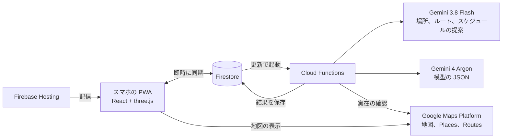

# 旅の計画が街になるアプリ 企画書（DF Hack26）

2026-11-04 作成 · かめ

話し合うほど、旅の計画が 3D の街として育っていく Web アプリを作ります。幹事だけでなく、全員で旅行を計画できるようにするのが狙いです。

## 1. タイトルとキャッチコピー

| 項目 | 内容 |
| --- | --- |
| アプリ名 | たびむすび |
| キャッチコピー | 旅の計画をみんなで、もっと楽しく。 |
| カテゴリ | 観光 |
| チーム名 | 未定 |
| メンバーと役割 | Active\_Turtle、Takana、ヨウキン、Mahiro（役割は未定） |

## 2. 課題

グループ旅行の計画は、幹事任せになりがち。幹事が一方的に進んでしまうケースが多い。

- 誰の課題か：若者の友人同士で旅行するグループ
- 幹事の困りごと：調べものと決定が集中し、共有しても反応が薄い
- 他の人の困りごと：文字の予定を見てもあまりイメージがわかず、ワクワクしない。結局幹事に任せっきりになってしまう。
- なぜ起きるか：旅のイメージを持てる人が一部だけだから。計画している人はすでに情報を得ているし、幹事1人でやってしまう。
- なぜ解きたいか：旅行は計画も楽しいのに、その楽しさが一部の人に留まっているから。計画するほど旅は「自分ごと」になるし、みんなの行きたいところを集めた理想の旅行プランができあがるのに。

## 3. 解決策

**旅の計画をみんなで、もっと楽しく。**

一部の計画者の頭にしかなかった旅の「ワクワクのイメージ」が、3Dの地図に落とし込まれることによって、みんなが旅行の計画に参加し、全員が主人公の旅行を作れます。

このアプリによって、旅が「幹事が決めて共有するイヤイヤ旅行」が「全員で組み立てて、いく前からワクワクする旅行」に変わります。

これにより「全員が主人公の旅行」を実現します！

スマホ優先のPWAにします（＝スマホを前提にします）

```
スマホ優先のPWAにした理由：旅行においては手軽さが命。パソコンを旅行に持っていく人は少ない。手元で日常的に、用事の隙間で手軽に旅行計画に参加できることを考えると、スマホで動くことが大前提。ネイティブはインストールと配布が重いので、URL だけで参加できる PWA にする。
```

### 表示言語

利用者は、端末ごとに日本語と英語を選べる。旅をつくる・参加する・地図で場所を探す・しおりを使うときの画面文言と案内を選んだ言語で表示する。Gemini の場所の説明も、用意できた英語の文があれば英語で表示する。Google マップの口コミは、英語を選んだ人には Google が英語に訳したものを出す（訳がない口コミは元の言葉のまま。口コミを聞く回数は言語によらず同じ。Youkin06 が 2026-11-23 の会話で決めた）。利用者が入力した文章はそのまま共有する。

### ユーザー体験

画面の流れは[画面イメージ・遷移図](https://claude.ai/artifact/43SzUgCqyFxMaFenBRPp5v)にあります（コピーと各画面の画像は [ui/screen-flow/](../ui/screen-flow/README.md)）。見た目は[いくつかの案](../ui/screen-flow/design-options/README.md)を比べ、A（ぷっくりポップ）と C（マップが主役）を合わせた A＋C で進めます（2026-11-07）。画面は A＋C で描いてあり、画像は [screenshots/](../ui/screen-flow/screenshots/) にあります。この節を画面にしたものなので、食い違ったらこの節に合わせて画面を直します。

1. 誰か（発案者）が旅行の日程（開始日と終了日。終了日なしなら日帰り）・出発地・おもな移動（電車・バス、車。下の「おもな移動」）を入れ、次の画面の日本地図から大まかな場所を選び、最後に旅の名前を決めて「ここへ出発！」を押すと、地図が選んだ場所へ寄って、そのまま旅の3Dマップになる（場所を選ぶと地図がその場所へ寄って少し傾き、出発を押すと画面いっぱいに寄る。場所選びにも旅の始まりのわくわくを持たせるため。Youkin06 が 2026-11-17 の会話で、試しに入れると決めた。案G：https://claude.ai/artifact/NUhEBux4pdiZ7SGKJKZpnT 、考え方：https://claude.ai/artifact/FAtVe1pdhVtwYNEtPTt2rA ）。入力は 1 問ずつ答える形にする。下のシートで「いつ行く？」（カレンダー）、「どこから出発する？」（よく集合場所に使う駅を、小さな丸いタグで横に並べる。入力してキーボードの決定を押すと、その場所を引いて地図に家を立てる。駅は全国の駅の表（国土数値情報の鉄道データ）から引くので、合言葉がなくても、どの駅でも家が立つ。駅でない場所は、今までどおり合言葉を通した人だけ Places で引く。Youkin06 が 2026-11-21 の会話で決めた）、「最後はどこに帰る？」（旅の最後にいたい場所。はじめは出発地と同じ名前が入っていて、書き換えられる。出発地と違う場所にしたときは、しおりの最後の日の帰りの移動の目安をその場所までで見る。Takana の依頼、2026-11-22）、「なにで行く？」（押しても進まず「つぎへ」で進む）、（名前を覚えていない人だけ）「あなたの名前は？」、「どこに行く？」、「旅の名前は？」の順に聞く。上の地図は、1 問目から最後の「旅の名前は？」まで、場所を選ぶ画面と同じ日本全体の Google マップ 1 つのまま変えない（Youkin06 が 2026-11-21 の会話で「日本地図は、ずっとこれであってほしい」と決めた。前は 1〜4 問目だけ自作の地図にしていた）。答えるたびに、地図に日程の月の舞うもの（紅葉・雪・桜）が重なり、出発地に家が立つ。上の帯は旅の画面の帯と同じ形で、旅の名前（名前は最後の問いで決めるので、ここでは「新しい旅」）と、答えた日程・乗り物・地方の印を出す。「どこに行く？」で、下のシートが地方の一覧に変わる。場所を選ぶ画面でも、上の帯は同じ旅の名前の帯のままにし、問いと結果（「北陸へ！ 東京駅から約290km」）とサイコロは下のシートの上に出す（Youkin06 が 2026-11-21 の会話で、試作 https://claude.ai/artifact/UgE4q8mz2Lp3Piiq5MEdoa を見て決めた。帯が急に問いに変わらないよう、問いはどれも下で聞く）。サイコロを押すと、まだ選んでいない地方から 1 つを選ぶ。光はどの地方にも跳ねるが、止まって選ぶのは、出発地から乗り物と日数で無理なく行ける範囲の県だけにする（車で東京から 1 泊なら関東や伊豆、大阪から 4 泊なら関東や九州の北まで。電車・バスは車より遠くまでで、1 泊で関東と関西を行き来できる。地方の一部の県だけが範囲なら、その県だけを選ぶ。範囲の数は実装した AI が仮に選んだ。Takana の依頼、2026-11-22）。旅の名前は、「どこに行く？」のあとの最後の問い「旅の名前は？」で、ほかの問いと同じ下のシートで聞く。欄には選んだ場所から作った仮の名前（「北陸の旅」）を入れておき、書き換えるか「Gemini につけてもらう」で Gemini（Flash）に考えてもらう。Gemini がつける名前は、上の帯に 1 行で収まるよう、日本語は 10 文字まで、英語は 18 文字までにする（Lazyturtle0852 の決定、2026-11-23。390px の幅でメンバーが 3 人のとき、14px の字で 10 文字が入る。自分で書く名前は 40 文字までのまま）。「ここへ出発！」はこの問いのボタンで、押すと旅を作る（Takana の依頼、2026-11-22。同じ日の午前に一度、名前を旅の確定のときに決める形にしたが、旅をつくる最初の流れの最後で決める形に戻した）。地図には出発地に家を立て、選んだ地方の名札を立てる（出発地から地方へ伸ばしていた橙の点線は、Youkin06 が 2026-11-20 の会話で、いらないと決めて外した）。一覧の地方と県には、形と名物のアイコン（地図の建物と同じ 3D の模型。どれを載せるかは仮。Youkin06 が 2026-11-20 の会話で、ここだけ 2D の絵なのをやめて模型にそろえると決めた）を並べ、選ぶと名物が跳ねる（Youkin06 が 2026-11-19 の会話で、案M を入れると決めた。https://claude.ai/artifact/NUhEBux4pdiZ7SGKJKZpnT ）。大まかな場所は選択式で、複数を選べる。すべて選ぶと、場所を絞らないという意味になる（2026-11-15 の打ち合わせ。すべて選んだときの意味は、かめが 2026-11-16 の会話で決めた）。選ぶ単位は 11 の地方（北海道、東北、関東、甲信越、北陸、東海、近畿、中国、四国、九州、沖縄）。旅をつくる画面の行き先の問い「どこに行く？」で、上に日本全体の Google マップ（見るだけで、選んだ県を緑に塗る）、下に地方の一覧が出る。一覧で地方をまるごと選ぶか、地方を開いて県を選ぶ。県の名前や読みで探すこともできる（ヨウキンが 2026-11-17 に案3 に決めた。案の画面 https://claude.ai/artifact/Y9XYN7L2eMc2ACvCahZAeo 。前は地図の上の地方の札を押して選んでいたが、札が重なり、県は地方を選んだあとでしか選べなかった）。選んだ地方は旅の基本情報に出て、全員が見られる（ヨウキンが 2026-11-16 の会話で決めた。自作の日本地図にしなかったのは、Maps Platform 規約 3.2.3(e) の心配をなくすため。#373）。県まで決まっている旅では、地方を選ばずに県から選べる（ヨウキンの依頼、2026-11-16）。旅の地図では、選んだ地方の外を灰色で覆い、中を緑の縁で囲む（ヨウキンが 2026-11-16 の会話で決めた。案A。県まで絞った旅も、塗りは地方の単位）。塗りは Google の地図の県境で行い、内陸ではどれだけ寄っても地図とずれない。県境のデータの海岸線は地図の海岸線より粗いので、街の中まで寄ったら緑の縁だけを消す（ヨウキンの決定、2026-11-17）。県で絞った旅は、選んだ県だけを中として塗る（同じくヨウキンの決定、2026-11-17。地図のスタイルで都道府県の境界の層をオンにした。todo/humans/2026-11-16-boundary-layer.md）。やりたいことから立つ候補のピンは、選んだ地方（県まで絞ったときはその県）の中の場所だけにする。やりたいことに地方の外の地名を書いても、その場所のピンは立たない（ヨウキンが 2026-11-16 の会話で決めた。すべて選んだときは絞らない）。選んだ範囲の中でどこに行きたいかは、発案者が決めず、全員が同じ立場で案を出す。友達を招待できる。招待リンクを開くと、名前を入れるだけでその旅に入れる。招待リンクのほかに、旅の合言葉でも参加できる。旅の合言葉は、旅ごとに自動で作る 6 文字の英数字で（旅を作った時点で裏で作り始め、招待の画面が出るころには出ているようにする。Takana の依頼、2026-11-22。前は招待の画面が出てから作り始めていて、待たされた）、招待の画面に、共有のボタンと QR コードと並べて出す。ホームで旅の合言葉を入れると、その旅の参加の画面が開く（2026-11-15 の打ち合わせ。今は PWA から招待リンクを開けず、PWA から旅に参加できないため。合言葉の形は、かめの 2026-11-16 の変更希望「部屋コードのような合言葉」に合わせた。本番のアプリ全体を守る合言葉とは役割が違う）。Google アカウントと連携すると、どの端末やブラウザから入っても、同じ人として同じ旅を開ける。連携は任意で、連携しなくても名前だけで使える（2026-11-15 の打ち合わせ。任意にするのは、かめが 2026-11-16 の会話で決めた。ログインなしで入れる手軽さを残すため）。地図の右上のホームボタンから、いつでもメニュー（計画中の旅の一覧、旅の切り替え）に戻れる。
2. 計画フェーズ（各自が好きなときに進める。ほかの人を待たない）
   1. それぞれが「温泉に入りたい」「スキー場で滑りたい」「わさび農園に行きたい」「夜景と一生の思い出を作りたい！」などと書く。「新潟の温泉！」のように場所も書けばそこを調べ、「温泉」だけなら、いまマップで見ているあたりから探す（ズームアウトして日本全体を見ていれば全国から）
   2. 関連する場所に候補のピンが複数立ち、タップすると場所の説明が見られる（[イメージ](https://pokemongo-get.com/wp-content/uploads/2016/09/%E8%BF%91%E3%81%84%E3%83%9D%E3%82%B1%E3%82%B9%E3%83%88%E3%83%83%E3%83%97.png)：ポケストップ）
   3. 気になったピンで「建築する！」を押すと、裏で建築が始まり、すぐ次のやりたいことを探せる（待ち画面は出さない）。建築ができ次第、マップのその場所に建物の3D模型が自動で建つ
   4. 建った場所は、しおりに旅の順で並ぶ。ルート案を何パターンも出すことと、どのルートにするかの投票はしない（2026-11-07 にチームで合意してやめた）
   5. 旅程に足りないものを、アプリが知らせる。まずは宿。しおりができていて、宿の決まっていない夜があると、やりたいことを書く欄の上に「1 日目の宿がまだ決まっていません」と「宿を探す」が出る（最初の建築の直後は出さず、その旅のしおりを一度開いたあとに出す。UI/UX レビューの M-4。#708）。押すとすぐ探しはじめ、上の帯の下の行（右上）に「1 日目の宿を探し中です」と出て、その日の終わりに無理なく着け、翌日も動きやすい場所に、宿の候補のピンが 3 つまで立つ（ふだんは、その日の最後に訪れる場所と、翌日の最初に訪れる場所のあいだ。夜に飛行機や長い新幹線で移る日は、移動の途中には探さず、どちらか一方の側で探す。決め方は下の「実装で仮に決めたこと」の宿の候補の出し方）。やりたいことに宿の名前や「〜に泊まりたい」と書いたときは、書かれた宿を優先して探す。宿も、ほかの場所と同じように「建築する！」で建てると決まる（AI は提案するだけで、決めるのは人）。宿やご飯が決まっていないと旅行が成り立たないのに、いまのしおりでは抜けていても気づけないため（Youkin06 が 2026-11-21 の会話で決めた。#517。食事は、しおりに昼食と夕食の枠を用意する形で、別の作業で作る。Paralysis の決定、2026-11-21、#522）
3. しおり（計画中もいつでも開ける。地図なしのしおりビューは、発案者が旅程を確定したあとに開ける）
   1. 左上の青いしおりボタン（ルートボタン）を押すと、しおりになる。しおりでは同じ場所が戻るボタンになり、開く・閉じるが同じ場所にある。ボタンは右上のホームボタンと同じ、帯の高さの正方形にし、みんなの地図としおりで帯の長さを変えない（チームの合意、かめの決定、2026-11-22。2026-11-21 から 11-22 までは、目立たせるため、いま見ているあたりの下に置いていた。目立たせるのはチュートリアルで足りるので戻した）。旅の設定は帯を押して開く（左上の設定ボタンはなくした。Youkin06 の案を Lazyturtle0852 が 2026-11-22 に採用）。建った場所が旅の順に並び（時刻・地点・誰のやりたいことか）、地図にも道順が出る。戻るボタンを押すと「この旅でやりたいことは？」を入れる画面に戻る
   2. しおりで場所を押すと（地図の建物でも、しおりの行でも）、その建物の3Dにズームし、下のシートがその場所の情報（場所の種類の小さな印と説明。本番で合言葉を通した人には、Google マップの写真 1 枚（撮った人の名前つき。写真を出す設定を人が入れたあと）と口コミも出す。どちらも保存しない。口コミは、やりたいことを書いて立った候補のピンの場所カードでも、同じ条件で出す（建てる前に選べるように。かめの承諾、2026-11-08、#203）。模型を Knowledge Graph の説明で作った場所には、その Wikipedia の説明（冒頭）も出典つきで出す。2026-11-08 かめの決定）になる。シートの左上の「<」ボタンで、しおりに戻る（名前を広く出すため、文字は付けない。Takana の依頼、2026-11-20）。しおりの先頭の集合場所の行を押すと、集合場所の情報になり、そこから旅の順に場所を見ていける（集合場所は建物ではないので、建物と見分けられる印で出す。Mah110hat が起票した 2026-11-09 の要望、#226）
   3. 場所の情報を見ているときに、地図のほかのところをスワイプして動かすと、シートは閉じる。シートの上の部分（「<」ボタンと場所の名前）だけは画面の下に残り、そこを触ると場所の情報に戻る。地図のほかのところを押す（タップする）と、しおりに戻る（みんなの地図で場所カードが閉じるのと同じ。2026-11-07）
   4. それぞれの端末で見られる。しおりを見たあとも、戻るボタンで戻って「やりたいこと」を足せる
      通常画面のホームボタンは、隣の旅の名前の帯と同じ高さにする。元の正方形を維持し、高さに合わせて幅も変える（Mah110hat、2026-11-10、#295）。
   5. しおりのシートの外側の左上にある再生ボタンを押すと、旅を映像で見られる。車の模型が集合場所から走り出し、しおりの順に道順をたどって走り、地図はそれを追う。再生中は下の欄を出さない。場所に着くと止まり、「パシャ」とシャッターの音を鳴らして、Google マップの写真 1 枚（場所の情報と同じ条件で出せるときだけ）を、撮った写真のように白い枠つきで大きく出す。写真の下の余白に、何番目か・時刻・場所の名前・誰のやりたいことかを書く。写真は建物の模型に重ならないよう画面の下に置き、地図は残りの所に建物を映す（画面の真ん中に重ねる形も試したが、下に戻した。Youkin06、2026-11-09）。そのあと次の場所へ進む。最後まで行くと、しおりに戻る。再生中は、画面の左下に一時停止のボタンと速さのボタンを出す。一時停止すると、車をその場に残して、着いている（走っている途中なら、向かっている）場所の情報に途切れずに移る。そこの再生ボタンで、止めた所から続きを走る。しおりやほかの場所へ移ると、続きは捨てる。速さは、押すたびに ×1 → ×2 → ×4 と切り替わる（Youkin06 が 2026-11-20 の会話で決めた。#374）。みんなが旅の流れを思い描けるようにし、旅のイメージを幹事だけが持つ状態をなくすため（Youkin06 が 2026-11-08 の会話で決めた。動画生成 AI は費用がかかるので使わず、地図の上で再生する）
   6. しおりは、あとから直せるようにする。時間、場所、順番を変えられ、建った建物を消せる。同じ場所を何度も訪れる旅程にもできる（スキー場に 2 日続けて行く、宿に毎晩戻る、など）。PDF か画像で書き出せる（書き出しに何を入れるかは決めていない。Maps の内容は外へ持ち出さない決まりなので、入れない前提で考える）。発案者は、地図も見えるしおりの一番下の「この旅で決まり！」で旅程を確定できる。押すとすぐ確定する（名前は旅をつくる最後の問いで決めてあるので、ここでは聞かない。Takana の依頼、2026-11-22）。確定すると、地図なしで画面いっぱいに読める決まったしおり（しおりビュー。別の画面）が発行され、確定しているあいだは建物と行程が止まる（建てる、消す、順番、移動の手段、集合場所、行きたいこと、旅の名前と日程を変えられない）。地図は見るだけになる。発案者だけは、確定しているあいだも時刻を直せる（地図の見えるしおりでも、しおりビューでも）。確定は発案者が取り消せ、取り消すとまた全員で計画できる。確定の前は、しおりビューを開けない。書き出しは、地図も見えるしおりでは Google マップの道順だけ、確定したあとのしおりビューでは Google マップ、PDF、Google カレンダー（かめの方針、2026-11-21、#502。確定を入れる理由：サークル旅行のように 10 人規模で計画すると、旅程が見えてきたあとで、ほかの人の操作で行程が大きく崩れることがある（白馬のはずが松本になる、など）。大まかな場所を発案者が決めても、その範囲が日本全体のこともあるので、それだけでは防げない。経緯：2026-11-15 の打ち合わせで発案者がしおりを確定にできるとし、#393 で取り消せない形で実装した。2026-11-20 にかめの方針で確定をなくした（#472）が、2026-11-21 に取り消せる形で戻した。かめが挙げた、画面を 2 つ残す理由：地図も見えるしおりは、旅行の前に旅のイメージをふくらませるためのもの。しおりビューは旅行中に見る想定で、その日に何をするかを一度に見られればよく、地図は要らない）。しおりを直す・書き出す機能の経緯と実装の状況は次のとおり（2026-11-15 の打ち合わせ。予選の審査員から確定版のしおりがほしいという声があり、チームからも、家を出る時間などを細かく合わせたい、上の世代やオフラインで見たい人に渡したい、という案が出た。順番の入れ替えは実装した（下の「実装で仮に決めたこと」。Takana の依頼、2026-11-16、#328。2026-11-21 に、行と行のあいだに差し込む形に変えた。#528）。建った建物を消すことも実装した（同じく下。Takana の依頼、2026-11-16、#349）。同じ場所を何度も訪れられるようにした（同じく下。Youkin06 の依頼、2026-11-21、#528）。PDF の書き出しも実装した（同じく下。Takana の依頼、2026-11-18、#393。このとき入れたしおりの確定は、2026-11-20 にやめ、2026-11-21 に取り消せる形で戻した）。しおりを、メンバーそれぞれが自分の Google カレンダーに書き出せるようにした（同じく下。Takana の依頼、2026-11-18、#396）。ほかはまだ実装していない）
   7. 泊まりの旅のしおりには、泊まる夜ごとに宿の枠が入る。宿が決まっていない夜の枠は点線の 1 行にたたんであり、「1 日目の宿」の名前と「＋ 決める」だけを出す。「＋ 決める」を押すと枠が開き、「宿を探す」と「自分で書く」の 2 つのボタンが出て、前の夜の宿が建物で決まっていれば「前の夜と同じ宿にする」も出る（しおりの中の緑の塗りのボタンを「この旅で決まり！」だけにし、空の枠のボタンが並んで行が読みにくくならないようにするため。UI/UX レビューの S-1。#708）。「宿を探す」を押すと、やりたいことを書く画面（みんなの地図）に戻ってすぐ探しはじめ、右上に「1 日目の宿を探し中です」と出て、その日の最後の場所と翌日の最初の場所のあいだに宿の候補のピンが 3 つまで立つ（上の 2-5 と同じ）。宿を建てると、その日の最後の行に宿が入り、翌日は宿から出発する。「自分で書く」は、車中泊や夜行の移動のように、宿を取らない夜のためのもので、押すと枠がその場で入力欄に変わり、過ごし方（「車中泊」「友だちの家」など。20 文字まで）を書いて決める。何も書かずに決めると「宿は取らない」になる。決めた夜は、書いた言葉の出る行になり、あとから書き直すことも、空の枠に戻すこともできる。確定したあとの決まったしおり（S14）と PDF でも、宿に決まった建物の行には「宿泊」と出し、宿を取らない夜は、その日の最後に書いた過ごし方（書いていなければ「宿は取らない」）を出す（#519 のレビューの指摘、#553）。宿を建てても過ごし方を書いてもいない夜があるあいだは、旅程を確定できない。発案者の「この旅程で確定する！」は押せず、ボタンの上に、どの夜の宿が決まっていないかを出す。その下の「＋ 1 日目の宿を決める」を押すと、その夜の宿の枠が開いて見える所まで送られる（UI/UX レビューの S-4。#708）（Youkin06 が 2026-11-21 の会話で、claude.ai にまとめた 3 つの案 https://claude.ai/artifact/5Db6ZgSU2kYHffQa9uZNwU から案 A を選び、「あえて決めない」とは書かないこと、「決める」をふつうの大きさにすることを決めた。「宿を探す」は、いったん検索欄に言葉が入る形にしたが、手元で触って、押したらすぐ探す形に戻した。画面の言葉は「1 日目の夜の宿」でなく「1 日目の宿」とする（どちらも同日）。#517、#530）
   8. しおりの日ごとに、朝・昼・晩ごはんの枠が入る。見た目と操作は宿の枠と同じで、決まっていない枠は点線の 1 行にたたんであり、「＋ 決める」を押すと「お店を探す」と「自分で書く」の 2 つのボタンが出る。「お店を探す」を押すと、みんなの地図に戻ってすぐ探しはじめ、その日の場所のまわりに、食べるお店の候補のピンが 3 つまで立つ。建てると、その日のその食事に合う位置（朝はその日の最初、昼は 12 時ごろ、晩は 18 時ごろか、宿の前）に入る。「自分で書く」は、押すと枠がその場で入力欄に変わり、「なし」「コンビニ」「宿で食べる」などの候補を押すか、自分で書いて決める（20 文字まで）。決めた枠は書いた言葉の出る行になり、あとから書き直すことも、空の枠に戻すこともできる。宿と違い、ごはんの枠が空いていても旅程は確定できる（枠が日数の 3 倍と多く、確定の邪魔になるため。実装した AI が仮に選んだ）（Youkin06 の依頼、2026-11-22。「なし」を選べるようにし、見た目は宿の枠と同じにする。#522）
4. コレクション（旅行のあとに見返す。かめが 2026-11-21 の会話で、作ると決めた。`todo/humans/2026-11-21-collection-in-product.md`。デザイン：https://claude.ai/artifact/CtaMT75scBbLDrf8NTNr9h 、もとのホワイトボード：[写真](../ui/collection/whiteboard-2026-11-21.jpg)。同じ日に、旅行中の機能（旅の最中に計画を動的に組み直す機能）は、ハッカソンのスコープから外すと決めた。残りの開発期間では、今ある機能を磨くほうが高い得点を目指せるため。ハッカソンのあとで、戻るかを考える。`todo/humans/2026-11-21-during-trip-out-of-scope.md`）
   1. ホームでは、確定した旅のうち、最終日を過ぎたものを「過去の旅」の欄に分ける。押すと、その旅の決まったしおりが開き、今までどおり 3D の地図と旅の再生で見返せる。計画した旅がそのまま実行されたものとして扱い、実際に行ったかどうかは記録しない
   2. ホームの下にフッターを置く（左がホーム、右がコレクション）。コレクションでは、過去の旅で建てた建物を、旅ごとにまとめて四角いタイルで並べる。旅ごとの「しおり」ボタンで、その旅の決まったしおりへ移る。建物を押すと、建物の詳細（回る模型、名前、場所、誰のやりたいことか）が画面の上に重なって出る。詳細からしおりへは移らない（かめのコメント、2026-11-21）
   3. コレクションの一番上の「日本地図で見る」で、過去のすべての旅の建物を、日本全体の地図に並べる。旅をまたいで、これまでどこへ行ったかが分かる

初めて開いた端末では、どの URL を開いても、ほかの画面より先にチュートリアルを出す（合言葉の画面よりも前）。1 枚に 1 つのことだけを載せる。背景は緑一色にし、アプリの画面を短く繰り返す動く画像（GIF のような、音なしの短い動画）にしてスマホの形の枠（縦も横も画面の 7 割ほど）に入れて上に置き、1 文ほどの文言を画面の下に固定して出す。動く画像は本物の地図の画面で撮り（しおりと再生は、道に沿った線が出る本番で撮る）、実際の画面の正確さより、このアプリで何ができるかが一目で分かることを優先する。ようこそ、建物が建つ、建物が増えて線でつながった地図、しおりの行程（食事と宿まで決まったしおりを、スクロールして見せる）、旅の再生（青い再生ボタンを押し、車で道に沿って走る）の 5 枚を、前後の 1 枚がつながる言い方で見せる（「みんなで気になる場所を建築していくと、」→「旅が出来上がっていくアプリ！」）。建物が建つ 1 枚は、下の欄にやりたいことを入れて探すと模型が建つ流れを、待ち時間を詰めて 3 秒ほどに早送りし、建つ瞬間に建物完成の音を鳴らす（その 1 枚を初めて見たときだけ）。最後は、欄に文字が残ったまま模型が建っている（実際にはない状態だが、入れるものと出てくるものを同時に見せる）。ようこその 1 枚は画面を録画せず、真ん中にアプリの名前を置き、後ろで地図に建つ実際の模型（善光寺、東京タワーなど）がたくさん、斜めの何本かの列に沿って 1 つずつ左下から右上へ流れていく場面をコードで描く（旅の設定は、閉じたあとすぐ自分でするので見せない）。最後の 1 枚（旅の再生）の文言「素敵な旅を作りましょう！」は、そのまま閉じるボタンにする（再生そのものは説明しない）。このボタンは、最後の 1 枚が出てから 4 秒ほどは押せず、見た目も押せない形にする（再生の動きを見てもらうため）（5 枚に絞ること、緑の背景とスマホの枠、1〜4 枚目の文言は Takana の依頼、2026-11-21、#569。動く画像にすること、わかりやすさを優先すること、1・2・4・5 枚目の中身、最後の文言、最後のボタンを少し押せなくすることは Lazyturtle0852 の依頼、2026-11-22、#532。最後の文言をボタンにすることと、音を初めの 1 回だけにすることは、実装で仮に決めた）。動きを減らす設定では動かさず、最後の 1 コマで止める（最後に、その 1 枚で伝えたい状態がそろうように撮る。2 枚目なら、欄の文字と建った模型。実装で仮に決めた）。文言は、期待が高まるように「！」を多めに使う。画面のどこでもタップ（右半分で次、左半分で前。最初の 1 枚はどこを押しても次）か左右のスワイプで切り替え、画面の上に、今が何枚目かを示す棒を並べる。インスタのストーリーのように、いまの 1 枚の棒は動く画像の 1 周に合わせて伸び、伸び切ると自動で次の 1 枚へ進む（ようこそは 8 秒。最後の 1 枚は自動では閉じず、繰り返して流す。動きを減らす設定と、動画を流せないときは自動で進めない）。「スキップ」でいつでも閉じられ、閉じると開こうとしていた画面になる。一度見るか飛ばした端末では、次からは出さない。ホームの「使い方を見る」から、いつでも見返せる（Takana の依頼、2026-11-21、#508。タップを画面全体で左右半分に分けることは Takana の依頼、2026-11-22。最初の 1 枚はどこを押しても次へ進むことは、実装で仮に決めた。棒を伸ばして自動で次へ進むことは、Youkin06 の要望と Lazyturtle0852 の依頼、2026-11-22）。

```
大まかな場所を最初に選ぶ理由（2026-11-15 の打ち合わせ）：みんなの行きたいところをそのまま集めると、大阪・長野・青森のように全国に散らばり、全員にとって微妙な旅になる。決める人がいないと、行き先が割れたときに旅行が決まらない。そこで、発案者が旅を作るときに、大まかな場所だけを決める。
選択式にした理由：指で塗る方式は自由度が高すぎる。地理に詳しくない人が適当に塗ると、大事な判断が雑になる。円で囲む方式は、途中の寄り道と両立しない。
すべて選んだときの意味：すべて選ぶのは、場所を絞らないという意味（かめ、2026-11-16）。2026-11-15 までは「行き先を県単位で決めるより、やりたいことから考える場面の方が多い」として、エリアを選ぶ画面を置いていなかった。すべて選べば、そのときと同じく、場所を絞らずに始められる。
```

```
しおりを動画にしなかった理由：動画は見ていて楽しいが、知りたい情報にすぐたどり着けない。場所を押すとその建物にズームして情報が出る形なら、ワクワク感と使いやすさを両立できる。
そのうえで再生ボタンを足した理由（2026-11-08）：しおりは一覧のまま残し、旅の流れをつかみたい人だけが映像で見られるようにする。動画ファイルは作らず、地図の上でその場で再生する（Maps の内容を外へ持ち出さない。費用もかからない）。
```

場所の情報（S12）と、そのシートを閉じた状態（S13）にも「ここから再生」を置く。押すと表示中の場所に着いたところから始め、しおりの順に最後まで再生する。場所の番号はしおり全体の番号を使う。集合場所の情報からは、既存の先頭からの再生を始める。停止・終了時はしおりの一覧に戻る（Mah110hat、2026-11-10、#296）。この再生ボタンはしおりと同じ、シートの外側の左上に置き、56px四方にする。読み上げ名は「ここから再生」のままにする。シートの開閉と一緒に動き、本文のスクロールでは動かない（Mah110hat、2026-11-10、#301）。見た目も、しおりの一覧の再生ボタンと同じ、ルートの色の丸いボタンにそろえる（アイコンだけにした形をやめた。Mah110hat、2026-11-10）。

```
ルートを自分でひく方式を採用しなかった理由：ルートを引くことを楽しく感じる人は確かにいるが、「みんなが主人公」の旅行を実現するにあたっては、ルートはハードルの高いところなのでそこはAIにやってもらうのが最善だと判断
```

AI は提案するだけで、決めるのは人！みんなが主人公。

「みんなが主人公」は、全員が決めるという意味ではない。全員が旅の計画にワクワクし、計画に参加し、自分の計画が反映されることを指す（2026-11-15 の打ち合わせ）。

決めることが要る場面では、発案者（旅を作った人。これまでの幹事にあたる）が決める。発案者が決めるのは、日程、大まかな場所、旅程の確定（と取り消し）の 3 つ（2026-11-20 から 2026-11-21 までは、確定をなくして 2 つにしていた。かめの方針、#472、#502）。日程は、旅を作ったあとも発案者が旅の設定（上の旅の名前の帯を押して開くシート）から変えられる。ほかのメンバーは見るだけで、旅程を確定しているあいだは発案者も変えられない。日程を縮めたときは、しおりをできるだけ組み直し（ゆとりのある日へ場所を入れ直す）、入りきらなかった場所はしおりから外す。外した場所の建物は地図に残る。外した場所の一覧は画面に出さない（Lazyturtle0852 が 2026-11-22 の会話で決めた）。外れた建物を地図で押すと、場所カードに外れていることの案内と「しおりに戻す」が出て、メンバーなら誰でもしおりに戻せる（時間に収まらなくても戻す）。日程を延ばしたり日付を動かしたりすると、外した場所のうち時間に収まるものは自動でしおりに戻る（Takana が 2026-11-23 の会話で決めた。バグ30。日程を 2 泊 3 日から 1 泊 2 日に縮めると、1 日目にゆとりがあっても 5 か所が外れ、戻す手段がなかった）。発案者は、旅に今いるメンバーのうち、いちばん早く入った人。旅を作った人が抜けたら、次に入った人が発案者になる（かめの決定、2026-11-21）。どこに行きたいか、何を建てるかは、全員が同じ立場で案を出す。

AI は幹事にしない。裏側で支える役に置き、旅を計画するところは AI に明け渡さない。「AI のこの機能がすごい」という見せ方もしない。

```
発案者が決める形にした理由（2026-11-15 の打ち合わせ）：決める人がいないと、行き先が割れたときに旅行が決まらない。投票で決めるのは手間がかかる。発案者が決めることは 3 つにとどめ、案を出してそれが採られることを、全員の主人公らしさにする。
AI を幹事にしない理由：旅を計画するところは、AI に明け渡してはいけない領域だと考えた（Active_Turtle）。予選で表彰されたチームは、どこも AI が補助に回っていた（Takana の見立て）。
```

#### 操作の効果音（2026-11-09 たかなの依頼）

操作に合わせて、[SEの対応表](../sound/README.md)で選んだ音を鳴らす。たかなの試聴を受け、日常操作は短く柔らかい「ぽよん」と弾むポップ・バブル系へ再選定した（2026-11-09）。採用は選択B、開くC、閉じるC、カード切替B、希望送信A、候補発見B、建築確定C、建物完成C。候補のA/B/Cは並べ替えず、採用IDで指定する。着工・再試行と、旅の作成・再生開始・再生完了の合図は無音にする。QRコードの表示・非表示も無音にし、保存成功の「ぴろりん」（confirmation_001）は残す。表で無音とした入力・連続した地図操作・自動表示更新には音を付けない。旅の再生中は出発・走行・シャッターを鳴らし、到着の通知音はシャッターと重ねない。

音量とミュートはホームから変更でき、この端末に保存する。初期音量は35%。初回の操作で音の準備をし、過去のデータの読み込みや同じ通知で繰り返し鳴らさない。ほかの人のできごとは小さく鳴らし、旅の再生中は抑える。音を出せない場合も、操作や画面の表示はそのまま使える。

#### おもな移動（電車・バス、車、飛行機、2026-11-18）

かめが 2026-11-18 の会話で決めた（#420）。グループの旅は電車・バスで動くことが多く、車を出せない人もいる。

- 旅を作る画面（S01）で、おもな移動を「電車・バス」「車」から選ぶ（S01 の「飛行機」は Takana の依頼で外した、2026-11-22。旅全体の「飛行機」は、しおり（S11）の切り替えで選べる）。既定は電車・バス。飛行機の旅では、直線 300 km 以上の区間を最初から飛行機にし、空港までと現地の近い区間は電車・バスで見積もる（飛行機は Takana の依頼、2026-11-22。300 km は実装した AI が仮に選んだ）。しおり（S11）で、メンバーなら誰でも選び直せ、しおりの時刻が組み直される（幹事だけに決めさせない）。旅程が確定しているあいだは、地図のしおりにも切り替えを出さず、決まったしおり（S14）にも置かない（2026-11-21、#502）。前からある旅は車のまま
- 電車・バスの移動時間は、時刻表も外部の API も使わずに見積もる。国土数値情報（鉄道データ）の駅と線路のつながりで乗り換えを探し、路線の種類ごとの速さで乗る。近くに駅がなければ近い駅までバスで行くとみる。バスの式と歩きとも比べて速いほうを取る。全国の観光の区間 35 で、実際との差は平均 7 分ほど、9 割以上の区間で 30 分以内（実験の報告：https://claude.ai/artifact/SMziadbQQhUX29sAeAP4jG）。画面では「目安」と書き、出典を出す（しおりでは料金の目安の下。UI/UX レビューの S-6。#708）
- 外れやすいのは、山の乗り物（登山電車、ケーブルカー）、観光地の市バスの乗り継ぎ、特急・高速バスの速さ。時刻表がないと詰められない
- 車の旅では、今までどおり Routes API（車）の時間をしおりを開いたときに出す。電車・バスの旅では Routes を呼ばない
- しおりの場所の行と行のあいだに、次の場所までの移動の行（手段と目安の時間）を出す。押すと、その区間だけ手段（電車・バス、車、徒歩）を選び直せ、しおりの時刻が組み直される。選んでいない区間は区間の既定（ふつうは旅全体の手段。遠い区間と島への区間は飛行機。下の項）で計算し、旅全体を切り替えても区間ごとに選んだものは残る。区間の既定と同じ手段を選ぶと、その区間の選択は外れる。順番を入れ替えて区間がなくなったら、その区間の選択も外れる。旅全体を切り替えて、区間の既定と同じになった区間の選択も外れる。徒歩は直線 10 km までの区間だけで選べる（歩いて約 3 時間。かめの決定、2026-11-18）。メンバーなら誰でも選び直せる（かめの決定、2026-11-18、#433。家から愛媛は車、現地は電車のような旅を表すため）
- 飛行機は、遠い区間だけに選択肢として出し、近い区間では出さない（かめの決定、2026-11-18）
- 車や電車では行きにくい区間は、選ばなくても最初から飛行機にする（かめの決定、2026-11-19）。直線 600 km 以上の区間と、北緯 30 度より南（奄美・沖縄・先島などの島）の端を持つ直線 200 km 以上の区間が当たる（600 km と北緯 30 度は AI が仮に選んだ）。この区間では飛行機が「この区間の既定」になり、電車・バスや車を選ぶとその区間だけの選択として残る
- 飛行機（#424）：飛行機の区間（最初から飛行機になった区間も、区間ごとの手段で「飛行機」を選んだ区間も）は、押さなくても最初から便を探す（かめの決定、2026-11-20、#482。「飛行機」を押してから便が出るのは使いにくいため）。しおりを作るときと組み直すとき（場所が建つ、順番を入れ替える、建物を消す、集合場所を変える、旅全体や区間の手段を選び直す、時刻を直す）に、便が決まっていない区間と、出発が遅くなって残した便に乗れなくなった区間の便を探す。残した便に乗れる区間は便を変えない。ただし、便を選んだ前提が変わるとき（時刻を直した、集合場所を変えた、旅全体の手段を切り替えて空港までの時間が変わった）と、その区間の「飛行機」を押したときは決め直す（便を変えないことと、前提が変わるときに決め直すことは、実装した AI が仮に選んだ）。便は、区間の両端から 150 km 以内の空港（それぞれ近い順に 3 つまで）を組み合わせ、ANA と JAL の時刻表（公共交通オープンデータセンター）から、その日の曜日に走る直行便のうち、空港に着いて手続き（60 分）を済ませたあとに出る最初の便を選ぶ。降りてから 20 分と、空港まで・空港からの移動（旅全体の手段の見積もり）を足し、行き先に最も早く着く便にする。便の名前と時刻をしおりの移動の行に出し、その下に出典の 1 行「時刻表：公共交通オープンデータセンター」だけを出す。取得日・正確とは限らないこと・問い合わせ先の文（「便と時刻は、…お願いします。」）は出さず、ほかの場所にも移さない（Takana の決定、2026-11-22。前は ODPT 開発者ガイドライン 2.2.1、3.1 に合わせて全文を出していた。かめの決定、2026-11-18）。時刻表がない、乗れる便がないときは、距離の式の目安にする。その日に便はあるが乗れる便がないときは、目安で組んだうえで、その日の最終便の時刻と、空港に着いておく時刻を出し、もっと早く空港に着くか翌日の便にするよう案内する（かめの決定、2026-11-18、#446。翌朝の便をしおりに入れる案はやめた）。日をまたぐ飛行機の区間では、翌日は到着の時刻から始める。計算はアルゴリズムで行い、便や時刻を Gemini に作らせない
- 時刻表はアプリの中（Functions のメモリー）にだけ持ち、1 日ごとに取り直す。公開リポジトリにも、端末から読める所にも置かない（ODPT 基本ライセンス 第8条）。ルートに残すのは、選んだ便の要約（便名、空港、時刻、取得日、所要時間）と、乗れる便がないときの最終便の要約（便名、空港、時刻、取得日）だけ
- 飛行機の区間で乗り降りする空港は、しおりで建物と同じ「場所」として扱う。しおりの一覧（地図のしおりと決まったしおり）では、移動の行の下に乗る空港と降りる空港の行を場所の行と同じ形で出し（便が決まっていれば発着の時刻つき）、地図には集合場所と同じ形の印を出す。旅の再生では区間を空港で区切り、空港まで・空港どうし・空港からをそれぞれの両端の距離で寄せて走り、空港に着くたびに建物と同じだけ止まる（Paralysis の依頼、2026-11-22）。空港の行はしおりのデータには足さず、画面で便と位置から決める
- 乗り継ぎ便、LCC（時刻表がない区間は目安）、運賃は扱わない

---

### 出発地点と建物の再利用（2026-11-16）

11/15の決定とDiscordのMahiro宛て依頼を具体化する（#367、#368）。この節が、以前の「固定の地名表だけ」「本番で生成失敗時に部品模型」の仕様を更新する。

- 出発地点は新宿以外も指定できる。既知の駅・街は手元の表で位置を引き、表にない名前は既存のPlacesテキスト検索で調べる。検索は確定時だけで、既存の合言葉と回数上限を守る。検索できなければ保存せず、名前の入力を促す。
- 作成後は、しおりの集合場所の情報から出発地点を変更できる（招待のシートからは変えない。Takana の依頼、2026-11-21）。メンバーなら変更でき、訪問順を保ったまま時刻を計算し直す。全員の地図と旅の再生に同じ位置を使う。
- 模型は場所の名前・地域・種類で識別して辞書化し、同じ場所の生成要求では生成済み模型を使う。Mapsの位置やplaceIdを模型の入力・辞書キーには使わない。参考資料の出典も引き継ぐ。
- 辞書にない場所はGeminiで生成する。本物の生成に失敗したときは汎用の部品模型へ置き換えず「失敗」にし、再試行できるようにする。ローカルの固定応答は検証用として残す。辞書から返すときにも短い工事中表示を残す（仮に4秒）。
- ただし、本物の生成を呼べないとき（合言葉を通した人がいない、または Argon の 1 日・累計の上限を使い切った）は、種類に合う部品の模型で「完成」にし、場所の情報に「用意した部品の模型です」と出す。何度押しても失敗する状態を作らないため（品質チェックで、本番の固定の宿の候補 82 件がすべて辞書になく、建てると毎回失敗すると分かった。#728。Lazyturtle0852 の決定、2026-11-23）。呼んだうえで失敗したときは、今までどおり「失敗」にする。
- 建築の途中で関数が止まり（時間切れやインスタンスの強制終了）、引き受けてから 10 分たっても「工事中」のままのピンは、失敗したものとして扱う。画面には「前の建築は失敗しました」を出してもう一度建てられるようにし、確定も止めない（#727）。
- ローカルのGeminiで事前生成した模型を検証し、配布用辞書に登録できる。辞書の本番反映も、今回の変更のデプロイもユーザー確認後に行う。
- 11/18のMahiro宛てDiscord依頼では、事前生成の対応範囲を1都道府県平均100件（全国4700件）へ増やす。既存151件を保ち、都道府県別の候補と生成済み模型を検証して追加する。最初のアカウントではArgonが使えなかったため、生成を再開できる手順を先に整えた。2026-11-21 にかめの agy で 56 件を作り、見た目と向きを人が確かめて配布用辞書に入れた（計207件）。続きは Argon の週の枠が戻ってから作る（枠を使い切ったときは、明示して Hydrogen も使ってよい。Lazyturtle0852 の決定、2026-11-22）。本番への反映は人が行う。

### 時刻が決まったイベント（2026-11-21）

花火大会や見学会のように、開催の日と時刻が決まった行き先を扱う。Takana と AI の会話で出た案で、チームの合意はまだない。

**探し方**

- やりたいこと（例：「花火がみたい」）から、旅の日程のあいだに、地図に見えている辺り（選んだ地方・県の中）で開催されるイベントを探す。今の検索は旅の日付を使っていないので、日付を渡す
- イベントか、ふつうの場所かは、検索の答えに印を付けて分ける。ピンの見た目も、ふつうの場所と分ける
- 見つかったら、ふつうと同じく候補のピンを立て、建築するとイベントの模型（花火なら花火）を建てる。模型は種類（「花火」）から作り、Maps から取った内容は入力にしない
- 開催日や時刻を Gemini に作らせない。何から探すかは決めていない（下の「決めていないこと」）。どの情報源でも、出典へのリンクと「公式サイトで確かめてください」の一言を出す

**見つからなかったとき**（Takana の決定、2026-11-21）

- 「この日程のあいだに、この辺りでの開催は見つかりませんでした」と出すだけにする。代わりのふつうの場所のピンは立てない（願いと違う場所を出さないため）
- 日程の外の開催や、似た体験ができる常設の場所を出すことは、今はしない

**しおりでの扱い**（Takana の決定、2026-11-21）

- イベントの行の時刻は、開催の時刻に固定する。枠で囲まず、押しても何も起きない（時刻を直す欄にしない）。押せない理由が分かる小さな印（「開催時刻」など）を付ける
- イベントの行はドラッグで持ち上げられない。イベントは開催の日から動かない
- 着く時刻は「始まり − 早めに着く分」、滞在は終わりまでにする。早めに着く分はイベントごとに持つ（花火は場所取り、見学会は受付）
- 人が直した時刻は並べ替えると外れるが、イベントの時刻は何をしても外れない

**時刻を直すとき**（Takana の決定、2026-11-21）

- 時刻を直した結果、ほかの行がイベントが占める時間と重なるときだけ、確定する前に確認のダイアログを出す。近いだけのときは出さない。移動時間は考えない
- 重なるかどうかは、直した行だけでなく、後ろの行がずれた結果で判定する（今は 1 か所を直すと後ろの行がすべてずれるため）

**自動で組むとき**

- Gemini は回る順番だけを決め、時刻は計算式で決める（今と同じ）。イベントに重なる順番や、移動がぎりぎりになる順番は、計算式の側で確かめて採用しない。Gemini の答えをそのまま信じない
- 自動で組むときは、イベントの前に人が直すときより厚い余裕をとる（例：移動時間に応じて増やす）。数字は決めていない
- 新しいピンを差し込む位置、並べ替え、宿で日を分ける処理でも、イベントが別の日に移ったり重なったりしないようにする

**実装で仮に選んだこと**（#581。チームの合意はまだない）

| 仮に選んだこと | 理由 |
| --- | --- |
| イベントは、見本のイベントの一覧（「見本の花火大会（諏訪）」など、実在の催しではないと名前と出典に書く）からだけ探す。本物の Gemini を使う旅でも、イベントは一覧から探す | 開催日を Gemini に作らせないため。本物の情報源は料金がかかるので、人が決める（todo/humans/2026-11-21-event-source.md） |
| 見本の開催は曜日で決める。花火大会は土曜の 19:30〜20:30（1 時間前に着く）、見学会は平日の 10:00〜11:30（15 分前に着く） | どの日程の旅でも、見つかる・見つからないの両方を試せるようにするため |
| 「花火」なら花火大会、「見学会」「工場見学」なら見学会、「イベント」「催し」だけなら両方を探す。「見学」の 1 語だけでは切り替えない（酒蔵やお城の見学は、ふつうの場所さがしにする） | 宿さがしと同じく、言葉で見分ける |
| 見つからないときは、地図の上の帯と、希望を書いた人へのお知らせに、決めた文言を出す | 帯は短く切れることがあるため |
| 自動で組むときの余裕は、イベントに入る移動の時間の 3 割（5 分きざみ）と 30 分の大きいほう | 移動が長いほど遅れやすいため |
| 自動で組むとき（建った場所を差し込む、しおりを作る）は、イベントを守れる位置を先に、次に夜（19 時）を越えない位置、次にイベントの前の空き時間が少ない位置、次に移動が短い位置を選ぶ。案の順番がイベントを守れないときは、イベントだけを入れ直す | 夜のイベントのあとに場所が並んだり、ほかの場所を全部翌日に回してイベントの日を待つだけにしたりしないため |
| 「重なる」は、前の予定の滞在を 0 分まで縮めても間に合わないとき、あとの予定に直した時刻がイベントを出る前のとき、開催日と違う日に並んだとき | 今のしおりは、直した時刻に合わせて前の予定の滞在を縮めるので、縮めて間に合うなら重なりではない |
| イベントの前の予定の出る時刻を人が直したら、その時刻を守る（ほかの行と違い、イベントの時刻に負けて消えない） | 直した時刻が黙って消えないようにし、重なりとして確かめるため |
| しおりのイベントの行には「開催 19:30〜20:30」を出し、重なっているときは赤で知らせる | 確認で「このまま変える」を選んだあとも、重なりが分かるようにするため |
| 他の行をイベントの前後へドラッグするのは止めない（確認も出さない） | Takana の決定は時刻を直すときの確認だけのため。重なれば行に赤で出る |

**決めていないこと**

- イベントの情報源。Google 検索で裏付ける Gemini は料金がかかり、人の判断が要る。手書きの一覧で作るなら、デモでその一覧から探していると分かるようにする
- 余裕の数字（自動で組むときの余裕、早めに着く分の既定）
- 花火のあとの帰り道の混雑の分を、次の移動に足すか
- 保存する移動時間（直線の見積もり）では間に合うのに、画面に出す Routes API の時間では間に合わないときの出し方
- 雨天の中止・順延と、予約が要ることの出し方（予約はアプリではしない）
- 旅の日程を変えて、イベントが日程の外に出たときの扱い（実装では、しおりから外す。上の「実装で仮に決めたこと（2026-11-07、旅の作成と招待）」の日程の変更の行）
- イベントどうしが重なるとき（同じ夜の 2 つの花火大会）。片方を入れたら、もう片方は入れられないようにする案がある
- 食事・休憩を自動で入れる処理（作業中）が、イベントの時間を避けること

### 実装で仮に決めたこと（2026-11-07、旅の作成と招待）

実装を進めるために、仮に決めたことです。チームで確かめて、合意したものは上の「ユーザー体験」へ移します。

| 仮に決めたこと | 理由 |
| --- | --- |
| アカウントのログインは求めない。旅を作るときと参加するときに、みんなに見える名前だけを入れる。名前はあとから変えない（招待のシートにあった「名前を変える」は、Takana の依頼で 2026-11-21 に外した）。Google アカウントとの連携は任意で、ホームと参加の画面から、したい人だけがする（上の「ユーザー体験」1） | 11/6 の打ち合わせの方針。名前がないと、誰の希望か・誰の票かを地図に出せない。連携を任意にしたのは、かめの決定（2026-11-16 の会話）。ログインなしで入れる手軽さを残すため |
| 招待リンクを開いた人は、参加するまで旅の名前や中身を見られない | 「他人の旅は読めない」を単純に守るため。リンクを知っていれば誰でも参加できる点は変わらない |
| 旅を作った人（発案者）が決められるのは、日程、大まかな場所、旅程の確定（と取り消し）の 3 つ（2026-11-15 の打ち合わせ。上の「ユーザー体験」。2026-11-15 までは、旅を作った人に特別な権限はなかった。しおりの確定は 2026-11-18 に取り消せない形で実装し（#393）、2026-11-20 にやめ（#472）、2026-11-21 に取り消せる形で戻した（#502）。大まかな場所はまだ前の形で、実装で発案者だけにできるのは、日程の変更（2026-11-22）、確定と取り消し、確定中の時刻の変更）。発案者が抜けたら、次に入った人が発案者になる。それ以外は全員同じ立場で、ほかの人を外す機能はない。自分が抜ける操作は今は画面にない（抜けるボタンを置いていた招待のシートから外した。Takana の依頼、2026-11-21） | 決める人がいないと、行き先が割れたときに旅行が決まらない。全員が主人公、幹事に集中させない、は変えない |
| 旅程を確定するのは発案者 1 人で、Functions が旅に確定の印を付ける。確定は旅の「決定」（status）とは別のもので、発案者がいつでも取り消せる。確定しても行程の中身は変えず、書き換えを止めるだけ（発案者だけは時刻を直せる）。前の形の「決定」（全員の投票で決まった旅と、2026-11-18 から 2026-11-20 までに #393 で確定した旅）は、データは残すが、確定していない旅として扱う（#502） | 決める人がいないと旅程が固まらず、10 人規模では意図しない書き換えが起きる。決める人を発案者 1 人にし、取り消せるようにして、1 人の判断が固まったままにならないようにする（かめの方針、2026-11-21。2026-11-07 までの「1 人が勝手に決められないようにする」は、全員の投票で決めていたころの理由） |
| 旅の基本情報のうち、作ったあとに直せるのは日程（発案者だけ、旅の設定のシートから）と出発地（しおりの集合場所の行から）。タイトルを直す画面は作っていない。日程を変えるのは Functions だけで、端末から旅の文書の日程を直接書き換えることはできない | 11/6 の打ち合わせで、旅の基本情報の画面（M02）はなくす方針になった。日程は、Lazyturtle0852 が 2026-11-22 に発案者だけが設定から変えられると決めた。しおりの組み直しと発案者の確かめを一度に行うため、Functions にした |
| 日程を変えたときのしおり。新しい日数で、今の回る順番のまま日の分け方を組み直す（区間ごとの手段、人が直した時刻、便の控えは残す）。宿は、新しい日程にない夜（日数が減って消えた夜）の宿をしおりから外す。縮めて時間に収まらない（下の「しおりが時間に収まらないとき」と同じ物差し。19 時を越えた分の合計が 60 分を越える）ときは、外す数がいちばん少なくなるよう場所を外し（自分たちの計算の順。Gemini は呼ばない）、外した場所を、19 時を越える分 → 移動 がいちばん少ない位置へ 1 つずつ入れ直して、収まるものは残す（宿の前の日のゆとりにも入る）。場所は少なくとも 1 つ残す。ごはんの枠は、新しい日程を越える日の枠と、外したお店の枠を消す。時刻が決まったイベントで、開催日が新しい日程の外になったものも外す。外した場所はルートに印（leftOutPinIds）を残し、あとから建った場所をしおりに足すときも、確定の前の「建った場所がすべてしおりに入っているか」でも、数えない。日程を変えるたびに（延ばす、日付を動かす、縮める）、前に外した場所のうち時間に収まるものはしおりに戻す。日程の外の夜で外した宿は、空いた夜の宿に戻す。戻したら、その夜より後の日が空かないよう、宿の前後に場所を分ける。外れた建物の場所カードには「しおりに戻す」を出し、押すと時間に収まらなくても戻す（ほかの場所は外さない）。建物を消すと、印も消える | 外し方（建物は残し、しおりから外す）と、外した場所の一覧を画面に出さないことは、Lazyturtle0852 の決定（2026-11-22）。延ばしたときに自動で戻すこと、場所カードの「しおりに戻す」は、Takana の決定（2026-11-23 の会話、バグ30）。前は最終日の後ろから外し、延ばしても戻さなかったため、宿の前の日にゆとりがあっても場所が外れ、戻す手段がなかった。外す数を最小にして入れ直す決めと、手で戻すときは収まらなくても戻すことは、実装した AI が仮に選んだ |
| ホームの旅の一覧には、Google アカウントと連携していなければ、この端末のこのブラウザで参加した旅だけが並ぶ。連携していれば、同じ Google アカウントでログインしたどの端末にも同じ旅が並ぶ | 連携していない人は匿名ログインのため。画面にもそう書いてある |
| Google アカウントと連携すると、その端末の匿名の自分が、そのまま Google アカウントの自分になる。すでに連携した Google アカウントでほかの端末からログインすると、その端末で名前だけで参加していた旅と、そこで書いた希望は、Google アカウントの自分へ引き継ぐ（同じ旅に両方が参加していたら、Google アカウントの自分の名前と色を残す） | 端末ごとに別の人として同じ旅に 2 人並ばないようにする。引き継ぎ方は、実装した AI が仮に選んだ（2026-11-16） |
| Google アカウントからログアウトすると、その端末は新しい匿名の人になる。参加していた旅は一覧から消え（もう一度ログインすれば戻る）、本番ではアプリ全体の合言葉をもう一度入れる | 合言葉を通した記録は人（uid）ごとに持っているため。ログアウトのあとも入れ直さずに済ませるかは決めていない（実装した AI が仮に選んだ、2026-11-16） |
| 旅の合言葉は 6 文字の英数字（見分けにくい 0・O・1・I は使わない）で、旅ごとに自動で作る。変えられない。合言葉を知っていれば誰でも参加できる（招待リンクと同じ）。作るのと照合するのは Functions だけで、続けて 10 回間違えた人は 1 時間断る。合言葉は、旅ができたときに Functions が裏で作っておき、招待のシートを開いた時点で出ているようにする（前は、シートを開いてから作っていたので「用意しています…」と出ていた。Lazyturtle0852 の決定、2026-11-22）。見せるのは、今までどおり招待のシート | 部屋コードのような形は、かめの変更希望（2026-11-16）。文字数、使う文字、間違えてよい回数は、実装した AI が仮に選んだ。招待リンクの ID より短く、総当たりされやすいので、端末から合言葉の一覧を読めないようにし、回数を限る。回数は人（匿名ログインの uid）ごとに数えるので、匿名ログインを作り直す相手は数え直しになり、総当たりを完全には防げない（合言葉は約 10 億通り。強めるかは決めていない） |
| アプリ名は「たびむすび」にする | 2026-11-07 の会話でかめが決定（todo/humans/2026-11-07-app-title-and-build-limit.md） |
| 本番の URL は、アプリ全体を合言葉で守る。どの画面（ホーム、旅をつくる、招待リンク）を開いても、合言葉を通すまで合言葉の画面だけが出る。合言葉は端末ごとに 1 回で、本物の Gemini などを開く合言葉と同じもの。合言葉は公開リポジトリに書かず、Drive の提出資料（プロダクト説明ドキュメントの「デプロイした URL」の項目）にだけ書く。招待される友人にも、リンクと一緒に合言葉を伝える | 2026-11-10 の会話でかめが決定（todo/humans/2026-11-10-app-passphrase-gate.md）。第三者の利用で Gemini と Google Maps の回数の上限に達し、審査のときに動かなくなるのを防ぐ。運営に確かめ、ルール上問題ないと回答をもらった |

### 実装で仮に決めたこと（2026-11-07、地図と、希望 → ピン）

実装を進めるために、仮に決めたことです。チームで確かめて、合意したものは上の「ユーザー体験」へ移します。

| 仮に決めたこと | 理由 |
| --- | --- |
| 1 つの希望から立つ候補のピンは 3 件まで。その旅にもう立っている場所は、もう一度は出さない | 画面イメージ（S05）の「候補 1/3」に合わせた。同じ「温泉」をもう一度書けば、次の 3 件が出る |
| 「清水寺に行きたい」のように特定の施設が 1 か所指定されたときは、該当する候補を先頭に出し、地図のピンをほかの候補より大きく表示する | 探していた場所を地図で見つけやすくする。2026-11-18 の [Discord での依頼](https://discord.com/channels/1566427413611806730/1566427979926737110/1572576844723781673) |
| 場所カード（S05）の何番目かの印（「1 / 3」）は、候補のピン（と、建築に失敗してもう一度建てられるピン）のときだけ出す。建築中と建った建物には出さない。「次の候補」のボタンは置かず、ほかの候補は地図のピンを押すか、候補のカードを左右にスワイプして選ぶ（右から左へで同じ希望の次の候補、左から右へで前の候補。端では止まり一周しない。地図は動かさない）。建築中・建った建物のカードも左右にスワイプでき、旅のほかの建物へ移る（しおりの順。しおりにまだ入っていない建築中の建物はそのあと。端では止まる。地図はその建物へ寄る）。候補と建物はまたがない。前・次があるときは、カードの左右の端から、となりのカードが少しのぞき、押してもその場所へ移る（端の側には出さない）。スワイプできることは、左右に選べるカードを地図から開いたとき、カードが左へ少し揺れて「左右にスワイプすると、ほかの場所に切り替わります」と数秒出して教える。一度スワイプしたら、その端末ではもう出さない（動きを減らす設定では揺れず、一言だけ） | 何番目かは、同じ希望の候補から選ぶときだけ意味がある。ヨウキンが 2026-11-07 の会話で決めた。スワイプの向きは場所の情報（S12）とそろえた。教え方は、Claude Design にまとめた 4 案からヨウキンが「はじめての時だけ揺れて教える」を選んだ。建物のカードのスワイプと、のぞくカードを押して移る操作は、Youkin06 が 2026-11-07 の会話で頼んだ（#117、#120）。建物は同じ希望に 1 つのことが多いので、建物どうしで移る形を仮に選んだ |
| 「いまマップで見ているあたり」は、映っている範囲そのもの。経度の幅で 12 度より広く映していたら、日本全体から探す。範囲の中に足りなければ、範囲に近い順に足す | 「ズームアウトして日本全体を見ていれば全国から」を数字にした。何も出ないより、近い場所が出るほうが次に進める |
| 場所を書いたとみなすのは、都道府県、地方（「信州」「関西」など）、市町村、場所の名前。書かれていたら、地図の範囲より優先する | 「新潟の温泉！」のように場所も書けばそこを調べる、に合わせた |
| いまの候補は、AI の提案ではなく、自分たちで書いた見本の場所の一覧（約 150 か所）から選んでいる。候補のカード（建てる前）に「見本の場所リストから出した候補です（AI の提案ではありません）」と出す。建った建物のカードでは出さない（かめの判断、2026-11-19。建った建物のカードは模型を大きく見せることを優先する） | Cloud の Gemini は、回数の上限と費用の確認が済むまで呼ばないため。動いていない機能を、動いているように見せない |
| 場所カード（S05）に写真は出さず、場所の種類（温泉、スキー、グルメ、農園、夜景、自然、寺社・城、あそび、街歩き）の絵を出す。建った建物のカードでは、種類の絵の代わりに、その建物の模型を右側の正方形の欄に大きく出し、ゆっくり回す。希望を書いた人が自分で建てたときは「〜が建てました」を出さない（かめの判断、2026-11-19）。出発地からの時間も出さない。場所の情報（S12）は、大きな種類の絵をやめて小さな印にし、口コミと同じ条件で Google マップの写真を 1 枚出す | 場所カードは候補を選ぶ段で、Places の写真の上限（1 日 30 回）を使いきらないため。場所の情報の大きな絵は、アイコンと種類だけなのに場所を取りすぎていた（ヨウキン、2026-11-08、#200）。写真を出すのはかめの決定（2026-11-07）。規約で写真は保存できないので、開くたびに聞く |
| 候補のピン（まだ建っていないもの）は、その希望を書いた本人の地図にだけ出す。前の検索の候補も消さずに残す。次の検索を書いたら、前の検索の候補は、面積が約半分の灰色で半透明のシンプルなピン（絵と名札なし）になり、いまの検索の候補だけを白い目立つピンで出す。灰色のピンも押せば場所カードが開く（建てたものは残る）。灰色のピンは、地図で見えている所がまるごとその場所から半径 10 km の中に収まるまで寄ったときだけ出し、引いているときや遠くを見ているときは出さない（街の中が見えるくらいまで寄ると出る。選んでいるピンは遠くても出す）。ほかの人の地図に出るのは、建てたもの（工事中と完成）だけ。建築に失敗したピンは、希望を書いた人と建てようとした人にだけ出す | 全員の候補が全員の地図に並ぶと、情報が多すぎる（Lazyturtle0852、2026-11-07。3 人で試したあとの判断。前の検索の候補を消すこと、候補を 5 分で消すことも同日に決めたが、Takana の依頼（2026-11-22）で、消さずに灰色の小さいピンで残す形に変えた。灰色のピンが邪魔で押し間違いの原因になる（Youkin06 の指摘、2026-11-23）ため、かめ（Lazyturtle0852）が 2026-11-23 に Discord で「その場所の半径 30 km 以内で初めて灰色のピンを出す」と決め、チームも了承した。数で絞る案（Takana）とズームで切り替える案は、ズームでは気づかれにくい（Youkin06）ため採らなかった。かめが localhost で寄り方を試し、測り方（見えている所の四隅がどれもその場所から一定の距離以内。ピンが真ん中に近いだけでは出さない）と、距離を 10 km にすることを決めた（2026-11-23）。選んでいるピンは遠くても出すことは、実装した AI が仮に選んだ。灰色のピンも押せること、名札を出さないことは、実装した AI が仮に選んだ）。チームで確かめたい。ほかの人の候補は見えなくするだけで、データは前と同じく旅のメンバーが読める |
| やりたいことの入力欄が空のときに入れ替えて出す例文は、地図でいま見ている地域に合わせる。都道府県ごとに 4 つ（その県の食べ物と、その県と言えばの場所を必ず入れる）を用意し、県まで寄っていればその県の 4 つから、地方の広さならその地方の県の例文から、日本全体なら全国向けの例文から、ランダムに出す。見ている地域が変わったら、次の入れ替えから、その地域の例文にする（3 秒出して約 1 秒で入れ替える間合いは変えない） | Takana の依頼（2026-11-22）。例文の中身は実装した AI が書いた（web/src/features/add-wish/model/regionalHints.ts） |
| 自分の希望にピンが立ったら、そのピンが見えるように自分の地図だけが動く。ほかの人の希望にピンが立っても知らせない（候補は本人にしか見えないため） | ほかの人が見ているところを、勝手に動かさない |
| 書いた希望を、あとから直したり消したりする画面はない | 画面イメージにないため。データとしても、端末からは直せない |
| 招待のシート（旅の設定）は、どの状態でも上の帯（旅の名前の帯。ホームボタンと左上のボタンのあいだ）を押して開く。設定のマーク（歯車）は付けない。招待のシートを開いているあいだも左上のしおりボタンは出したままにし、押すとシートを閉じてしおりへ移る（帯の長さを変えないため。実装した AI が仮に選んだ、2026-11-23）（Youkin06 の案、Lazyturtle0852 の決定、2026-11-22。2026-11-21 から 2026-11-22 までは、みんなの地図では左上の設定ボタンで開いていた）。誰がいるかは帯の顔で分かる。帯には、旅の名前の下にメンバーの顔を少し重ねて並べる（5 人以上は 3 人と「+N」）。みんなの地図としおりの帯には、建物とピンの数を出さず、名前とメンバーの顔を 1 段に並べる。名前は大きな字（20px）にして左に寄せ、帯の上下の中央に置く。1 行に入らないときは 14px まで小さくして 1 行に収め、それでも入らない長い名前は 2 行に折り返す（Lazyturtle0852 の指摘、2026-11-23。左上のしおりボタンで帯が狭くなったため）。メンバーの顔は帯の右下にそろえる。帯の高さは、数の印があった 2 段の帯と同じ 64px にし、左右のボタンもその高さの正方形にする（Takana の依頼、2026-11-23。1 段ぶんの 56px にしたら左右のボタンも小さく見えたため。2026-11-22 は、顔を名前のすぐ右に並べ、帯を 1 段ぶんの高さにしていた。Lazyturtle0852 の決定。同じ日に Takana の依頼で名前を 14px にして上に寄せたが、帯の下半分が空いて名前が小さく見えたため戻した）。顔は小さくして多めに並べる（6 人以上は 4 人と「+N」）。招待のシートを開いても、帯に日程（「1泊2日」）と大まかな場所（県）の印は足さない（Takana の依頼、2026-11-22）。閉じると元の状態に戻る（旅の再生は止まる） | 画面イメージ（S04）には入口がないが、あとから友達を呼べるようにするため。前は地図の右上の顔のボタンから開いていた。旅の名前とメンバーをひとまとめにし、どの状態でも同じ入口にするのは、Mah110hat が起票した 2026-11-09 の要望（#231。Google の共同編集の顔の並びを参考にした）。2026-11-22 から、ふたたびどの状態でも帯が入口 |
| 押せない表示（しおりの画面の「しおり」の見出し、建物が建った直後の「建築完了」）は、押せるものと同じ塗りと影の「ぷっくり」の形にしない。見出しは色の塗りも影もない文字とマーク（地図の上で読めるよう、うすい白地だけ敷く）、状態は白地に色の文字とチェックにし、どちらも影を付けない | 押せそうに見えて押せないと迷うため（Mah110hat が起票した 2026-11-09 の指摘、#225、#227） |
| 招待のシートの「次へ：計画をはじめる」は、旅を作った直後に開いたときだけ出す。あとから上の旅の名前の帯で開いたときは、右上の × で閉じる | すでに旅に入っているときは、× と「次へ」が同じ役割で二重になるため（かめの指摘、2026-11-07） |
| 招待のシートに置くのは、共有のボタン（四角と上向きの矢印のアイコン。OS の共有の画面を開き、リンクのコピーもそこでする。共有の画面のない端末ではリンクをコピーする）、旅の合言葉とそのコピー、QR コードを出す正方形のボタン、「次へ：計画をはじめる」だけ。リンクのコピー、出発地の変更、名前の変更、メンバーの一覧、旅から抜けるボタンは置かない | 招待の画面で迷わないよう、することを絞る（Takana の依頼、2026-11-21）。メンバーの一覧を外したのは、依頼の「これだけあればいい」に合わせて実装で仮に決めた |
| 左上の青いルートボタン（しおりボタン）でしおりを開く。右上のホームボタンと同じ、帯の高さの正方形で、角は帯と同じ少し四角い丸み。しおりでは同じ場所・同じ大きさの戻るボタンになる。右上はホームボタン（2026-11-07 に入れ替えた。2026-11-21 にルートボタンを左上から、いま見ているあたりの下へ下ろし、左上を設定ボタンにした。2026-11-22 に設定ボタンをなくした。Lazyturtle0852 の決定。2026-11-22 夜に、開く・閉じるが同じ場所になく帯の長さが変わるのが気持ち悪いという意見でチームが合意し、左上に戻した（かめの決定）。上の「ユーザー体験」3） | 画面イメージ（S04、S11） |
| 地図の絵のない表示（目盛りの線と地方の名前だけにピンを出す）は、開発のとき（Vite の開発サーバー、localhost、Emulator）だけ。`?map=off`、キーがないとき、地図を読み込めないときに出す。本番では出さず、地図を読み込めないときは「地図を読み込めませんでした」とだけ出す | 地図の読み込みは 1 日 300 回までなので、開発中の確認で使い切らないため。本番で出さないのは、Maps Platform 規約 3.2.3(e)（Google 以外の地図との併用）の心配をなくすため（かめの決定、2026-11-07。todo/humans/2026-11-07-mapless-fallback-terms.md） |

### 実装で仮に決めたこと（2026-11-07、建築）

| 仮に決めたこと | 理由 |
| --- | --- |
| いまの建物は、AI が作ったものではなく、用意した部品の模型（温泉宿、雪山とロッジ、農園、食堂、展望の塔、丘と湖、神社、観覧車、町並みの 9 つ）から、場所の種類で選んでいる。場所カードに「（用意した部品の模型です）」と出す | 技術構成の「部品だけで先に全体を通し、生成はあとからつなぐ」に従った。Cloud の Gemini は、回数の上限と費用の確認が済むまで呼ばない。動いていない機能を、動いているように見せない |
| 部品の模型のときは、「建築する！」から 4 秒ほど「工事中」を見せてから完成にする | 部品はすぐ返るので、そのままだと「工事中」が全員の画面に見えない。本物の生成（約 2 分）では待たせない作りのまま |
| 「建築する！」を押せるのは、候補のピンが見えている人、つまりその希望を書いた本人（データとしては、メンバーなら誰でも押せるまま） | 候補のピンは本人にしか見えないため（上の「地図と、希望 → ピン」）。建った建物は全員の地図に出る |
| 1 つの旅で建てられるのは 20 棟まで。工事中と完成を数え、失敗したものは数えない。21 棟目は、ボタンが押せなくなり、「建築は 20 棟まで」と出る | 5 棟だと複数人で試したときにすぐ上限に達したため、20 棟に引き上げた（かめの決定、2026-11-07。todo/humans/2026-11-07-app-title-and-build-limit.md） |
| 建った建物は消せる（下の「しおり、場所の情報」）。消した建物は建てた数に数えないので、20 棟を使い切っても、消せばまた建てられる | 2026-11-15 の打ち合わせで、建った建物を消せるようにすることにした（上の「ユーザー体験」3-6）。それまでは取り壊す操作がなかった。上限を 20 棟に引き上げて余裕を持たせたのは、かめの決定（2026-11-07） |
| 建築が始まると、ほかの人の画面に「りんが「大王わさび農場」の建築をはじめました」と出る。建つと、全員の画面の上の帯の下の行（いちばん新しいできごと）に、建てた人の顔と「大王わさび農場が建った・たった今」が出て、押すとその建物が見える所へ地図が動く。大きなお知らせは出さない。建った建物には 9 秒ほど、選んだときのオレンジの輪郭線と同じ太さの青い輪郭線と「建築完了」を出す（選んでいる建物はオレンジのまま） | 画面イメージ（S07）の「上に通知が出るだけで、画面はふさがない」。前は大きなお知らせ（地名、建てた人、「しおりに入った」）と、帯の下の小さな行の 2 つで同じできごとを出していたので、小さな行にそろえた。建った印も、緑の楕円から選んだときと同じ輪郭線の形に変えた（どちらも Takana の依頼、2026-11-10） |
| 建物の画面の上での大きさは、拡大の度合いで変える。日本全体が見えるくらい（拡大の度合い 5 以下）では基準（みんなの地図で幅 113px）の √2/4 倍（約 0.35 倍。面積で 1/8）、市街地のあたり（11〜12）で基準、いちばん寄ったとき（16）は、まわりに建物がなければ地図の幅の 40% ほどを建物が占める大きさにする。あいだは直線でつながず、拡大の度合いに対して両端でゆるやかに変わる曲線（smoothstep）で、倍率を対数で変える。寄って大きくするときは、まわりの建物とぶつからない大きさまでにとどめる（どれだけ混んでいても基準より小さくはしない） | 引いたときは建物が日本地図を覆わないように小さく、寄ったときは 1 棟の建物が主役に見えるようにする（Takana の依頼、2026-11-16。それまでは、どの拡大でも同じ大きさにしていた：2026-11-07、2026-11-10 に 0.9 倍）。引いたときの大きさは、小さすぎて見えにくいので、面積を 2 倍にした（幅 1/4 から √2/4 へ。Takana の依頼、2026-11-21）。「40%」は、模型の建物が描かれる幅を、地図の幅（スマホの縦持ちで短いほう）の 40% にすると仮に決めた。曲線の区切り（5、11、12、16）も仮に決めた値 |
| 引いて建物どうしが近づき、半分ほど重なるくらい（模型の外枠の半分ほど）より近くなったら、位置は変えずに、そのうち 1 つを代表にして出し、まとめた数を右上に出す（2 つなら「2」）。それまでは、重なっても両方出す。選んでいる建物がまとまりの中にあれば、それを代表にする。建ったばかりの建物（青い輪郭線を出している 9 秒ほど）も、選んでいる建物の次に代表にする | 場所は動かさずに重なりを抑える。触れたところでまとめると、離れて見えるうちにまとまってしまう（Takana の依頼、2026-11-07） |
| 建物の下の名札は、十分に寄っているとき（拡大の度合い 13 以上）だけ出し、それより引いたら、どの建物でも出さない（選んでいる建物も）。寄っていても、ほかの名札や印とぶつかる名札は出さない。候補のピンと工事中の印は、ズームで大きさを変えず、まとめず、名札はぶつからないものだけを出す | 引いたときに文字が並ぶと読めない（Takana の依頼、2026-11-07）。13 は、市街地が見えるくらいの拡大で、仮に決めた値 |
| 旅の地図は、旅のエリア（選んだ地方の範囲）の全体が、上の帯と下のシートに隠れずに見える拡大の度合いより、0.5 段（約 1.4 倍の広さ）引いたところまでしか引けない。旅をつくる画面の地図と、場所を絞っていない旅は、今までどおり日本全体まで引ける | Takana の依頼（2026-11-22）。どこまでも引けると、行くエリアを見失うため。依頼は「行くエリアの 5/3 くらい」で、ぎりぎりより少し余裕のあるほうがよいとのこと。帯とシートを除いた所に収める計算に、0.5 段の余裕を足す形は、実装した AI が仮に選んだ |
| 地図を真上から見ているときは、建物を奥へ倒して、斜め上から見た形に見せる。指 2 本で地図を傾けると、そのぶん起き上がる | 真上からだと屋根しか見えないため。画面イメージの見え方に合わせた |
| 建築に失敗したピンは候補に戻らず、「前の建築は失敗しました」と出て、もう一度建てられる | 企画書「生成の失敗：再試行し、駄目なら部品に戻す」。部品に戻しても書けなかったときの扱い |

### 実装で仮に決めたこと（2026-11-07、しおり、場所の情報）

- デジタルのしおりでは、訪問予定の日付と行き先に合わせて気象庁の天気予報を表示する。府県内の予報区が分かる名前と出典を添える。発表前など予報を取得できない日は表示を省く。PDF とカレンダーには含めない（#533）。決まったしおりでは、場所の行の右端に、その日・その府県の天気を「晴れ・くもり・雨・雪」の小さな絵（太陽、雲、傘、雪だるまと雪の結晶）で出す。確率の数字は出さない。降水確率が 50% 以上なら雨（雪がまじる予報なら雪）にし、6 時間ごとの降水確率がある日は、着く時刻の区切りで決める。府県に予報区がいくつもあるときは、気象庁の並びで最初の予報区を使う。気温は出さない（Takana の依頼、2026-11-22、#635）。天気予報は決まったしおりだけに出し、確定前の地図の見えるしおりには出さない。決まったしおりを開いたときに最新の予報を取り、端末に覚えておいて、そのあとは覚えた予報を使う。覚えてから 1 日たったら取り直す（開いたままでも取り直す）（Takana の依頼、2026-11-22）。

ルート案と投票をやめた（上の「ユーザー体験」2-4、3）のに合わせて、前の「ルート案と投票」「決定、しおり、決まったあとの追加」の実装を作り直した。

- デジタルのしおりに、1 人あたりの交通費・食費と合計の目安を幅で出す。交通費は予定の区間と移動手段から計算し、車は燃料代を参加人数で割る。食費は日数分の昼食と泊数分の夕食を目安にする。外部の運賃や料金は照会しない（#538）。

| 仮に決めたこと | 理由 |
| --- | --- |
| しおりのルートは、建物が 1 つ建ったときに 1 本作る。2 つ目からは、今の順番を変えずに、移動（直線距離）がいちばん増えない位置に足す。並べ直しはしない | 「建った場所は、しおりに旅の順で並ぶ」。見るたびに順番が入れ替わると、しおりとして読めないため |
| 最初の順番は、前のルート案の「移動が短い」案の計算で決める。しおりに、順番を誰が決めたか（見本の計算か、Gemini の提案か）の注記は出さない | Cloud の Gemini は、回数の上限と費用の確認が済むまで呼ばない。注記は、ヨウキンの指摘を受けて、かめが消してよいと決めた（Discord、2026-11-07 22:07、#144） |
| しおりに保存する時刻と移動時間は、直線距離から見積もる（道のりは直線の 1.3 倍、時速 60 km、乗り降りに 10 分）。本番で、しおりを開いた人が合言葉を通しているか、全員に開く切り替え（settings/ai の openToAll）が入っていれば、開いたときに Google の Routes API（車、渋滞は考えない）で区間の時間と道の形を聞き、乗り降りに 10 分を足して計算し直した時刻と、道に沿った線を、画面に出すだけにする（保存しない。道の線はヨウキンの要望、2026-11-08、#218）。聞けないときは保存してある目安を出す。回る順番は直線距離で決める。9 時に出発。そこにいる時間と日の分け方は、次の行の決めによる。しおりに、目安であることの注記は出さない | Routes を本番だけ・合言葉つきで使うのは、かめが決めた（Discord、2026-11-07 22:52〜22:56、#145）。規約で Routes の時間は保存できない（Service Specific Terms 19.3、Terms of Service 3.2.3(a)(b)）ので、保存せず開いたときに聞く形（案 B）に、チームが 2026-11-08 に決めた（#157）。全員に開く切り替えで Routes も開くのは、ヨウキンが 2026-11-08 に決めた（#165）。車にしたこと、1 日の上限を 30 回のままにしたことは、実装した AI が仮に選んだ。注記は、かめが消してよいと決めた（#144） |
| しおりで場所にいる時間は、場所の種類ごとの目安にする。遊ぶところは終日（7 時間。ただし水族館と動物園は 2 時間半）、スキー場は最低 4 時間で、その日のあとに昼の予定がなければ 16 時まで、温泉・自然・街歩きは 2 時間、農園と神社・寺・城は 1 時間半、夜景と食べものは 1 時間。種類の分からない場所は 1 時間。日の分け方は、場所の数で均等に割らず、その日の 19 時までに入るだけ入れ、入らない場所から次の日に回す（移動は目安の時間で数える）。そのあと、場所のある日どうしで、ゆとりの少ない日から多い日へ場所を移してならす。場所が少なければ、あとの日は空く。宿のある日は、宿に 19 時までに着くように入れ、間に合わない場所は翌朝（宿のあと）へ回す。宿の夜で区切った区間で、宿の日に宿しか残らないときは、区間の最後の場所を宿の日へ回す。夜景は、その日の最後（宿の前）に置き、日の入りの目安（月ごと）の 30 分後より前には着かないようにする。夜景は 19 時までの枠に数えない。スキー場に 12 時より遅く着く日は、その日にほかの場所があれば、スキー場を翌日へ回す。宿を取らない夜の翌朝は、前の日の最後の場所から移動して始める。人が直した時刻は、日の分け方には使わない | しおりがスカスカになる（複数日の旅で 1 日 1 予定になる）のと、予定にかける時間が短すぎるのを直すため。一律 1 時間のバッファは入れず、場所の種類ごとの目安の時間と、しおりに見える「ゆとり」にすることを Takana が決めた（2026-11-21 の会話、#520、`todo/humans/2026-11-21-shiori-slack-and-suggestions.md`）。目安の分数、19 時、宿の日に場所を回すことは、実装した AI が仮に選んだ。6 つの旅程で試して、夜景が昼に入る、スキー場に昼から着く、宿に 20 時過ぎに着く、1 日目だけ詰まる、水族館に 7 時間いる、といったずれが見つかり、夜景は夜に、スキー場は 10 時ごろから最低 4 時間、宿に着くのは 18〜20 時ごろ、日をならす、水族館・動物園を短く、宿のない夜の翌朝の移動を数える、とすることを Lazyturtle0852 が決めた（2026-11-22 の会話、#602）。宿の 19 時（18〜20 時の真ん中）、16 時、12 時、2 時間半、日の入りの目安は、実装した AI が仮に選んだ |
| しおりの各日の最後に「ゆとり」の行を、点線の枠と薄い字で出す。最後の場所を出てから 19 時までの空きで、「ゆとり 16:30〜19:00（2 時間 30 分）」と書く。宿の日は、宿の前の場所を出てから、宿へ移動して 19 時に着くまで。夜景のある日は、夜景の前の場所を出てから、夜景へ移動を始めるまで。最後の日は、最後の場所を出てから、出発地へ帰る移動の目安を 19 時から引いた時刻まで（帰りの行はしおりに出さない）。予定のない日は「まだ予定のない日」として、その日の始まりから 19 時までを出す。30 分より短い空きは出さない | 余白を、見えないところで時間を伸ばすのではなく、余白だと分かる形で残すため（Takana の決定、2026-11-21、#520）。19 時と 30 分は、実装した AI が仮に選んだ。宿・夜景・帰りの移動の分を引くのは、最後の日のゆとりが帰りの移動の分だけ大きく出て、空きへの提案が帰りの時間を埋めていたため（Lazyturtle0852 の決定、2026-11-22、#602） |
| 空きが 2 時間以上ある日には、その日の最後の場所（予定のない日は、前の日の最後の場所）の近く 40 km 以内から、場所を 1 つ提案する。入れても、いる時間と行き帰りのあとに 1 時間のゆとりが残る場所のうち、いちばん近いものにする。提案は、地図に薄い青の点線のピンで全員に出し、しおりのその日のゆとりの枠の中に薄い字で、「入れる」と「無視」のボタンと、見本の場所リストから選んだ提案であること（AI の提案ではないこと）を添えて出す。「入れる」はメンバーなら誰でも押せ、「建築する！」と同じく建物になって、建つとしおりに入り、押した人のやりたいことになる。取り消すときは、その建物を消す。「無視」もメンバーなら誰でも押せ、その提案は全員の地図としおりから消え、同じ場所は二度と提案されず、その日に次の提案が出る。提案は、しおりが変わるたびに立て直す（今の提案がまだ入るならそのまま）。宿は提案しない。旅の地方の外、旅にもうある場所、旅程が確定しているあいだ、建物が上限に達したときは提案しない。提案は見本の場所の一覧（約 150 か所）から選び、Gemini も Maps も呼ばない | 空いたところに道中や近くの予定を足して、旅を彩る選択肢を出すため（Takana の依頼、2026-11-21、#520）。確定はメンバー 1 人の操作で取り消せること、1 日に最低 1〜2 時間のゆとりを残すこと、空きが 2 時間以上の日だけ提案することは Takana が決めた（`todo/humans/2026-11-21-shiori-slack-and-suggestions.md`）。見本の一覧から選ぶのは、Cloud の Gemini と Maps の料金のかかる呼び出しをしないため。40 km、1 日に 1 つ、宿を外すこと、無視をメンバー全員に効かせることは、実装した AI が仮に選んだ |
| しおりが時間に収まらないとき（各日の 19 時を越えて場所を出る分と、旅の最終日に家へ帰り着くのが 22 時を越える分の合計が 60 分を越えるとき）は、時間に収まる範囲で、できるだけ多くの場所を残すように、場所をしおりから外す。外した場所は建物を地図に残し、しおりに入れないだけにする。外した理由は出さない。戻すボタンは、外れた建物の場所カードにだけ出す（Takana の決定、2026-11-23、バグ30。上の日程を変えたときの行）。外す順は、Gemini（Flash）に旅が楽しくなる「残したい順」（種類の釣り合い、移動が長すぎないこと、遠いまとまりはまとめて残すか外すか）を付けてもらい、その低いほうから、収まるまで外す。外しすぎた場所は、順の高いほうから戻す。Gemini の順で外す数が、自分たちの計算で収まる最小の数より 2 つ以上多くなるとき、または収まらないときは、自分たちの計算を使う。外す数は Gemini でなく時間の計算で決め、Gemini には時間を見積もらせない（いる時間、片道 2 時間以内でつながるまとまり、ほかのまとまりからの片道をこちらで計算して渡す。人の名前や ID は送らない）。Gemini が使えないとき（Cloud の関所を通らない、応答の形が違う）は、自分たちの計算の順（外すと 19 時の越えが最も減る順。場所 1 つずつと、まとまりごとを比べる。同じなら移動が多く減るほう、それも同じなら場所の多い人のほう）にする。宿、時刻が決まったイベント、食事の枠に入れたお店は外さず、場所は少なくとも 1 つ残す。判定するのは、しおりを作るときと、建物が建ってしおりに足すとき（足す前から人が行を増やすなどして越えていた分は外さない）。Gemini に順を聞くのは足すときだけで、しおりを作るとき（ふつうは建物が 1 つ目で、外す場面がほとんどない）と、ルート案の Gemini を同じトリガーでもう呼んだあとは、自分たちの計算の順で外す | Notion「遠すぎるピンを AI の計画側で切り捨てる」。地方を選ぶ画面（#376）があっても、地方を選ばない旅、複数の地方、広い地方、短い日数や長くいる場所では、回りきれないしおりができるため。時間（現実性）を最優先にし、一人に偏らないことは同点のときだけ見ること、理由を出さず当たり前のように外して建物は残すこと、外す順を Gemini の残したい順（旅の楽しさ）にすることは、Lazyturtle0852 が決めた（2026-11-22 の会話、#622）。60 分、22 時、片道 2 時間、Gemini の順を最小より 1 つ多くまで採ること、宿・イベント・食事の枠のお店を外さないこと、場所を 1 つは残すこと、人が直して前から越えていた分は外さないこと、判定する時機は、実装した AI が仮に選んだ |
| 地図で建った建物を押して出る場所カードの一番下に、横長の赤い「建物を消す」ボタンを置く。押すと「本当に建物を削除しますか？」の確認が出て、「消さない」（左）と「消す」（右、赤）を選ぶ。「消す」で、その建物と模型は全員の地図から消え、しおりから外れる。残りの場所は今の順番のまま、時刻と日の分け方を計算し直す。最後の 1 つを消すと、計画中の旅のしおりはなくなり、次に建ったときに作り直される（前の形で決まった旅は、空のしおりを残す）。工事中の建物には出さない。消すのはメンバーなら誰でもできる | 企画書「ユーザー体験」3-6 の「建った建物を消せる」。置き場所、ボタンと確認の文言と並びは Takana の依頼（2026-11-16、#349）。工事中に出さないのは、模型を作る処理と重ならないように、実装した AI が仮に選んだ。誰が消せるか（下の「まだ決めていないこと」）は、入れ替えと同じく仮に全員にした |
| しおりの場所の行を長押しすると、その行が浮いて取れ、元の場所はくぼみ、その行につながる線が消える。PC のマウスでは、長押しを待たず、行を押したまま動かすだけで取れる。取った行はドラッグでき、いま離すと入る位置（行と行のあいだ）に、青い横の線が出る（Google Colab でセルを動かすときと同じ見せ方）。そこで離すと、取った行がその位置に差し込まれ、あいだの行は 1 つずつずれる。行の縦の真ん中を過ぎたら、その行の向こう側に入る。順番が変わらない位置（取った行のすぐ上とすぐ下）では線は出ず、離すと元の位置へ戻る。動かした順で、時刻と日の分け方を計算し直して保存する（どの場所を何日目に回るかも、これで変わる）。位置が変わった行（取った行から、入った位置の行まで）の、人が直した着く時刻は外れる。集合場所の行は取れず、その前にも差し込めない。長押しの前に指が動いたら、しおりのスクロールにする。動かすのはメンバーなら誰でもできる | 企画書「ユーザー体験」3-6 の「順番を変えられる」。はじめは Takana の依頼（2026-11-16、#328）で、落とした先の行と場所を入れ替える形（ほかの場所の行を点線で囲み、落とせる行を灰色にする）にした。同じ場所を何度も訪れられるようにしたとき（#528）、Youkin06 の依頼（2026-11-21）で、行と行のあいだに差し込む形と、Colab ふうの線の見せ方、マウスでのドラッグに変えた。誰が動かせるか（下の「まだ決めていないこと」）は、全員が主人公の考えに合わせて、実装した AI が仮に全員にした。位置が変わった行の時刻を外すことも、実装した AI が仮に選んだ。上の「並べ直しはしない」は自動の並べ直しのことで、手で動かした順は、そのあと建った場所を足すときも保つ |
| 同じ場所を、旅の中で何度も訪れられる。しおりの場所の行のすぐ下（次の場所までの移動の行の右）に複製ボタンを置き、押すと、すぐ下に同じ場所の行が増える。増えた行は、ほかの行と同じく長押しで取って動かせるので、離れた順番や別の日に同じ場所を入れられる。行ごとに、着く時刻を直せ、次の場所までの手段を選べ、場所の情報を開ける。同じ場所の行が 2 つ以上あるときは、それぞれの行に「1 回目」「2 回目」の札が付き、複製ボタンの左に「この行を消す」ボタンも出て、その行だけを消せる（建物は残る）。最後の 1 行は消せず、場所ごと外すときは「建物を消す」を使う。建物を消すと、その場所の行はすべて消える。地図の建物は 1 つのままで、建てた数（20 棟まで）は増えない。しおりの行は 40 行まで。ただし、車の移動時間と道に沿った線（Routes API）は、一度に聞ける経由地が 25 までなので、集合場所を入れて 28 地点以上のしおりでは出ず、目安の時刻とまっすぐな線になる。日の分け方は、ほかの行と同じく、その日の 19 時までに入るかで決まる（いる時間と日の分け方の行）ので、行を増やすと、あとの場所が次の日へずれることがある。複製も、行を消すのも、メンバーなら誰でもできる。旅程が確定しているあいだは、ボタンを出さず、Functions も断る | Notion「今後の策」のタスクと亀井の案（建物ごとの複製ボタンで、すぐ下に同じ建物を出し、ドラッグで動かす。Youkin06 の依頼、2026-11-21、#528）。行を 1 つだけ消すボタン、最後の 1 行を消せないこと、40 行までの上限、誰ができるか（入れ替えと同じく仮に全員）は、実装した AI が仮に選んだ。データは、しおりの順番に 2 回目からの訪問を「ピンの ID~番号」の形で持ち、建物（ピン）は増やさない |
| しおりの集合場所の行は、集合時間と出発時間を分けて出す（しおり、場所の情報、しおりビュー、PDF、カレンダー）。集合時間は、決めていなければ出発の 15 分前。しおり（S11）では、行の時刻（集合時間、出発時間、場所に着く時刻と出る時刻）を枠で囲み、押すと数字だけの入力欄になる。24 時間制で 4 けた打つと決まり、欄の外を押しても決まる。行の丸と時刻は場所の情報を開かず、地名から右を押すと開く。場所の情報の右上の時刻も同じように直せる。直した時刻は残り、出発時間を直すと 1 日目がそこから始まり、場所に着く時刻を直すと、そこからあとがずれ、同じ日の前の場所にいる時間が伸び縮みする（間に合わない早い時刻でも、入れた時刻を使う）。順番を変えると、位置が変わった行の着く時刻は外れる。集合時間を出発時間より遅くすると、直す前の集合から出発までの差を保ったまま、出発時間を新しい集合時間のあとへずらす（出発時間を集合時間より早くしたときは、同じ差で集合時間を前へずらす）。出発時間は、電車なら一番近い電車に合わせたいが、電車の時刻表がないので入れた時刻をそのまま使う（飛行機の区間は、直した時刻から便を選び直す）。メンバーなら誰でも直せる | 操作と見た目は Takana の依頼（2026-11-19、#462）。集合時間を出発より遅くしたときに出発をずらすことは Takana の依頼（2026-11-20）、出発を集合より早くしたときに集合をずらすことは実装した AI が仮に選んだ。集合時間を出発の 15 分前にすること、場所に着く時刻を直したときに前の場所にいる時間で合わせること、入れ替えで外す時刻、誰が直せるか（全員が主人公の考えに合わせて全員）は、実装した AI が仮に選んだ |
| しおりの道順の線と、建物の回る順番の番号は、しおりを開いていないふだんの地図にも出す | ふだんの地図でも旅の流れが見えるように（Lazyturtle0852、2026-11-07） |
| 地図も見えるしおりのシートの一番下に、発案者だけ「この旅で決まり！」を出す。押すと、確かめずにすぐ確定する（取り消せるため。旅の名前は旅をつくる最後の問いで決める。Takana の依頼、2026-11-22）。発案者でない人には、発案者が確定するとしおりができることを短く出す。しおりに建った場所がないときと、建物を作っている途中のときは確定できない。確定したあとは、しおりビューの一番下に発案者だけ「確定を取り消す」を出し、押すとその場で 1 回確かめる。発案者でない人には「発案者が確定しています」の帯を出し、編集の部品は押せなくする。確定したときにしおりを写して残すことはしない（#393 の finalShiori は使わない。データは消さずに残る） | かめの方針（2026-11-21、#502）。2026-11-18 の #393（Takana の依頼）では「この旅で決まり！」で取り消せない形で確定し、2026-11-20 の #472 で確定をなくした。生成中の建物があるときと場所がないときに確定させないこと、確定と取り消しをほかのメンバーに通知しないこと（旅を開いたときの帯で分かる）は、AI が推奨し、かめが会話で了承した |
| 決まったしおり（S14）は、別の画面（`/t/<旅>/final`）にする。2026-11-18 の #393（Takana）の画面の形（表紙に「決まったしおり」の印、日程、集合場所、メンバー。その下に日ごとの行）で、中身は今のしおり（保存してある時刻）から作る。発案者だけは、地図のしおりと同じく時刻を直せる（ほかの人には読むだけ）。書き出しは Google マップ、PDF、Google カレンダー。下の中央に「地図で見る」を浮かべ（スクロールしても同じ位置に残る。下の端の、上が透けるグラデーションの帯に載せ、行の右端の天気の絵と重ならないようにする）、一番下に発案者だけ「確定を取り消す」（白地に濃い字の、縁と厚みのあるボタンに、戻す向きの矢印を添える）。左上のボタンは、行き先のホームに合わせて家の形にする（UI/UX レビューの F-1〜F-3。#708）。「地図で見る」を押すと、地図だけの画面（`/t/<旅>?view=map`）になる。旅程は決まったしおりで見ているので、しおりのシートも上の帯も出さず、左上の戻るボタン（決まったしおりへ戻る）と左下の再生ボタンだけを置く。地図の場所を押しても場所の情報は出さない（再生中の写真は出す）。地図のしおり（S11）からは、確定したあとに一番下の「決まったしおりを見る」で開く（取っ手を上へ引いて広げる動きはやめた）。確定中に発案者が時刻を直せるのは、地図のしおりと決まったしおりの両方（どちらも確定しているのに直せるかが違うのはおかしい、というかめの指摘。2026-11-21）。前の URL（`?view=shiori&book=1`）は、この画面へ送る | かめの決定（2026-11-21、#502）。「地図で見る」を浮かべることと、押した先を地図だけにすることは、Lazyturtle0852 の依頼（2026-11-22。一番下まで行かないと押せず、押した先でしおりを見直す必要もないため。ボタンの形、戻り先、場所を押したときの扱いは、AI の案を Lazyturtle0852 がそのまま選んだ）。確定したしおりは別の画面になったので、地図のしおりと部品を共通にする必要がなくなり、#393 の画面のほうが決まったしおりらしいため。電車・バスと車の切り替えは、決まったしおりには要らない。時刻を直す場所と移り方は、AI が案を出し、かめが選んだ。2026-11-20 の #472 では、同じシートを画面いっぱいに広げる形にしていた（読み込みを挟まずに移るため） |
| （2026-11-21 にやめた）広げた形（地図が見えない）で、Routes API の時間で計算し直した時刻を出している間は、おもな移動の切り替えの下に「車の移動時間のデータ：Google Maps」と出していた。広げた形はやめ、決まったしおり（S14）は別の画面にした。決まったしおりは保存してある時刻（直線距離の目安）を出し、Routes の時間は使わないので、この表示は出さない | 実装した AI が仮に選んだ（かめの確認待ち）。Routes API の方針のページ（developers.google.com/maps/documentation/routes/policies、2026-11-20 に読んだ）に、Maps Platform の内容を出すときは Google Maps の表示が要り、表示の見えている Google の地図の上に出すときだけ足さなくてよい、とあるため。字の形（Roboto、12〜16px、色、折り返さない、訳さない）も同じページに合わせたが、Roboto のフォントは入れていないので、端末にないときは別のフォントで出る。ほかの直し方（広げた形では保存してある目安を出す、ロゴの絵を置く）もある |
| 地図のしおり（S11）の上の部分は、日程、メンバーの数、書き出しのボタン。おもな移動の切り替え（確定中は出さない）と、確定中の案内（「発案者が旅程を確定しています…」）は、行の欄の先頭に置き、行といっしょに上下に送る（上に残すと、行を見られる高さが狭くなる。Takana の依頼、2026-11-22）。書き出しのボタンは、地図のしおりでは「Google マップで道順を見る」だけ、決まったしおり（S14）では「Google マップで道順を見る」「PDF で保存」「Google カレンダーに入れる」の 3 つ | 書き出しの分け方は、かめの決定（2026-11-21、#502）。2026-11-20 の打ち合わせでは決まらず、1 つのボタンに 3 つとも入れる形を実装した AI が仮に選んでいた |
| しおりの場所の行の下に、左の線に沿って、そこにいる時間（「滞在 1 時間」）と、出る時刻（「出発 13:40」。着く時刻＋いる時間）を出す。その下に、次の場所までの移動の行が続く。上から、着く時刻 → 滞在 → 出る時刻 → 移動 → 次の場所に着く時刻、と時間の順に読める。出る時刻は、のちに直せるようにした（下の行） | かめの依頼（2026-11-20、#472。はじめのしおりビューの「滞在 1 時間　次まで移動 3 時間 40 分」と横に並べた書き方が読みにくかったため。左に時間の軸があるので、時刻と長さを縦に並べる）。出る時刻を直せないままにしたのは、実装した AI が仮に選んだ（いる時間を直す操作が、まだないため） |
| しおりの場所の行は、そこにいる時間（「滞在 1 時間」）を出さず、集合場所の行（集合・出発）と同じく、時刻の欄に「到着 12:40」「出発 13:40」の 2 段で出す（出発は着く時刻＋いる時間）。出発も、到着と同じく押して直せる。出発を直すと、その場所にいる時間が「出発 − 到着」に変わり（到着より早くすると 0 分）、そこからあとがずれる。同じ日の次の場所の着く時刻を直してあれば、それは外れる（着く時刻を直したときは、前の場所の直した出発が外れる。両方を残すと、どちらかが効かなくなるため。日をまたぐ区間と飛行機の区間では、ぶつからないので両方残す）。順番を変えると、位置が変わった行の出発も外れる。場所の情報（S12）の時刻にも「到着」と付く。決まったしおり（S14）も、地図のしおり（S11）と同じく、到着・出発の 2 段と、その下に次の場所までの移動の行（「車で約 40 分」。押せない形）を出す（前の「滞在 1 時間　次まで移動 40 分」の 1 行はやめた）。行の丸には、場所の種類の絵の代わりに建物の模型の絵を出す（枠なし。模型が読めていなければ種類の絵）。ここまでは確定の前もあとも同じ。確定しているあいだは、地図のしおりの「電車・バス」「車」の切り替えを出さない（電車・バスの出典の注記は残す） | かめの依頼（2026-11-21、#502）。上の行の「滞在」の部分と、2026-11-18 の #393 の決まったしおりの書き方を変える。模型の絵は試験的。出発を直せるようにしたのは、かめの決定（2026-11-21、#566。枠があるのに押しても直せなかったため）。次の場所の着く時刻を外すことは、実装した AI が仮に選んだ |
| ホームでは、確定した旅を「決まったしおり」の欄に分け、押すとその旅のしおりビューが開く。計画中の旅は、押すと旅の地図が開く（しおりビューは確定の前は開けないので、旅の箱の「しおり」ボタンは置かない） | かめの方針（2026-11-21、#502。ホームは #393 の形に戻してよいとした）。2026-11-20 の #472 では、旅を 1 つの一覧に並べ、旅の箱に「しおり」のボタンを置いていた |
| PDF に入れるのは、旅のタイトル、日程、集合場所、メンバー、日ごとの場所の行（時刻、場所の名前、滞在時間、次への移動の目安、誰のやりたいことか）。地図の絵、Routes の時間と道の線、Places の写真と口コミは入れない。PDF は外のライブラリを使わず、端末の中で絵にしてから作る | 「書き出し（PDF・画像）に何を入れるか」（下の「決めていないこと」）を仮に決めた。Maps の内容を外へ持ち出さない決まりに合わせた。外のライブラリなしにしたのは、日本語の字の形をそのまま出せて、読み込みが重くならないため |
| 書き出しのボタンの「Google カレンダーに入れる」は、押した人の Google カレンダー（メイン）に、しおりの場所ごとに 1 件ずつ予定を入れる（時刻から滞在の長さまで。説明に誰のやりたいことか）。集合場所の時刻が分かれば、出発の予定も入れる。場所から場所への移動も 1 件ずつ予定にする（前の場所を出る時刻から、移動の長さだけ。日をまたぐ移動は、次の日の場所に着く時刻で終える）。ゆとり（移動を終えてから次の場所の時刻までの空き）には予定を入れない。入れられるのはメンバー全員。2 回入れても予定は増えない | Takana の依頼と決定（2026-11-18、#396）。予定の分け方は、カレンダーで 1 日の流れが見える形として Takana が選んだ。移動の予定を入れ、ゆとりには入れないことは、Takana の依頼（2026-11-22）。全員にしたのは、それぞれが自分のカレンダーに入れるため（11/15 の打ち合わせの「誰のカレンダーに追加するのか」に、押した人のカレンダーと答える） |
| 「Google カレンダーに入れる」を押すと、Google のポップアップでカレンダーの許可をもらう。Google アカウントと連携していない人は、このポップアップで連携する。連携が済むと、そのままカレンダーに入れる画面を出す（画面ごと移る方式や、アカウントの切り替えで読み込み直したあとも続ける）。手元（Emulator）では本物のカレンダーを呼ばず、見本として動かす | Takana の依頼（2026-11-18、#396）。本番で使うには Google Cloud の設定が要る（todo/humans/2026-11-18-calendar-api-setup.md） |
| しおりは、みんなの地図と同じ地図の上で切り替える（URL に `?view=shiori`）。地図を読み込み直さない | 地図の読み込みは 1 日 300 回まで。画面を移るたびに地図を読み込むと、すぐ使い切る |
| しおりの行の丸は、その場所を希望した人の色にし、場所の種類の絵を入れる。出発地の行は「集合場所」 | 画面イメージ（S11）。誰のやりたいことかが一目で分かる |
| しおりと場所の情報の「Google マップ」は、場所の名前で Google マップを開くだけ（Maps URLs。キーは使わず、Maps の内容も取ってこない） | 実物の確認は Google マップで十分。費用がかからない |
| 旅の再生（上の「ユーザー体験」3-5）は、しおりのシートの外側の左上に浮かぶ再生ボタン（アイコンだけ）で始める。ボタンはシートといっしょに動き、シートを閉じても、閉じたシートの左上の外に残る。Google のロゴがボタンに隠れないよう、ロゴをそのぶん上に出す。車は集合場所から走り出し、1 つ目の場所へ向かう（かめの決定、2026-11-09）。集合場所の位置は、出発地の名前から引くおよその位置を使い、集合場所から 1 つ目の場所までの線も出す（再生の前から出す。Takana の依頼、2026-11-22。前は走るあいだだけ出していた）。位置が分からない出発地では、1 つ目の場所から走り出す。1 区間を走るのは 2.6〜6.5 秒（距離に応じて長く）、着いたら 4.5 秒止まる。地図は車を真ん中にして追う。寄り具合は区間ごとに、建物と建物のあいだが画面の縦の長さの半分以上に見えるようにする（傾けると南北が縮んで見えるので、縦の 0.7 倍の長さに見せる。着いて止まっているあいだも同じ寄り具合。Youkin06 の要望、2026-11-09。前の「残りの距離で決める」では、近い場所どうしの旅で引きすぎた）。ベクター地図では 45 度まで傾ける（引いているときは Maps が傾きを抑える）。車は自分たちで作った模型の絵で、走っている道の向きに向ける（16 方向）。走る乗り物は、しおりの移動の行で区間ごとに選んだ手段に合わせて変える。電車・バスの区間は電車、徒歩の区間は歩く人、車の区間は車、飛行機の区間は飛行機で、着いて止まっているあいだは入ってきた区間の乗り物のままにする（2026-11-20 の打ち合わせでヨウキンが持った。#525）。人は、進んでいるあいだ足を交互に動かして歩き、止まっているあいだは立つ。飛行機は、区間の途中で地図から浮いて飛び（真ん中でいちばん高い）、両端では地面に下りる。影は地面に残す（飛行機をやるかは 2026-11-20 の打ち合わせで決まっていなかったが、Youkin06 が 2026-11-21 の会話で、飛行機を足し、人を歩かせると決めた。#541）。車は建物の模型の真ん中ではなく縁で止まり、縁から走り出す（建物に重ねない）（どちらも Youkin06 の要望、2026-11-08）。「やめる」、左上の戻るボタン、地図を指で動かすと止まる。再生中に画面（地図や建物、着いた場所の写真）を押すと、移動を飛ばして次に着く所（場所か空港）へ一瞬で移る。着いて止まっているときに押すと、次に着く所まで飛ぶ。最後の場所では飛ばない（押すと飛ぶことは Takana の依頼、2026-11-22。建物を押しても止めずに飛ばすこと、空港でも止まること、最後の場所では飛ばないことは、実装した AI が仮に選んだ。前は建物を押すと止まった）。動きを減らす設定では走らずに場所を切り替える | Youkin06 が 2026-11-08 の会話で、動画生成（Veo、Gemini Omni）より費用のかからない地図の上の再生を選んだ。秒数と傾きは、実装した AI が仮に選んだ。電車・バスの区間を電車の模型にそろえること（区間ごとに電車かバスかを持っていないため）と、乗り物の模型の形、人の歩き方（2 つの形を交互に出す）、飛行機の浮く高さは、実装した AI が仮に選んだ。ボタンの位置は、Youkin06 が 2026-11-08 に 4 つの案（シートの外の左上・右上、日程の行の中、上の帯）から左上を選んだ |
| 旅の再生の一時停止と速さ（上の「ユーザー体験」3-5。#374）。一時停止のボタンは、場所の情報の再生ボタンと同じ左下（シートの左上の外）に置き、止めても指の位置が変わらないようにする。速さのボタンはその右に置き、「×1」のように書く。速めているあいだはルートの色にする。速さのボタンは再生中だけ出し、一時停止した場所の情報には出さない（ほかの場所へスワイプしたときに出たり消えたりしないよう、どの場所でも再生ボタン 1 つにそろえる。Youkin06、2026-11-20）。速さは、走る時間にも着いて止まる時間にも掛け、再生をやめても覚えておく（ページを開いているあいだ）。一時停止すると、地図は傾きを戻しながらその場所へ寄り、続きから再生すると、そこから車へ追いつく。一時停止した場所の情報では、上の印を「一時停止中」にし、再生ボタンの読み上げ名を「続きから再生」にする。「再生をやめる」は左上の戻るボタンのまま。再生中に地図を指で動かしたときは、前と同じく再生をやめる | ボタンの位置と形、「×1」の書き方、「続きから」の文字を出さないことは、Youkin06 が 2026-11-20 に claude.ai のデザインを見て決めた。走っている途中で止めたときに向かっている場所へ移ること、速さの段階（1・2・4 倍）、地図を動かしたときの扱いは、実装した AI が仮に選んだ |
| 旅の再生で着いた場所の写真は、場所の情報（S12）と同じ Google マップの写真 1 枚で、同じ条件（本番、合言葉、写真を出す設定）のときだけ出す。出せないときは、写真の枠を出さず、名前などの説明だけのカードにする（かめの依頼、2026-11-09）。シャッターの音は音の素材を使わず、ブラウザの中で作る（出典とライセンスが要らない）。下の欄で見せる前の版は、手元のタグ shiori-tour-original に残した（Youkin06 の依頼、2026-11-08）。向かっているあいだに聞いておき、着いたら出す。聞いた答えは場所の情報と同じページのメモリーを使い回し、同じ場所を聞き直さない。保存しない | 口コミ・写真の 1 日の上限（Places の詳細 30 回）を、再生のたびに使い切らないように |
| 建物が建つと、ルートボタンに「NEW」を出し、しおりを開くと消す。その旅のしおりに初めて場所が入ったときは、画面全体をうすく暗くしてルートボタンのまわりだけ明るく残し、ボタンへ向けた矢印と「しおりを開く」を出す。ルートボタンを押すと消える。暗い所を押すと、しおりを開かずに案内だけ消える（とばす。済んだことにする）。ほかは押せない。旅ごとに一度だけ（端末に覚える）。すでに場所の入った旅を初めて開いたときにも出す | 画面イメージ（S07）。しおりの入口に気づいてもらうため（Takana の依頼、2026-11-10）。すでに場所の入った旅を開いたときにも出すのは、実装した AI が仮に選んだ（建ったときに見ていなかった人も、入口を知らないため）。暗い所を押してとばせるようにするのは、Takana の依頼（2026-11-22） |
| 旅を作った直後に出る招待のシート（共有のボタンと「次へ：計画をはじめる」）を閉じたときか、しおりを見てみんなの地図に戻ったときに、画面全体をうすく暗くして旅の名前の帯のまわりだけ明るく残し、帯へ向けた矢印と「もっと招待するときはここから」を出す。帯を押すと招待のシートが開いて消える。暗い所を押すと、シートを開かずに案内だけ消える（とばす。済んだことにする）。ほかは押せない。この端末で一度だけ（端末に覚える）。しおりの「宿を探す」「お店を探す」で地図に移ったときは出さず、済んだことにもしない（次に左上の戻るボタンで地図に戻ったときに出す）。旅を作った直後だけは、この案内のあとに 2 段目として、下のやりたいことを書く欄のまわりを明るく残し、「まずは、この旅でやりたいことを書いてみよう！」を出す（欄を押すと書きはじめられる。暗い所を押すととばす。これも端末で一度だけ）。しおりの入口の案内とは同時に出さず、こちらを先に出す | 2 段目と、宿・お店さがしのときに出さないことは、UI/UX レビューの M-1、M-5（#708。2 段目の文は仮）。設定のマークをなくし、帯を押すとあとから招待できることが見て分からないため（Youkin06 の依頼、2026-11-22。出すときは、旅を作って共有のボタンを押したあとがよい、との案から）。しおりから戻ったときにも出すこと（リンクで参加した人にも届くように）と文言は、Lazyturtle0852 の依頼（2026-11-22）。端末で一度だけにすることは、実装した AI が仮に選んだ。暗い所を押してとばせるようにするのは、Takana の依頼（2026-11-22） |
| 場所の入ったしおりの画面を初めて開いたとき（入口の案内から開いても、ほかの道から開いても）に、しおりの中を案内する。画面を暗くして下のシートだけ明るく残し、シートへの矢印と「旅の行程が自動でしおりになるよ！自分で微調整もできるよ！」を出す。明るく残したシートを押すと、本来の動きはせず、次の段へ進む。確定ボタン（「この旅で決まり！」。発案者で、まだ確定していないときだけある）があれば、シートの一覧を一番下まで自動で送り、確定ボタンのまわりだけ明るく残して「旅に満足したら確定しよう！」を出す。明るく残した確定ボタンを押しても確定はせず、次の段へ進む。確定ボタンがなければ、暗い面が下へ流れて画面全体が暗くなる。そのあと文字が消えて左の再生ボタンのまわりが明るくなり、「このボタンで旅をシミュレーションできるよ！」を出す。再生ボタンを押すと再生が始まり、案内は消える。どの段でも、暗い所を押すとそこで案内を終える（とばす。先の段へは進まない）。入口の案内をとばしたときは、続けてしおりの中を案内しない（しおりを開かないので）。旅ごとに一度だけ（端末に覚える。案内の途中でしおりを離れても済んだことにする） | 画面イメージ（S07）。しおりで何ができるかを最初に伝えるため（Takana の依頼、2026-11-21）。暗い所を押してとばせるようにすることと、入口の案内をとばしたら、しおりの画面を初めて開いたときに中の案内を出すことは、Takana の依頼（2026-11-22）。旅ごとに端末に覚えることは、実装した AI が仮に選んだ（入口の案内とそろえた）。確定ボタンの段（再生ボタンの段の前に入れる。押しても確定しない）と文言は、Takana の依頼（2026-11-22）。確定ボタンのない人（発案者でない、確定済み）にはこの段を出さないことは、実装した AI が仮に選んだ |
| 候補のピンを初めて選び、押せる「建築する！」の入った場所カードが出たときに、画面全体をうすく暗くして建築ボタンのまわりだけ明るく残し、ボタンへ向けた矢印と「この場所に行きたければ建築しよう！」を出す。案内を出しているあいだ、建築ボタンは押せない。明るく残したボタンを押しても建築は始めず、案内だけ消える。暗い所を押しても、建てずに案内だけ消える（とばす）。どちらも済んだことにする。ほかは押せない。建てるかは、案内が消えてから本物のボタンで決める。この端末で一度だけ（端末に覚える。案内の前に自分で建築を頼んだときも済んだことにする） | 画面イメージ（S05）。建てると行き先になることを最初に伝えるため（Takana の依頼と文言、2026-11-22）。端末で一度だけにすることは、実装した AI が仮に選んだ。案内の中のボタンを押しても建築しないのは Takana の依頼（2026-11-23） |
| 場所の情報（S12）のシートを右から左へスワイプすると、しおりの次の場所、左から右へスワイプすると前の場所の情報になり、地図もその建物にズームする。最初と最後では止まる（一周しない）。前・次があるときは、場所カード（S05）と同じく、シートの左右の端からとなりのカードが少しのぞき、押してもその場所へ移る（端の側には出さない）。しおりから開いたときは、のぞくカードがシートの後ろから左右へ出てくる。はじめての時の一言と揺れも場所カードと同じ。しおり（S11）の一覧はスワイプしない。並びの先頭は集合場所で、しおりの集合場所の行を押すと開く。集合場所の情報は、しおりの集合場所の行と同じ濃い色の丸に電車の印と、「集合場所」の札で、建物と見分けられるようにする（番号は付けず、建物の番号はしおりと地図の番号のまま。建物の数や旅程には入れない）。集合場所の位置は、Functions がしおりの移動時間に使うのと同じ表で、出発地の名前から引く（およその位置）。位置が分かれば、しおりの地図に集合場所の印を出してそこへ寄り、分からなければ地図は動かさない | しおりに戻らなくても、旅の順に場所を見ていける。集合場所から見始められるようにしたのは、Mah110hat が起票した 2026-11-09 の要望（#226）。向きはヨウキンが 2026-11-07 の会話で決め、同じ日に写真をめくるのと同じ向きに直した。見た目を場所カードとそろえ、スワイプできることが一目で分かるようにするのは、Youkin06 が 2026-11-07 の会話で頼んだ（#126）。前は何番目かの印の左右に前・次のボタンを置いていた |
| 場所の情報（S12）を見ているときに、指で地図を動かすとシートを閉じる（S13）。閉じたとき、選んだ建物が帯やシートに隠れていたら、見える所まで地図を戻す | 選んだ場所を見失わないため |
| 場所の情報（S12）で地図を寄せるときの拡大の度合いは、選んだ場所から、いちばん近いほかの建物までの距離で決める。2 つの建物が重ならない間隔（建物の絵の幅の 1.1 倍）まで寄り、そのうえで、近い建物も地図の見える所に入るうちでいちばん寄る（寄れば重ならず、離れていれば引いてまわりを見せる）。見える所が狭くて両方を満たせないときは、重ならないほうを選ぶ。拡大の度合いは 9〜15 に収め（0.25 きざみ）、ほかに建物がないときは 11。今の拡大の度合いとの差が 0.5 以内なら変えない。寄るときは 0.45 秒ほどでなめらかに動かす（動きを減らす設定では、すぐ切り替える）。地図に触れるまでは、シートの高さが変わるたびに、同じ拡大の度合いのまま、選んだ場所がシートに隠れない所へ寄せ直す | 密集した所では建物が重なって見分けにくく、点在する所では寄りすぎてまわりとの位置関係が分からなかった（Mah110hat が起票した 2026-11-08 の要望、#224）。数値は、実装した AI がスマホ（390×844）の見え方で仮に決めた |
| しおり（S11）でも、指で地図を動かすか地図の何もない所を押すと、しおりのシートが日程の行だけ残して下がる。そこを押すと元の高さに戻る。下がる・上がる動きは場所の情報のシートと同じ。地図を動かしたあとは、シートの高さが変わっても地図を全体に戻さない | しおりのシートが画面の半分ほどを占め、地図を見たいときに触りにくかった（ヨウキンの指示、2026-11-07） |
| 下のシート（しおり S11、場所の情報 S12、場所カード S05）の上の横棒（取っ手）は、押すたびに閉じる・開くが切り替わる。しおりと場所の情報は閉じた状態（上の部分だけ）になり、場所カードは名前の行だけを残す。閉じた場所カードでも、左右のスワイプとのぞくカードは使える。取っ手から見出しの行まで（しおりは日程と書き出しのボタンの行、場所の情報と場所カードは名前の行、旅をつくる画面の場所選びは問いの行）を上下にドラッグしても閉じる・開くができる。取っ手のつかめる範囲は、シートの横幅いっぱいで、シートの上の辺から見出しの行のすぐ上まで。見出しの行のボタンは、押しただけならそのまま押せる（つかめる範囲を広げたのは Takana の依頼、2026-11-22）。上の部分や取っ手の上から左右に払ったときは、前後の場所へ移る（ドラッグの向きは動かし始めで決める）。iPhone のホーム画面から開いたときも、地図以外を触って画面全体が上下に動かないようにする | 地図を見たいときに、シートをすぐ下げて、すぐ戻せる（Youkin06 が 2026-11-07 の会話で頼んだ、#132）。場所カードのドラッグと、画面全体が動かないようにするのは、Takana が 2026-11-10 の会話で頼んだ。ピンを見比べるときの左右の移動は残す |
| 下から出るシート（しおり S11、場所の情報 S12、場所カード S05、旅をつくる画面の場所選び）の開いた形は 2 段で、どれも同じ動き。ふつうは画面の半分ほどまでで、中は縦にスクロールする。取っ手を上へ引くと、指についてシートが伸び、離すと上の端まで広がって止まる。上の端は、旅の地図では上の帯（戻るボタンと旅の名前）のすぐ下、旅をつくる画面では画面の一番上。広げたときに下へ引くとふつうに戻る。ふつうのときに下へ引くと上の部分だけになる | 場所の情報の 2 段は、口コミが出るとシートが画面の 7 割ほどになり、地図が見えなかったため（ヨウキンの要望、2026-11-08、#204）。どのシートも上の端まで広げられるように揃えたのは Takana の依頼（2026-11-22）。それまで、しおりは上へ引いても離すと元の高さに戻り、場所の情報は画面の 8 割ほどまでだった。旅をつくる画面で画面の一番上までにしたのは、Takana の案（「最上部までかな？」）をそのまま採った |
| 宿の枠（上の「ユーザー体験」2-5、3-7。#517）。泊まる夜は、旅の日程の日数から 1 を引いた数。場所の種類に「宿」を足し、宿の種類の建物が建つと、Functions がその夜の宿としてしおりに入れる。どの夜に入れるかは、「宿を探す」を押した夜、それが埋まっていれば、空いている夜のうち、その日の最後の場所がいちばん近い夜。空いている夜がなければ（日帰りの旅など）、ふつうの場所として並べる。宿はその日の最後の行になり、地名の下に「宿泊」と出し、出発の時刻は翌朝に宿を出る時刻になる。翌日は宿を 9 時に出て、1 つ目の場所へ向かう（宿が決まっていない夜の翌日は、今までどおり 1 つ目の場所から始まる）。宿の行は長押しの入れ替えで動かせない。宿の建物を消すと、枠は点線に戻る。同じ宿に 2 泊以上するときは、宿の枠の「前の夜と同じ宿にする」を押す。前の夜の宿の行を複製して（同じ場所を何度も訪れる行）、その夜の宿にする。前の夜の宿が建物で決まっているときだけ出る（Takana の決定、2026-11-22、`todo/humans/2026-11-22-lodging-same-inn.md`）。宿を取らない夜の過ごし方は、ルートの宿の項目に「@skip:車中泊」の形で残す。宿の種類の場所の情報（S12）と候補の場所カード（S05）には「宿を調べる」として、Booking.com で宿の名前と地名を検索するリンクを出し、本番で口コミが出る条件のときは、Places にある宿の公式サイトへのリンクも出す（Takana の依頼、2026-11-23、#705） | 泊まる夜の数え方、どの夜に入れるか、翌朝に出る時刻、入れ替えの扱いは、実装した AI が仮に選んだ。宿を「建てて決める」形にしたのは、ほかの場所と同じ操作で済み、全員の地図としおりにそのまま出るため。宿の写真・リンク・料金のうちリンクを選んだのは実装した AI で、写真は Place Photo の 1 日の上限が 0 回（人の決定、#200）、料金は Places の価格が宿にほぼなく、ほかの API はキーと規約を人が決める必要があるため。Booking.com はただの検索リンクで費用も契約も要らず、公式サイトは口コミと同じ Places の呼び出しで受け取る（websiteUri は口コミより下の区分なので、回数も料金も増えない。保存しない） |
| ごはんの枠（上の「ユーザー体験」3-7 の 8。#522）。ルートの meals に、「日-食事」（「1-lunch」）をキーにして、建てたお店のピンの ID か、決めた印（「@skip:コンビニ」）を残す。「お店を探す」の希望には、どの日のどの食事か（mealSlot）を付け、Functions は食べもののお店だけを、その日の場所のまわりで探す。建ったお店は、しおりの今の時刻を見て、朝はその日の最初の場所の前、昼は 12 時より前に着く最後の場所のあと、晩は 18 時より前に着く最後の場所のあと（宿の行の前）に入れる。お店の行がしおりからなくなったら（建物を消した）、枠は点線に戻る | 位置の決め方、ルートに残す形、確定を止めないことは、実装した AI が仮に選んだ |
| 宿の候補の出し方。宿さがしは、しおりから、その夜の最後の場所（そこを出る時刻）と、翌日の最初の場所と、2 つのあいだの移動の手段と時間を読み、どこに泊まるかを決めて探す。2 つのあいだの移動が飛行機か 90 分より長いとき（新幹線など）は、移動の途中には泊まらない。ふだんはその日の最後の場所の近くに泊まり、夜のうちに移ってもホテルの上限の時刻までに着けるとき（移ったあと宿までの移動の 15 分を見込む）だけ、翌日の最初の場所の近くに泊まる。それ以外は、2 つの場所のあいだを真ん中にして探す（Youkin06 の依頼、2026-11-21。翌日の出発が楽な所に泊まれるように）。ただし、車の旅で 2 つのあいだも車で移る夜は、移動の長さにかかわらず、どちらかの場所の近くに寄せず、最後の場所から翌日の場所へ向かう道の途中のうち、ホテルの上限の時刻までに着ける所なら、どこでも探す（最後の場所を出る時刻から上限までに車で進める所までを探す範囲にする。Takana の依頼、2026-11-22）。翌日の場所がまだなければ、その日の最後の場所（その日に場所がなければ、それより前の最後の場所）のまわりから探す。宿に着く時刻の上限は、夕食付きの旅館が 18:00、ホテル（ゲストハウス、貸別荘などを含む）が 21:00 で、着く時刻（最後の場所を出る時刻と、宿までの移動の目安）が上限を過ぎる宿は出さない。ただし、夜景や花火大会のように予定そのものが遅くまで続く夜（最後の場所を 20:30 より後に出る夜）は、ホテルの上限を、最後の場所を出てから 30 分後にする（旅館は 18:00 のまま。候補が 0 件にならないように。Takana の決定、2026-11-22、`todo/humans/2026-11-22-lodging-late-night.md`）。最後の場所から宿へ寄って翌日の場所へ向かう道のりが、まっすぐ向かうより 45 分を超えて長くなる宿も出さず、寄り道の短い順に並べる。本物の Gemini のときは、実在する宿（旅館、ホテル、ゲストハウス、貸別荘など）を、最後の場所の名前と出る時刻、翌日の場所、移動の手段、上限の時刻を添えて頼み、宿の種類（旅館かホテルか）も答えてもらう。本番で Places を呼べるとき（希望を書いた人が合言葉を通しているか、全員に開く切り替えが入っているとき）は、候補を上から 3 件まで Places のテキスト検索で確かめ、宿でない場所、見つからない場所を外す。車の旅では駐車場があるかも確かめ、ないと分かった宿を外す（分からないときは残す）。確かめた宿は Places の位置で着く時刻と寄り道を確かめ直し、ピンの位置と placeId を Places のものにする（建てるときに、もう一度確かめない）。確かめた宿で 3 件に足りなければ、ふるいを通った残りの候補を確かめずに足す（カードに「実在の確認はしていません」と出る）。固定の応答のときは、宿の名前を出さず、見本の一覧の温泉地と、県庁のある街などの駅前を「草津温泉の宿」「松本駅周辺の宿」のようにエリアで出し、宿そのものは場所カードの「Google マップ」で選んでもらう（Places では確かめない）。やりたいことの文に「宿」「ホテル」「旅館」「泊まりたい」などがあれば、宿さがしとして扱う（「新宿」「宿場町」などの地名は除く）。人数に合う部屋は選ばない | 着く時刻の上限（旅館 18:00、ホテル 21:00）、飛行機や長い移動の夜にどちらの側に泊まるか、Places で宿と駐車場を確かめること、人数に合う部屋を選ばないことは、Takana が決めた（2026-11-22 の会話、`todo/humans/2026-11-22-lodging-search-realistic.md`。東京 → 札幌のように飛行機で移る夜に、移動の途中の青森のあたりの宿が出ていたため）。Places のテキスト検索は 1 日 30 回の上限を建てる場所の確かめと分け合い、上限は上げない。駐車場を聞くと料金の区分が上がる（Enterprise + Atmosphere）ので、車の旅のときだけ聞く。長い移動とみなす 90 分、寄り道の上限 45 分、確かめるのを 3 件までにすること、足りないときに確かめていない候補で埋めること、移ったあとの 15 分は、実装した AI が仮に選んだ。予定が遅い夜に 30 分までずらすことは、AI の案を Takana が選んだ。見本の一覧に実在の宿を手で書くと、営業していない宿や位置の違う宿を出すおそれがあるため、固定の応答ではエリアまでにした（動いていない機能を、動いているように見せない）。Airbnb など外の予約サービスとはつないでいない |
| 検索欄の上の知らせは、しおりに場所が 1 つ以上あり、宿の決まっていない夜があるときに、いちばん早い夜の 1 つだけを出す。全員の画面に出る。右の × で、その端末ではその夜の知らせを閉じられる（しおりの枠は残る） | 知らせを 1 つにしぼること、全員に出すこと、閉じられるようにすることは、実装した AI が仮に選んだ（何度も出て、やりたいことを書く邪魔にならないように） |
| 前の形で投票まで済んだ旅は、決まったルートをしおりにする。前の URL（`/routes`、`/shiori`）は、地図の上のしおりへ送る | 作り直す前の旅とリンクを使えなくしないため |
| 票のデータ、票の書き込みのルール、票を数える関数は、まだ残している（画面からは使わない） | 片付けは別の作業にする。ルールの変更は確認を分けたいため |

### 実装で仮に決めたこと（2026-11-21、コレクション）

企画書「ユーザー体験」4 を実装するときに、実装した AI が仮に選んだこと。変えたいときは、ここを直してから実装を合わせる。

| 仮に決めたこと | 理由 |
| --- | --- |
| 過去の旅は、確定していて、最終日（終了日。日帰りは開始日）が端末の今日の日付より前の旅。最終日の当日は、まだ「決まったしおり」に並ぶ。確定していない旅は、最終日を過ぎても計画中の旅のまま | かめの依頼は「確定した旅のうち、最終日を過ぎたもの」。日付を端末の時刻で比べるのは、ほかの日付の扱い（`web/src/shared/lib/dates.ts`）に合わせた |
| コレクションと日本コレクションに出すのは、自分が参加している過去の旅の、建った建物の全部（建った順）。新しい旅を上に並べる | 実際に行ったかどうかは記録しないので、建った建物をそのまま行った場所として扱う。Google アカウントと連携していない人は、ホームと同じく、この端末で参加した旅の分だけ |
| タイルは 3 列で、地図と同じ模型を斜め上から見た絵を出す。新しい画像は作らず、保存もしない | 列の数は任された（3 列か 4 列）。3 列のほうが模型が大きく見える。絵は、しおりの行と同じ部品（ModelSprite）でその場で描く |
| フッターは、ホームとコレクションの 2 つの画面にだけ出す。日本コレクションと、旅の中の画面には出さない | 地図の画面は、下の操作欄と重なるため |
| コレクションのアイコンは、四角が 4 つ並ぶ形 | 任された。建物のタイルが並ぶ画面の形に合わせた |
| 建物の詳細に出すのは、回る模型、名前、場所（県や市）、旅の名前と日程、希望した人とやりたいこと。× か、まわりの暗い所を押すと閉じる | かめのコメントで、しおりへ移るボタンは置かない |
| 日本コレクションは、旅の地図と同じ地図の部品を使い、最初に日本全体を映す。近い建物は 1 つにまとめて数を出す（旅の地図と同じ）。下に並ぶ旅の名前を押すと、その旅の建物が全部入る所へ寄る。建物を押すと、コレクションと同じ建物の詳細が出る。詳細を出しても、地図は動かさない。数の札が付いた建物（近くの建物をまとめた代表）を押したときは、詳細を出さずに、まとめた建物が分かれて見える所まで寄る。寄っても分かれない建物（同じ場所に建てたものなど）は、同じ建物をもう一度押すと詳細が出る | 旅の地図と同じ地図を 1 つだけ作って使い回す。ただし、旅の地図を開かずに日本コレクションを開いたときは、ここで地図を 1 回読み込む（1 日の上限は変えていない。本番に出したあと、上限に収まっているかを人が確かめる。`todo/humans/2026-11-21-collection-map-loads.md`）。寄ると 1 つずつ見える。詳細の裏で地図が動くと、閉じたときに見ていた所が変わってしまう |
| 本番の建物の位置のうち、Places で直したものの保存は 30 日まで（`docs/process/setup.md` の「保存の決まり」）。コレクションでも、この決まりのままにする（期限までに旅を消すか、位置を戻す）。コレクションは、ハッカソンの審査で見せるための機能として扱い、ハッカソンのあとも続けるなら、位置を戻して出すか、出すたびに取り直すかをそのときに選ぶ | かめが 2026-11-21 の会話で A を選んだ（`todo/humans/2026-11-21-collection-places-location.md`）。この実装は、位置の保存のしかたを変えていない |
| 過去の旅がまだないときは、コレクションに「終わった旅がここに並びます」と出し、「日本地図で見る」は出さない | 空の画面で、何が並ぶかが分かるように。文は UI/UX レビューの C-2 で人が決めた 1 行（#708。前は「旅程を確定した旅が終わると、ここに建物が並びます」） |

### 実装で仮に決めたこと（2026-11-07、複数人シミュレーション）

| 仮に決めたこと | 理由 |
| --- | --- |
| 台本の 3 人は「ゆう」「みお」「けん」。旅は「秋の信州ふらり旅」（11/21〜22、東京駅発）。希望は「長野の温泉に入りたい」「長野でスキーがしたい」「長野でそばを食べたい」で、白骨温泉、白馬八方尾根スキー場、戸隠そばを建て、3 人ともしおりを開き、ゆうが白骨温泉の場所の情報を見て、最後に別所温泉を足す（2026-11-07：ルート案と投票をやめたので、投票の段をなくした） | 企画書「ユーザー体験」の流れをそのまま通す。3 人が 1 つずつ希望を書き、1 つずつ建てるので、全員が主人公になる。希望に地名を入れるのは、固定の応答が地図の範囲に左右されずに同じ場所を出すため |
| 3 人の画面は、本物のアプリをそのまま iframe で 3 つ並べる。1 つの画面の中に 3 つ描く作り（3 つのルーター）にはしない | 画面の高さ（100dvh）、お知らせの位置（fixed）、地図の 1 つしかない入れ物（`window.__konbuMap`）が、1 つの画面に 3 つ入れると壊れる。iframe なら製品のコードを変えずに、スマホと同じ 390×844 で動く |
| 既定では 3 画面とも地図なし。`?map=on` を付けたときだけ、左の 1 画面（ゆう）に本物の地図を出す | 地図の読み込みの上限（1 日 300 回）を守る。3 画面で本物の地図を出すと、1 回の通しで 3 回数える |

### 2026-11-15 の打ち合わせで決めていないこと

上の「ユーザー体験」に入れた決定（大まかな場所、発案者、しおりの編集、旅への参加）のうち、細かいところはまだ決めていません。経緯は [2026-11-15 の議事録](../contexts/meetings/2026-11-15-meeting.md) にあります。

| 決めていないこと | 打ち合わせで出たこと |
| --- | --- |
| 選んだ範囲の中でピンが散らばったときの外し方 | AI が多くの人の希望を優先して一部を外す、というところまで決めた。どう外すかは決めていない。AI が外すことと、上の「AI は提案するだけで、決めるのは人」をどう両立させるか（外す前に人が確かめるかなど）も話していない |
| 旅を作ったあとで、発案者が大まかな場所を変えられるか | 話していない。日程は発案者が変えられる（Lazyturtle0852 の決定、2026-11-22） |
| しおりの編集と建物の削除を、誰ができるか（全員か、建てた本人や発案者だけか） | 話していない。確定しているあいだは、発案者だけが時刻を直せ、ほかは誰も変えられない（かめの決定、2026-11-21） |
| 書き出し（PDF・画像）に何を入れるか | 話していない。実装では仮に決めた（上の「実装で仮に決めたこと（2026-11-07、しおり、場所の情報）」の PDF の行）。地図の絵、Routes の時間と道の線、Places の写真と口コミは、保存や持ち出しをしない決まりがある（上の「しおりを動画にしなかった理由」の囲みと、下の Routes の行） |
| 6 章とピッチでの Gemini の位置づけ（「主役」「見せ場」）を、AI を前に出さない方針にどう合わせるか | 話していない。6 章は前のまま |
| 発案者の呼び方 | 「発案者」にそろえる（かめの決定、2026-11-21） |
| 誰に向けたアプリか（行き先がおおよそ決まっている人に絞るか） | 絞る案と絞らない案が出て、保留にした |
| Airbnb など、外の宿の予約サービスとつなぐか | Youkin06 が「対応できるとよさそう」と挙げた（2026-11-21）。話していない |

### 街を見ると分かること

3D は飾りではなく、計画の今を映す画面です。

| 計画の状態 | 街での見え方 |
| --- | --- |
| まだ決まっていない | 空き地 |
| 提案中 | 半透明の建物 |
| 決定 | 建物が建つ |
| 誰の希望か | 個人の色の旗 |
| 移動 | 建物を結ぶ道と乗り物 |

## 4. 主な機能

コア機能（これだけは動かす）

1. URL だけで全員が参加できる
2. 話したことから Gemini が場所を提案する
3. 反応して、全員が案を出す（ルートの投票はしない。気になった場所をそれぞれが建てる。日程と大まかな場所は発案者が決める。2026-11-15 の打ち合わせ。それまでは「全員で決める」と書いていた。旅程の確定も発案者がする。2026-11-20 にやめ、2026-11-21 に取り消せる形で戻した）
4. 決まると 3D の街が育つ
5. 特別な場所の 3D をその場で生成する（間に合わなければ、作っておいた部品で代わりに見せる）
6. デジタルしおりを見られる

Plus 機能（時間があれば）

- Discord と連携する
- 乗り物が走る旅程シミュレーション
- ルートを手で直す（線を引く、地点を外すなど）
- コレクション（過去の旅のしおりと、建てた建物を見返す。上の「ユーザー体験」4）

2026-11-15 の打ち合わせで、しおりの編集・確定・書き出しと、建物の削除をタスクにした（上の「ユーザー体験」3-6。確定は 2026-11-20 にやめ、2026-11-21 に取り消せる形で戻した）。コア機能に入れるか、Plus 機能のままにするかは決めていない。大まかな場所を選ぶ画面と、旅の合言葉・Google アカウントの連携での参加（上の「ユーザー体験」1）も、コアか Plus かは決めていない。

作らないもの：旅行中の機能（2026-11-21 にかめが決めた。上の「ユーザー体験」4）、旅行後の写真や思い出の記録、予約や決済、実在の建物の再現。旅行後に見返すコレクションは作る（同じく「ユーザー体験」4）

## 5. システム構成と技術

この章の構成は仮の案で、開発を進めながら変わる可能性があります。

この企画書が、何を作るかとなぜ作るかの正本です。どう作るかの最新は[技術構成](https://claude.ai/artifact/V2HQqotX1paAXFZgTYxjDN)を見ます。根拠は[地図の 2 案](https://claude.ai/artifact/Jxoj9j5gBc69hSTeRNLFuv)と[検証](https://claude.ai/artifact/EjnCk4NQgfkDtQ9XjUHXSi)にあります。

| 役割 | 使うもの |
| --- | --- |
| フロントエンド | React + TypeScript（Vite）、three.js（Gemini が返す JSON を共通処理で描く。AI が書いたコードは実行しない）、Firebase Hosting |
| バックエンド | Cloud Functions（第 2 世代）、Firestore、Authentication（匿名、Google アカウントとの連携は任意） |
| AI | Gemini 3.8 Flash（場所、ルート、スケジュールを提案する）、Gemini 4 Argon（模型の JSON を返す） |
| 地図（場所カード、車と徒歩の移動時間） | Google Maps Platform。Google の地図に模型を重ね、Places API と Routes API を使う（案 A に決定。自作のローポリ地図の案 B はやめた） |



### 工夫する点

3D の生成には 2〜3 分かかるので、会話中には待たせません。

- 定番の場所：先に作っておいた部品をすぐ置く
- 特別な場所：名前と一言から裏で作り、完成までは「建設中」として見せる
- 場所の提案：Gemini は Maps を使わずに場所名と説明を提案する。「建築する！」を押した場所だけ Places で実在を確かめ、ピンを正しい位置に直す（1 か所 1 回、合言葉を通した人の分。かめの決定、`todo/humans/2026-11-08-places-verify-suggestions.md`）。Maps の情報（place_id、位置）は 3D に渡さない
- 曖昧な名前：Gemini が確信度を見て、候補を出すか一言聞き返す
- 生成の失敗：再試行し、駄目なら部品に戻す
- 電車とバス：Routes API では日本の電車・バスを取れないので、国土数値情報（鉄道データ）の駅と線路のつながりから見積もる（上の「おもな移動」）

### やめた案

| やめた案 | 理由 |
| --- | --- |
| 発言のたびに 3D を生成 | 遅くて会話が止まる |
| 部品を手で選ぶだけ | 会話から計画につながらず、Gemini の出番がなくなる |
| Tripo で 3D を作る | 他社 AI が前面に出ると審査対象外 |
| Unity で作る | URL を開くだけで参加できるよう、Web（three.js）にする |
| ストリートビューから 3D を作る | 実物の確認は Google Maps で十分。街は計画を見るためのもの |
| Blender で 3D を作る | サーバー処理が増える |
| Maps の画像や口コミから 3D を作る | Maps の規約に反するおそれが強い |
| Argon のコードをブラウザで実行 | 画面を閉じていると完成しない |
| Argon のコードを Cloud Run で実行 | 構築で詰まる心配がある |

## 6. Google 技術の活かし方

方針：主役は「利用者の言葉を Gemini が計画と街にする」ことです。Google Maps を実在の場所と移動の裏付けに使います。

| 技術 | 役割 | 位置づけ |
| --- | --- | --- |
| Gemini Flash | 希望から場所、ルート、スケジュールを提案する | 主役 |
| Gemini 4 Argon | 名前と一言（あれば百科事典の説明も）から模型の JSON を返す | 主役を支える手段 |
| Knowledge Graph Search API | 模型を作る前に場所の名前を調べ、詳しい説明（Wikipedia、CC BY-SA）を Argon に参考として渡す。出典は場所の情報に出す（2026-11-08 かめの決定） | 主役を支える手段 |
| Maps Platform（地図、Places、Routes） | 場所カード、車と徒歩の移動時間 | 裏付け |
| Firebase（Hosting、Firestore、Authentication、Cloud Functions） | アプリを動かす | 土台 |
| Gemini Omni | 旅程が決まったときの 10 秒の予告編 | Plus 機能 |

### どうするべきか

1. 3D 生成を売りにしない：速さでは専用ツールに勝てません。「Gemini が利用者の言葉を街にする」と説明します。
2. 3D の入力は利用者の言葉にする：名前と一言から作ります。Knowledge Graph で百科事典の説明が見つかれば、参考として足します（Maps 由来の内容は使いません）。マイナーな場所でも作れることを見せ場にします。
3. Maps は確かめて見せる役割にする：建てる場所を Places で確かめて地図の正しい位置に置き、3D には渡しません。
4. 電車とバスは自分たちで見積もる：Routes API では日本の電車・バスの結果が空でした。国土数値情報の駅と線路のつながりから見積もり、しおりで「目安」と書きます（2026-11-18、上の「おもな移動」）。
5. 技術の数を増やさない：使う技術ごとに、選んだ理由を記録します。
6. Omni は後回しにする：コアが動いてから考えます。

ピッチでは、「旅の会話と一言を Gemini が計画と街に変える」と説明し、「Google Maps で実在の場所と移動を裏付ける」も加えます。

## 7. 今後の展望

- 旅行中：街を見ながら、次の行き先を確認する。旅の最中に、その場の状況で計画を組み直す（ハッカソンのスコープからは外した。2026-11-21）
- 旅行後：写真や思い出を街に残し、次の旅行につなげる（建てた建物を見返すコレクションは、2026-11-21 に作ると決めた）
- 広げ方：普段使っているチャットアプリから使えるようにする

## デモの流れ

チームの実際の旅行を題材に、最初の 1 分で「なぜ」を話し、すぐデモに入ります。

1. 計画が幹事任せになった実例を見せる
2. 空の島に、全員がスマホで入る
3. 発言、提案、反応で街が育つ
4. 特別な場所が完成する
5. しおりと、使ってみた結果を見せる
